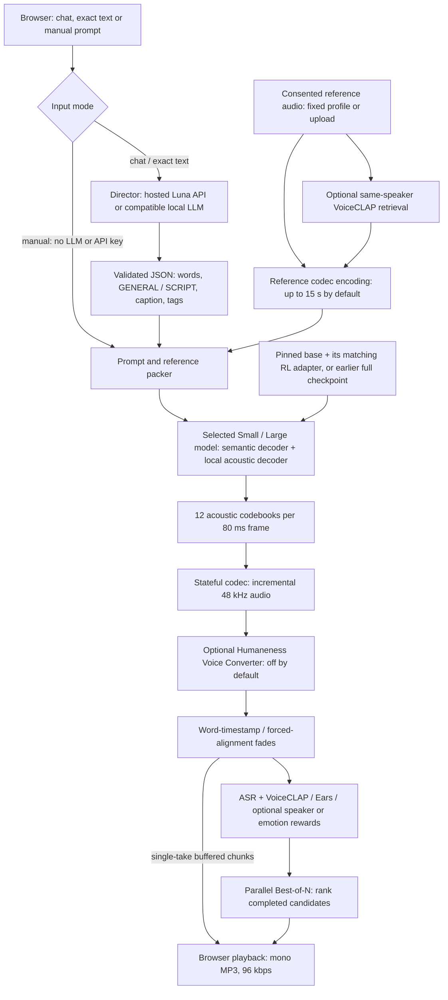

# Humaneness Voice

**Experimental LFM3 audio/video lab:** Robby includes an opt-in recorded-clip lab for overlapping audio and video descriptions, person labels and timing, separate from its live conversation. [Setup, privacy, model limitations and measurements](robby/LFM3_LAB.md).

**Conversation continuity:** A provisional unknown voice no longer forces a name question. Both directors use relevant memory and dialogue and avoid assuming a new person solely from a voice-track change. [Reproducible conversation checks](robby/VOICE_ASSISTANT_TEST_PROTOCOL.md).

**Latest Robby update (October 28):** Automatic microphone, camera and gaze start when browser permissions allow; say “Hey Robby” or “Hi Robbie”. Same-speaker follow-ups remain open for ten seconds after playback. Persistent text memory is enabled by default and can be disabled or reset; it is not encrypted at rest and the selected cloud provider receives conversation text. Face ID and biometric persistence remain separately opt-in. [Auto-start checks](https://projects.laion.ai/Humaneness-Voice/robby/auto-wake-report.html) · [Memory and privacy](robby/PERSISTENT_MEMORY.md) · [Browser memory check](https://projects.laion.ai/Humaneness-Voice/robby/knowledge-memory-browser.json). Earlier status updates below are historical.

**Current Robby default:** Say “Hey Robby”; the same voice can continue for 10 seconds, renewed when Robby finishes its reply. The speech-pause setting defaults to 300 ms. Automatic environmental comments are OFF by default; explicit sound questions still examine bounded recent audio and a post-question window. Both options are visible beside the avatar. [Implementation and test procedure](robby/WAKE_MODE.md) · [Wake-mode report](https://projects.laion.ai/Humaneness-Voice/robby/wake-report.html). Earlier descriptions below are historical.

**Current identity update:** Robby distinguishes user and robot roles explicitly, uses the current registered speaker for direct name questions, and shows the actual reply model/provider. Open-speaker matching defaults to **0.32**, with bounded continuity and multiple voice prototypes. Uncertain vocal age/gender/timbre hints and cautious background questions are on; durable biometric profiles require separate opt-in consent. Camera and factual wiki memory are now on by default; Face ID remains off. [Implementation and reproduction](robby/SOCIAL_IDENTITY.md) · [Tests, timings and retained failures](https://projects.laion.ai/Humaneness-Voice/robby/social-identity-report.html).


**Current Robby update:** parallel CPU AudioSet candidates (EfficientAT MN04) and GPU sound captions, **8-dB** prominence, music-at-start detection and after-question sound identification. Local reactions are **OFF by default**; if enabled, the exact memory/sound-informed reaction enters Qwen before its answer starts, while reaction playback overlaps generation. No second filler bridge. Foreground guests can join without a wake phrase, with independent quiet-background filtering and optional partner focus. Camera and persistent text wiki memory are now on by default.
[Setup, pinned models and controls](robby/PROACTIVE_ENVIRONMENT.md) ·
[English measurements, semantic errors and browser receipts](https://projects.laion.ai/Humaneness-Voice/robby/environment-report.html) ·
[Reproducible sound/conversation protocol](robby/VOICE_ASSISTANT_TEST_PROTOCOL.md).

**Restore point before proactive audio awareness:** [`robby-before-proactive-2026-10-27`](https://github.com/LAION-AI/Humaneness-Voice/tree/robby-before-proactive-2026-10-27) preserves the running PR #17 baseline. [Recovery guide, model inventory, launch order and source verifier](robby/RESTORE_BEFORE_PROACTIVE.md).

**Historical three-part speech experiment (superseded by the optional reaction → Qwen flow above):** memory-informed first reactions, an informed transition based on Qwen’s actual opening, and the complete answer. One shared TTS model batches two streams at temperature **0.8**, preparing the main answer while the transition runs. Warm HTTPS scheduled playback was **634–781 ms** in two tested turns; first post-restart playback was 2.47 s. [English report, audio, failed attempts and timings](https://projects.laion.ai/Humaneness-Voice/robby/two-stage-report.html) · [Architecture and reproducible tests](robby/TWO_STAGE_SPEECH.md).

**Quick-reaction quality update:** [40-case study with listening examples](https://projects.laion.ai/Humaneness-Voice/robby/quick-quality-report.html), tone-specific local prompting, repeated-opening suppression, better joke follow-ups and duplicate-condolence handling. Local generation remains about 200 ms; model-rated engagement improved, but some factual prefaces remain generic and main-answer joke quality is imperfect. [Method and reproducible tests](robby/QUICK_REACTIONS.md).

**Earlier Robby update:** optional parallel local E4B reactions (at most six words), faster direct PCM speech transport, a conversation-first UI, and **default-off persistent wiki memory** with evidence, version history, bounded retrieval and reset. [Quick-reply measurements and listening examples](https://projects.laion.ai/Humaneness-Voice/robby/quick-reaction-report.html) · [Memory design and privacy](robby/PERSISTENT_MEMORY.md) · [Actual recall/browser tests](https://projects.laion.ai/Humaneness-Voice/robby/knowledge-memory-report.html). The earlier canned-bridge PDF is superseded. Reproducible tests and failed attempts remain published; server onset under 900 ms does not imply microphone-to-ear latency under 900 ms.

An expressive speech system: a **director LLM** turns a brief into words and
acting directions, a **speech model** performs them in a reference voice, and
optional **perceptual models** rank alternative takes. You can chat, perform
exact text, or bypass the LLM with a manual prompt.

## Start here: October 2026 Playground

**Current default: [Small 1.1 Alpha RL r128 v1](https://huggingface.co/laion/Humaneness-Voice-Small-1.1-Alpha-RL-r128-v1).**
The [Large RL counterpart](https://huggingface.co/laion/Humaneness-Voice-Large-1.1-Alpha-RL-r128-v1)
and four earlier checkpoints are selectable. RL releases contain a **pinned
final SFT5 base plus its own fixed RL adapter**. They are not the old DPO or
speaker LoRAs, and must not be mixed with those by filename or rank alone.

| Find it quickly | Read / download |
| --- | --- |
| **Robby conversational robot:** Qwen/OpenRouter or local Bolt, focused voice conversation, sentence streaming, interruptible TTS and gaze | [Robby source and setup](robby/README.md) · [latency, BF16 and CUDA experiments](robby/static/robby-local-speed-report.html) |
| **Robby expressions & little tricks:** 40 poses, head turns, grimaces and LLM action tools | [Interactive GitHub Pages manual](https://laion-ai.github.io/Humaneness-Voice/robby/) · [tests and banana-game diagnosis](https://laion-ai.github.io/Humaneness-Voice/robby/avatar-checks.html) |
| All six UI checkpoints, exact base/adapter relationships and earlier stages | [Weights and compatibility guide](docs/PLAYGROUND_MODELS.md) · [runtime pins and hashes](manifests/playground-2026-10-16.json) · [file-level checkpoint inventory](manifests/checkpoint-inventory-2026-10-16.json) |
| Installation: standalone model vs full demo, assets and hardware | [Run the current system](docs/PLAYGROUND_INSTALL.md) |
| Hosted API or local LLM director | [LLM connection and JSON contract](docs/PLAYGROUND_LLM.md) |
| Exact **current Luna system prompt**, not the older Gemma prompt | [Full prompt](docs/LUNA_SYSTEM_PROMPT.md) · [source](playground/runtime/actor_prompt.py) · [request/validation code](playground/runtime/director.py) |
| How to write an emotional performance while retaining the speaker | [Prompting and settings](docs/PLAYGROUND_PROMPTING.md) |
| HTTP requests, streaming events and parallel Best-of-N | [Current API](docs/PLAYGROUND_API.md) |
| Studies, listening reports, code, conclusions and limitations | [Experiment map](docs/PLAYGROUND_EXPERIMENTS.md) |
| Actual current integration source and environment | [Playground snapshot](playground/README.md) · [environment](playground/environment-2026-10-16.json) · [source hashes](playground/source-manifest.json) |
| Older SFT3 agent, tools and compatible LoRAs | [Historical stack below](#historical-sft3-agent-september-2026) · [legacy model guide](docs/MODELS_AND_ADAPTERS.md) |

### System architecture



The global/semantic autoregressive decoder supplies a conditioning vector to
the local autoregressive acoustic decoder for each frame. The latter predicts
12 codebook tokens; a frame represents 80 ms. The codec reconstructs audio.
The LLM directs the performance but **does not synthesize audio or choose LoRAs**.
Chunk-level winner/top-2 search is a separate experimental path, not ordinary
full-utterance Best-of-N; [its RL precision limitation is disclosed here](docs/PLAYGROUND_EXPERIMENTS.md#current-rl-validation-boundary).

### Current defaults and how to use the UI

1. Choose **Small RL** or another checkpoint at the top. Choose a profile,
   upload a reference you have permission to use, or choose no reference.
2. Choose **Chat** for an acting brief, **Perform exact text** to preserve every
   spoken word, or **Manual** to supply GENERAL/SCRIPT or CAPTION/TRANSCRIPT.
3. Generate one streaming take, or choose Best-of-N / All N for parallel
   candidates. Explore scoring, conversion and experimental search separately.

Defaults at this snapshot: **Small RL · Mira · fixed reference · one take ·
streaming · 800-ms codec chunks · temperature 0.70 · CFG 2.0 · fades on**.
Dynamic reference selection, voice conversion, legacy DPO/voice adapters and
hidden-state speaker steering are **off**. Reference audio is capped at 15 s
by default, configurable up to 20 s; do not reintroduce the old 2.96-s limit.
The separate optional VC stage currently uses at most 10 s of target audio.

The default ranking is **50% normalized VoiceCLAP prompt fit + 50% Ears Medium
Content Enjoyment**, multiplied by `max(0, 1 − prefix_WER)`. The UI also exposes
quality-only ranking and legacy speaker/dimension/burst rewards; a visible
speaker slider is **not** secretly included in the Ears mixture. There is no
unbounded `1/WER` singularity. [Exact formulas and alternatives](docs/PLAYGROUND_PROMPTING.md).

**Small RL and Large RL use BF16-rounded bases upcast to FP32, separate FP32
residual adapters, policy autocast off and TF32 off** on the tested single/
Best-of-N paths. The codec remains BF16. Do not silently merge/cast the RL
policy to BF16 to make it fit. Small's parallel cap is 8; Large RL's is 2 on
the tested 24-GB GPU. Large RL offloads ASR, Ears and alignment to CPU; this adds
latency. First-use compilation can take minutes. CFG 2.0 is a demo extension,
not a claim that the published RL baseline or earlier CFG studies prove it optimal.

### Reproduction boundary

For a **standalone speech-model run**, begin with the pinned model repository's
own `infer.py` and README: [Small RL](https://huggingface.co/laion/Humaneness-Voice-Small-1.1-Alpha-RL-r128-v1),
[Large RL](https://huggingface.co/laion/Humaneness-Voice-Large-1.1-Alpha-RL-r128-v1).
For the **whole web pipeline**, use [the application guide](docs/PLAYGROUND_INSTALL.md)
and checked-in source/environment manifests. The October snapshot is working-host
integration source with disclosed asset paths, **not a newly validated clean-machine
installer**. The original root-level installer/launcher still runs the September
SFT3 agent; it does not magically start the October RL demo.

The working-host checks recorded 359 passing CPU tests, two skipped Node checks,
Chrome desktop/mobile checks and four real HTTPS/GPU RL smoke requests. They
are [published as evidence](playground/evidence/), not proof of general quality
or bit-identical results on arbitrary hardware. Source recordings, uploads,
credentials and weights are not copied into Git. Record the actual reference
hash and all resolved dependency revisions before claiming exact reproduction.
Some historical loaders still resolve unpinned upstream heads: the inventory
is explicit about that remaining gap.

Permanent reports: [study Space](https://huggingface.co/spaces/laion/humaneness-voice-small-studies).
The [working-host live UI](https://fuji-formal-while-plugin.trycloudflare.com/)
uses a temporary Cloudflare URL, not permanent hosting or an authenticated API.

## Robby: conversational robot integration

[Interruption wording and private playback notes](https://projects.laion.ai/Humaneness-Voice/robby/interruption-update.html):
internal history annotations no longer enter spoken replies; “Danke, das reicht”
and “Halt die Klappe” now enter the direct Stop path as well as Laya. The
text/model/UI checks pass; the new acoustic attempt was blocked by an occupied
ASR slot and is not claimed as a pass.

The current **[Voice Assistant Test Protocol](robby/VOICE_ASSISTANT_TEST_PROTOCOL.md)**
defines exact fixtures/hashes, real-service and CPU-browser commands, group
conversation/TV stress cases, Stop and task-continuity checks, metrics and a
staged configuration search. Tests retain each attempt; proposed room/held-out
targets are explicitly separate from measured development results.
[Adversarial conversation report](https://projects.laion.ai/Humaneness-Voice/robby/adversarial-report.html):
seven stateful scenarios and 34 steps with two competing voices, synthetic TV,
music, noise, guest permissions, task recall, real public tools and Stop/Wait at
four input phases. Complete development runs passed 12/34, 16/34 and 18/34;
the last strict Stop/Wait sweep passed 6/8. These are retained failures and
development diagnostics, not a claim of reliable room conversation. Separate
clean-input and typed-tool controls distinguish fixture, acoustic and answer
errors. [Pinned synthetic fixture pack](https://github.com/LAION-AI/Humaneness-Voice/releases/tag/robby-test-fixtures-v2).
[Earlier reliability report](https://projects.laion.ai/Humaneness-Voice/robby/rebalance-update.html).
[Local E4B gpu-unlock investigation](https://projects.laion.ai/Humaneness-Voice/robby/gpu-unlock-4b.html): unchanged shared-GPU baseline, compile blocker and reproducible procedure; no unlock speedup claimed.
Current partner retention defaults to **0.28**, with a **700-ms** pause;
explicit invitations add guests without losing the original participant.
Short foreground Stop prioritizes user control despite uncertain one-word
identity and is not speaker authentication. Strong-overlap ASR remains limited.


The current demo supports **Qwen 3.8 27B via OpenRouter/Cerebras**, other exact
provider endpoints and the local Nemotron LLM. Administrator credentials are
authenticated-encrypted outside the checkout; the browser can select routes
without receiving the key. Recent ASR/user/robot turns sit beside the avatar,
with live component timings below it. The optional **conversation focus** can retain the current person across intonation changes. It is off by default so foreground guests can join. Open recognition uses a 0.32 threshold plus bounded recent-speaker continuity; focused retention uses its separate 0.28 control. Quiet-background and interruption checks remain independent. Focus can be tuned, released or disabled. See the [deployment and timing report](https://laion-ai.github.io/Humaneness-Voice/robby/openrouter-update.html)
and [speaker-focus report, tests and acoustic limits](https://laion-ai.github.io/Humaneness-Voice/robby/conversation-focus-update.html).


The additive [`robby/`](robby/) snapshot connects the existing Small RL speech
service to a browser-local robot, frozen Nemotron ASR and TYGER turn taking.
The new local mode uses [NVIDIA Nemotron 3.5 Bolt E4B Q4_K_M](https://huggingface.co/nvidia/NVIDIA-Nemotron-3.5-Bolt-E4B-4GB)
through CUDA llama.cpp, answers intelligible voices without wake-word enrollment,
and assigns approximate session voice labels using prefetched ECAPA embeddings.
Completed output sentences immediately enter streaming TTS; 100 fixed acting
templates replace generated GENERAL prose. Earlier speaker-gated/Luna paths
remain configurable. [Exact policies, API and reproducible setup](robby/README.md).

Input now waits for a **700-ms neural speech pause** by default, adjustable
from 200 to 2,000 ms with a persisted slider. Consecutive spoken sentences are
grouped into one turn; punctuation alone cannot dispatch a request. A small
CPU Silero VAD distinguishes speech from background noise, and resumed speech
invalidates a pending final ASR check. See the [implementation and synthetic
browser/audio checks](https://laion-ai.github.io/Humaneness-Voice/robby/speech-pause-update.html).

Robby's current prompt prioritizes complete poems, stories and useful longer
answers, with a warm, playful robot personality and simulated emotions. The
GGUF template's extra brevity mode is disabled. Verse lines/stanzas survive
streaming and session history; a bounded continuation guard can request missing
lines instead of silently ending a counted task. [Reply-quality update and
real local-model/browser checks](https://laion-ai.github.io/Humaneness-Voice/robby/long-replies-update.html).

Clear requested grimaces, eye rolls and face/head poses now dispatch validated
animation before the local language model starts. A missing tool call cannot
silently suppress the requested face; Robby still generates its spoken reaction.
Standalone silent stage notes no longer become empty TTS requests.
[Command reliability fix and real-model/browser tests](https://laion-ai.github.io/Humaneness-Voice/robby/avatar-command-update.html).

The [German ASR selection report](https://laion-ai.github.io/Humaneness-Voice/robby/asr-model-update.html)
documents original Nemotron 3.5, Moonshine German, telephony-adapted German Nemotron,
Parakeet v3 and Whisper Turbo CT2 to Robby's visible recognition menu. Four
alternatives are preloaded in CPU RAM; only one extra recognizer is on GPU.
The original encoder/TYGER path retains live previews and interruptions while
the selected model supplies the speech-pause-final transcript. Whisper uses
buffered input segments. Robby replies in German by default, with an explicit
English override. Exact pinned sources, setup, synthetic checks and limits are
in [Robby's README](robby/README.md).

The [English latency and precision report](robby/static/robby-local-speed-report.html)
contains GPU stage profiling, 54 paired precision/adapter experiments, two CUDA
experiments and synthetic socket/browser checks. Merged FP32 reduced median
GPU TTS generation from 973 to 876 ms with matching code sequences in nine
paired clips. Merged BF16 reached 795 ms but worsened speaker cosine/WER in
that pilot, so it is experimental. Set `HVS_RL_PRECISION=fp32_merged` on the
shared TTS service to reproduce the selected live setting; omission retains
the official strict FP32 fallback. First-use warm-up is excluded and recorded
separately. These are RTX 3090 engineering measurements, not human quality or
physical-room accuracy claims.

New foreground speakers can optionally join without a wake phrase. Explicit
claims can associate multiple session voice anchors; this is not authentication.
Read-only news, weather and Wikipedia tools expose actual source links. During
speech, bounded 320-ms scheduling checks for current-speaker stop requests;
accepted interruptions cancel queued audio and generation. Silence is the default;
brief polite acknowledgments are optional. News and longer explanations request
calm, gentle, unhurried delivery.

[Current short-command/acknowledgment tests](robby/static/stop-fix-update.html),
[retained earlier failures](robby/static/stop-reading-update.html),
[speed/model comparison](robby/static/speed-and-tools.html), and
[task log](robby/static/worklog.html) retain unsuccessful experiments as well as
passing tests. Working-host synthetic/browser checks are not physical-room human
accuracy claims or a clean-machine installation certification. Source includes
no API keys, microphone recordings, enrolled voiceprints or model weights.
The [live Robby demo](https://arrive-locations-parade-research.trycloudflare.com/desk-robot/)
uses temporary Cloudflare hosting.

## Historical SFT3 agent (September 2026)

The following preserved installation, defaults, tool calls and adapter doses
describe the older root-level application, **not the current RL Playground**.

Humaneness Voice is an open voice-acting agent, not a single text-to-speech checkpoint. A language-model **director** interprets a scene and writes local performance cues; a speech **instrument** renders the words with a chosen voice, references and compatible LoRA adapters; perceptual **ears** can compare candidate takes. The included web app is one way to run that pipeline.

This repository is a reviewed, standalone snapshot of the [Humaneness Voice Demo Server](https://github.com/LAION-AI/Humaneness-Voice-Demo-Server) at commit [`aa299f1`](https://github.com/LAION-AI/Humaneness-Voice-Demo-Server/commit/aa299f18879b4985136375ccb0c8d2d533995932). The original remains available. This repository contains code, director prompts, WikiSkills, tests and an exact asset manifest; model weights and reference audio remain in their respective Hugging Face repositories. The historical `sft3_*` names in Python and adapter keys identify training-lineage compatibility. They do not name a different serving system.

## What happens to one scene

```text
scene or chat message
    → director LLM: fixed words, sentence-level acting cues, timing and reactions
    → retrieval: matching reference take and emotion/delivery choices
    → Humaneness Voice Base + one voice LoRA + compatible acting/quality LoRAs
    → streamed take, or N candidates scored and ranked by the perceptual ears
```

The director uses the checked-in [`wikiskills/`](wikiskills/) to turn measured acting recipes into a prompt. The instrument is the full-parameter [Humaneness Voice Base](https://huggingface.co/laion/moss-tts-local-transformer-4.55b-voice-acting-v2-sft3), historically called the MOSS SFT3 checkpoint, with the [MOSS Audio Tokenizer v2](https://huggingface.co/OpenMOSS-Team/MOSS-Audio-Tokenizer-v2). Its starting point was [MOSS-TTS-Local-Transformer-v1.5](https://huggingface.co/OpenMOSS-Team/MOSS-TTS-Local-Transformer-v1.5), followed by the documented voice-acting adaptation. The ears use [VoiceCLAP Commercial](https://huggingface.co/laion/voiceclap-commercial), the separate [genuineness](https://huggingface.co/laion/voiceclap-commercial-genuineness) and [vocal-burst blend](https://huggingface.co/laion/voiceclap-commercial-vocalburst-blend) heads, audio/text fit and ASR. These heads help select takes; they are not a substitute for human judgments of acting.

## Reproduce the historical SFT3 local run

The original server was developed for Linux, Python 3.12, CUDA 12.4 and two 24 GB GPUs. A smaller configuration may be possible but is not measured here. Install `ffmpeg`, a CUDA-compatible PyTorch build, and [llama.cpp](https://github.com/ggml-org/llama.cpp) with `llama-server` for the optional local director. You need substantial free disk space for the base model, LoRAs, director and temporary reference-data shards; the full upstream reference dataset is **not** downloaded by the setup below.

```bash
git clone https://github.com/LAION-AI/Humaneness-Voice.git
cd Humaneness-Voice
python3.12 -m venv .venv
.venv/bin/python -m pip install --upgrade pip
.venv/bin/python -m pip install torch==2.6.0 torchaudio==2.6.0 torchvision==0.21.0 \
  --index-url https://download.pytorch.org/whl/cu124
.venv/bin/python -m pip install -r requirements.txt

# Pinned base, codec, the serving LoRAs, scorers and local director weights.
.venv/bin/python setup/fetch_all.py --profile emolia_c1699 --director
# Extract only the chosen pilot voice's best reference take per condition.
.venv/bin/python setup/fetch_profile_refs.py emolia_c1699
# Build its VoiceCLAP retrieval index.
.venv/bin/python setup/build_retrieval_index.py emolia_c1699

export LLAMA_SERVER=/absolute/path/to/llama-server
./run.sh both
```

Open <http://127.0.0.1:8792>. In another terminal, request a single take first:

```bash
curl -fsS http://127.0.0.1:8792/api/speak \
  -H 'content-type: application/json' \
  -d '{"text":"Tell her I came back because I could not leave it unfinished.",
       "best_of":1,"sidon":false}' -o take.mp3
```

For candidate selection, change `"best_of":1` to `"best_of":10`. That requires the scorer and ASR assets installed by the full `fetch_all.py` command; it is slower and returns the highest-ranked take. The plain `/api/speak` default is ten candidates, whereas streaming `/api/turn` uses one take unless explicitly configured. `./run.sh app` starts only the speech app and expects a reachable director endpoint. `./run.sh stop` stops only processes started by this repository's `both` mode. See [installation and troubleshooting](docs/INSTALL.md) for the individual steps, data paths and checks, and [HTTP examples](docs/SERVER.md) for each endpoint.

The installer writes a gitignored `.env.generated` containing only local paths to pinned downloaded snapshots. Put personal overrides or hosted-provider credentials in `.env.local`, also gitignored. `run.sh` sources both. The preferred asset root is `HUMANENESS_DATA_DIR` (default `~/.cache/humaneness-voice`); `MOSS_DATA_DIR` and other historical `MOSS_*` environment names remain supported for existing deployments. No API key is needed for the local director.

## Historical SFT3 serving stack (not the RL defaults)

The labels below refer to the *role* of each asset. The linked repository IDs retain their original names for traceable provenance; nothing has been silently renamed or relicensed.

| Role | Asset and current default |
| --- | --- |
| Humaneness Voice Base | [full SFT3 checkpoint](https://huggingface.co/laion/moss-tts-local-transformer-4.55b-voice-acting-v2-sft3), without the LoRA stack |
| Codec | [MOSS Audio Tokenizer v2](https://huggingface.co/OpenMOSS-Team/MOSS-Audio-Tokenizer-v2), 12 RVQ codebooks at 12.5 frames/s |
| Preference | [DPO p2](https://huggingface.co/laion/moss-va-sft3-dpo-lora-p2), `sft3_dpo:p2` at 1.0 |
| Identity | [SFT3 voice LoRAs](https://huggingface.co/laion/moss-va-sft3-voice-loras), one selected pilot voice at 1.0, paired with its [reference recording](https://huggingface.co/datasets/TTS-AGI/moss-voice-profile-references) |
| General quality | [quality DPO step376](https://huggingface.co/laion/moss-va-sft3-quality-dpo-lora) at 1.5; the separate [quality-axis LoRAs](https://huggingface.co/laion/moss-va-sft3-quality-lora-adapters) use genuineness 0.25, blend 0.5 and aesthetics 0.5 |
| Acting direction | One retrieved [emotion LoRA](https://huggingface.co/laion/moss-va-sft3-emotion-loras) at 1.0; up to one [vocal-delivery LoRA](https://huggingface.co/laion/moss-va-sft3-voicenet-lora-adapters) as directed |
| Vocal reactions | Requested [burst LoRAs](https://huggingface.co/laion/moss-va-sft3-vocal-burst-lora-adapters), with class-specific WikiSkill recipes and a 2.0 combined dose budget |
| Perception and ranking | [VoiceCLAP Commercial](https://huggingface.co/laion/voiceclap-commercial), [genuineness](https://huggingface.co/laion/voiceclap-commercial-genuineness), [blend](https://huggingface.co/laion/voiceclap-commercial-vocalburst-blend), and [Parakeet-TDT-v3 ASR](https://huggingface.co/nvidia/parakeet-tdt-0.6b-v3) |

The complete, pinned list, including optional aligner, restoration, research-only adapters and licence declarations, is in [`manifests/agent-default-v1.json`](manifests/agent-default-v1.json) and [the asset guide](docs/MODELS_AND_ADAPTERS.md). The installer downloads only the selected voice profile by default; `--all-profiles` selects the ten tested pilot IDs, not every voice in the larger upstream LoRA repository. `--minimal` installs a deliberately reduced stack and does **not** reproduce the default agent or the pass@10 configuration.

## Where to read next

| Question | Document |
| --- | --- |
| How do I install, check missing assets or bring my own model path? | [Installation](docs/INSTALL.md) |
| Which Hub repository does each adapter key load, and at what weight? | [Models and adapters](docs/MODELS_AND_ADAPTERS.md) |
| What do Mind, Instrument, Tools and Ears do? | [Architecture](docs/ARCHITECTURE.md) |
| What does the director send to the speech model? | [Prompt format](docs/PROMPTING.md), [exact system prompts](docs/SYSTEM_PROMPTS.md) |
| What is the server's HTTP interface? | [Server API and examples](docs/SERVER.md), [acting-task cookbook](docs/VOICE_ACTING_TASKS.md) |
| How is best-of-N computed? | [Candidate ranking](docs/BEST_OF_N.md), [burst reward](docs/BURST_REWARD.md) |
| Which claims are from the original experiment and which remain to validate? | [Provenance and limits](docs/PROVENANCE.md), [historical measurements](docs/EXPERIMENTS.md) |

Run `python setup/check_release.py` for manifest checks, `python setup/check_docs.py` for prompt/document consistency, and `pip install -r requirements-dev.txt && python -m pytest -q tests` for the lightweight tests. A GPU/audio end-to-end test requires the downloaded weights, recordings and suitable hardware; this repository publication does not by itself establish that such a test ran on every target machine.

## Licence, attribution and use

This repository's code and documentation retain their existing [CC BY 4.0](LICENSE) attribution. The Humaneness Voice Base card declares CC BY 4.0; the original MOSS tokenizer card declares Apache 2.0; adapter and perception repositories have **their own** declarations. Some experimental assets have missing licence metadata, and reference-audio rights must be checked separately. Consequently the entire downloaded stack must not be described as a single Apache-licensed package. Consult each pinned card and [the provenance guide](docs/PROVENANCE.md) before redistributing weights, recordings or generated voices. Use a speaker's identity only with appropriate consent.

This public repository intentionally names its source and contributors. It is **not** an anonymized ICLR review artifact; a separate review copy must be audited for URLs, history, metadata and attribution obligations.
