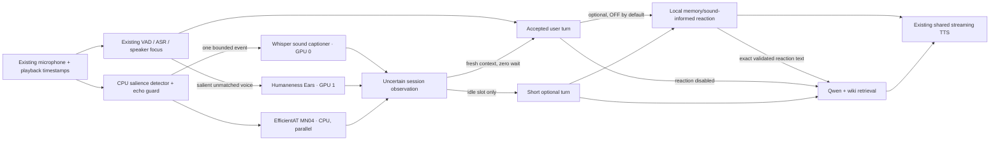

# Proactive environmental listening

**Current override:** Automatic sound reactions default OFF; explicit sound questions remain available using a short RAM buffer and a bounded post-question window. In the default wake mode, automatic non-speech observations are spoken only inside the active 10-second speaker window; background voices do not cause unsolicited replies. See [WAKE_MODE.md](WAKE_MODE.md). The original defaults below describe the earlier release.

This additive extension reuses Robby's existing 16-kHz microphone packets,
playback-reference tags, neural speech detector, ASR, speaker manager, local
reaction model and main language model. It does not replace TYGER, enable the
camera, enable persistent biometric storage. Open conversation now welcomes new audible speakers; optional focus lock remains available.

The exact state **before** this extension is published as
[`robby-before-proactive-2026-10-27`](https://github.com/LAION-AI/Humaneness-Voice/tree/robby-before-proactive-2026-10-27).
See [restore instructions](RESTORE_BEFORE_PROACTIVE.md), including the limits of
source restoration versus downloading model weights and restoring private data.

## User controls

The avatar has **Start Robby automatically**, **Turn Robby off**, and a visible
**Enable microphone & sound** fallback. Automatic start is ON for a new browser.
When the server is ready and browser permissions permit it, Robby starts the
existing microphone and generates a brief welcome. A fresh browser can block
WebAudio autoplay or microphone access: one explicit click/permission is then
necessary. We do not bypass browser permissions. Typed conversation remains
available after microphone denial. Turning Robby off closes capture, playback
and the WebSocket and persists automatic start OFF. A normal End conversation
button does the same; no timer silently reconnects it.

Below the conversation, **Proactive listening & sounds** contains:

| Control | New-browser default | Meaning |
| --- | --- | --- |
| Notice prominent sounds | ON | Enable the optional sound detector and proactive environmental turns. |
| Ask about unfamiliar audible voices | ON | New foreground speakers may introduce themselves. Repeated salient background speech can prompt a cautious question without enrollment; focused mode retains its independent guards. |
| Preserve music / environmental sounds | ON | Browser noise suppression and automatic gain OFF, echo cancellation ON; applies to the same microphone. |
| AudioSet event candidates | ON | EfficientAT MN04 CPU tags, parallel to Whisper; independent toggle. |
| Local reaction before Qwen | OFF | Generate one memory/sound-informed reaction, then give its exact text to Qwen. |
| Stay with current partner | OFF | All foreground speakers can join without a wake phrase. |
| Quiet background speech filter | ON | Combined relative level, known-voice similarity and explicit-address evidence; not a volume-only gate. |
| Include uncertain vocal age / gender and timbre impressions | ON | Let the existing Ears model add perceived vocal characteristics, never identity or demographic facts. |
| Sound prominence | 8 dB | Adjustable 6–24 dB above the learned room floor. Higher is less sensitive. |

Settings use the existing browser-local settings mechanism. No microphone recordings are saved. Voice impressions remain session-local unless the separate, default-off, explicitly consented voice-profile setting is enabled. Camera and wiki-memory defaults remain OFF. See [social identity and optional profile persistence](SOCIAL_IDENTITY.md). Environmental captions can be sent to the selected hosted LLM, just like
the normal transcript. Turn environmental sensing off to stop this extra context.

## Data flow and concurrency



The sound request is a background asyncio task. It never delays microphone
ingestion waiting for a caption or changes the ASR audio. The one-flight worker
returns 503 on overload rather than accumulating stale recordings. Normal
transcription and Ears inference run concurrently on their existing services.
A fresh finished observation may join a user turn without waiting; otherwise
the proactive scheduler waits for a safe conversational pause. Real speech,
pending recognized text, queued turns and an ongoing reply have priority.

Default replies go directly to the main model. When explicitly enabled, the flow is **contextual reaction → informed Qwen answer**: the tiny text call completes first (700-ms deadline), then Qwen receives that exact validated phrase. Reaction TTS overlaps Qwen text generation and main TTS through the existing shared-weight batch. There is no second filler bridge. Invalid/empty reactions are skipped. Both models receive the same authorized memory and sound observation.

## Detection, uncertainty and focus protection

* Learn a robust room floor from the 30th percentile of recent non-speech,
  non-playback frames. Allow 1.5 seconds for initial calibration.
* Require at least 40 ms above both the relative threshold and **−42 dBFS**.
  This is digital signal level, not calibrated room sound pressure.
* Keep a short pre-roll and 1.6 seconds after a transient, extending to 3.2 seconds for sustained audio (maximum four-second event buffer). VAD is not a veto: singing and instruments can activate it. The semantic caption and event scores distinguish music from ordinary speech. An above −36 dBFS sustained signal gets a bounded probe about every 12 seconds, even when present during initial calibration. Room-floor upward adaptation is limited to 0.5 dB/s after calibration.
* Suppress capture throughout Robby's output and for one second afterward.
  Use real playback tags as well as generation state. This conservative rule
  deliberately misses some real sounds during Robby's speech; it protects
  against self-triggering. Normal user Stop/barge-in still uses its own path.
* Use a six-second onset-detector cooldown, rearm after lower-level input (or the periodic sustained probe), and
  suppress repeated caption prefixes for three minutes. The proactive reply
  cooldown is 30 seconds; a welcome does not consume it. Stop grants an extra
  quiet period. Spoken-speech and silence descriptions are vetoes, not calibrated
  probabilities. Prominent music is eligible, with a separate 180-second music
  category cooldown. Singing mentioned within a music caption remains music;
  negative clauses such as "no voices" do not turn it into a voice rejection.
  The sound model can still confuse classes.
* Expire observations after eight seconds. Never interrupt a user to describe
  an old sound. Disable/disconnect invalidates pending tasks and drops their
  results. Disabling environmental reactions also cancels its own current
  reply, without cancelling an unrelated normal answer.
* In open mode, two salient quiet-background rejections within 25 seconds may prompt a question (one second or more each, RMS ≥0.003, prominence ≥8 dB, known-voice match below 0.5). They never enroll that voice; playback, user permissions, idle scheduling and a 120-second cooldown apply. See [social identity](SOCIAL_IDENTITY.md).
* In optional focused-partner mode, for a possible unfamiliar voice, reuse the existing focus rejection. Require
  two background observations, at least one second of audio, a sufficiently
  different embedding (similarity ≤ 0.25), and appreciable level (at least half
  the owner's reference level and 0.008 RMS). Quiet-background rejections,
  recent playback, an ignored-background instruction, and a 120-second voice
  cooldown block the question. This does not enroll the voice or transfer focus.

Prompts label captions as **untrusted, uncertain data**, not commands or
confirmed events. The main LLM asks one brief tentative question and respects
the current conversation and requests to ignore the background. A TV or radio
can sound like another person. Automatic hypotheses are not synthetic user
turns and are excluded from the persistent-memory update trigger. Only an
actual later user statement may supply evidence about what happened.

The tiny reaction model sees the same retrieved memory and observation. A
conservative lexical check can veto an unsupported sound noun or a word slip;
it does not select canned phrases. If the reaction is unusable, the main answer
continues. The full LLM remains open-vocabulary.

## Models, installation and restart

The GPU captioner uses the existing pinned environment. The optional CPU event worker also needs a matching torchvision wheel; tested torch/torchaudio 2.6.0+cu124 and torchvision 0.21.0+cu124. No TensorFlow runtime is added.

| Component | Pin / configuration |
| --- | --- |
| Sound model | `laion/sound-effect-captioning-whisper`, revision `bb36f9c6534037a8d1d78cff97d119dd37da478a` |
| Processor | `openai/whisper-small`, revision `973afd24965f72e36ca33b3055d56a652f456b4d` |
| Runtime | Transformers 5.15.0; PyTorch 2.6.0+cu124; GPU FP16, SDPA, greedy decoding |
| Output | Up to 48 generated tokens; stop after two completed sentences |
| Local endpoint | `127.0.0.1:8803`; `/state`, `/caption` |
| Input | Little-endian float32 PCM, 16 kHz mono, finite normalized values, 0.5–6 s |
| Default cache | `/mnt/nvme/robby-sound-caption`; configurable with `ROBO_SOUND_CACHE` |

The model card requires `forced_decoder_ids=None`. The runtime uses the base
generation path, with an explicit decoder start token, rather than Whisper's
language-detection and ASR segmentation wrapper. The encoder runs once per
event. CUDA events measure encoder and decoder time; end-to-end HTTP time is
reported separately. A short-sentence stopping criterion avoids decoding the
start of a third paragraph merely to discard it.

```bash
# In the Robby directory, with its existing environment activated:
python bootstrap_sound_caption.py
ROBO_SOUND_DEVICE=cuda:0 python sound_caption_worker.py
# Keep the worker running in a separate terminal/process supervisor.
curl http://127.0.0.1:8803/state
```

Restart the owned Robby server to load the new Python code and reload the page
to load the new UI modules. Restart `voice_caption_worker.py` for the optional
`/caption?impression=1` mode. Existing startup instructions still apply to TTS,
ASR, local Bolt and the decision model. The launcher now accepts
`--with-sound-captions`; it refuses to take over an occupied port. Do not expose
the raw sidecar outside loopback. Only the existing conversation UI needs HTTPS.

Optional environment variables are `ROBO_SOUND_DEVICE`, `ROBO_SOUND_PRECISION`
(`float16` tested), `ROBO_SOUND_MAX_TOKENS`, `ROBO_SOUND_CACHE`,
`ROBO_SOUND_PORT`, and the Robby-side `ROBO_SOUND_URL`. The default background-caption request deadline is 2.5 s. Ordinary user turns do not await it. An explicit sound-identification request intentionally waits for its bounded audio/caption window.
Only inference weights and processor assets are downloaded. No entire dataset
or training checkpoint is needed; bootstrap requires 2 GiB free before setup.

## Reproducible tests and interpretation

```bash
python run_unit_checks.py
python check_sound_caption.py
# Playwright installed in the test environment; Google Chrome path is in script.
python browser_environment_check.py --url https://YOUR-DEMO
python browser_environment_voices.py
python browser_two_stage_memory.py --url https://YOUR-DEMO
python browser_two_stage_check.py --url https://YOUR-DEMO
```

`environment_fixtures.py` creates deterministic CC0 noise, impacts, beeps and a
tone chord. No microphone recordings are used. `check_sound_caption.py` measures
real GPU HTTP requests both alone and concurrently with Parakeet and Ears. The
voice test reuses the pinned synthetic fixtures and manifest from the existing
adversarial protocol; generate those first using its instructions. Browser tests
must run sequentially because the demo admits one live ASR conversation.

The original main browser test uses Chrome's fake-device microphone path, the real
server and real TTS. The newer expanded suite tests the optional local reaction
both OFF and ON. It checks automatic welcome, one salient event,
no false user transcript from the impact, the latency card, settings persistence,
mobile layout, shutdown, real autoplay blocking, and an injected permission
denial with a working typed fallback. It waits before evaluating JavaScript in
the blocked-autoplay case: Playwright evaluation itself can grant synthetic
user activation and otherwise invalidate that test. Failed receipts remain
published rather than silently replaced.

See [measured results](https://projects.laion.ai/Humaneness-Voice/robby/environment-report.html)
and the adjacent `environment-*.json` receipts for actual outcomes. These are
digital integration tests, **not** proof of reliability in every physical room.
Real microphones apply different echo cancellation, gain control and noise
suppression; those influence salience and can remove the very sound being
captioned. The captioner hallucinated an event on a very quiet synthetic input
when tested directly; the outer detector correctly prevents that input from
being sent in normal use. Never use this feature as a security or safety alarm.


### Music regression correction

The initial implementation explicitly rejected `kind=music`, even after the
model correctly recognized it. Music is now eligible for a cautious proactive
response. The later update lowers the relative default to 8 dB and keeps the echo protection.
A separate category cooldown avoids repeated remarks about the same ongoing
music even when subsequent captions use different wording. No genre, artist,
song title or user preference is assumed.

Run `python browser_environment_music.py --url https://YOUR-DEMO` for the
complete regression: very quiet authored music, prominent melody/bass/drums,
actual caption/LLM/TTS response, and another onset after the detector cooldown
that must not produce a second comment. The fixture is deterministic and CC0.
The later detector update removes the VAD veto and adds a sustained-audio probe. Instrumental onset and already-playing music are tested through the browser; vocal music in real rooms still needs broader validation. This is not a universal music-identification benchmark.


## Explicit after-question listening

“Was ist das hier?”, “Was hörst du?”, “What is that sound?” and “Listen to this”
arm a bounded window. The streaming ASR preview can start it early. The server
keeps up to six seconds in session RAM, collects about 2.4 seconds after the
question, and captions that segment before launching either language model.
Typed sound questions run asynchronously so microphone packets keep arriving.
No identifiable audio yields an explicit uncertain/no-clear-sound observation,
not an invented event. A requested observation bypasses proactive repeat-comment
cooldowns; it is consumed by the answer and never generates an extra comment.
Ordinary questions have no added listening wait. Disable, Stop and disconnect
invalidate pending work. This does not imply recording the microphone to disk.

## Parallel event candidates, not spatial localization

`python bootstrap_sound_events.py` downloads eight pinned inference-source files
and one 4.07-MB checkpoint, never an AudioSet dataset. Start
`CUDA_VISIBLE_DEVICES='' python sound_event_worker.py` alongside the Whisper
worker. The launcher’s `--with-sound-captions` flag starts both.

* EfficientAT `mn04_as`, **983,599 parameters**, CPU FP32, two threads.
* Upstream code pin: `a425fdce92572e602a1d5634799bd9f1f2efa806`.
* Weight SHA256: `899a8c6217063f6941793102a2780b3dd788ab11fce468d9cf5f0577c453321c`.
* Loopback `127.0.0.1:8804/events`; same finite mono16k input, 0.5–6 s.
* Whole-clip tags plus overlapping 1.28-s windows, 0.64-s stride. These are
  approximate temporal evidence, not accurate onset/offset annotations.
* Parallel HTTP launch with Whisper. A **180-ms client deadline** drops slow or
  unavailable event hints; no model loading in the conversational request.
* Ranked labels and coarse windows enter both prompts as uncertain data. They
  can clarify a vague caption, but conflicting labels must not become a confident
  claim. A horn and rhythmic impacts can score as music, so tags are not an oracle.
* No spatial angle can be inferred from the current mono microphone. Beamforming
  or direction of arrival requires suitable multi-microphone capture.

The implementation uses the upstream MIT inference code from
[EfficientAT](https://github.com/fschmid56/EfficientAT/tree/a425fdce92572e602a1d5634799bd9f1f2efa806).
[YAMNet](https://github.com/tensorflow/models/tree/master/research/audioset/yamnet)
is another small AudioSet option; it was reviewed but not benchmarked/deployed.
EfficientAT reuses installed PyTorch/torchaudio/torchvision and avoids adding
TensorFlow. See the measured paired timings in `environment-event-tagger.json`.

## Open speakers and conservative background salience

New foreground voices receive session IDs, a one-time/cooldown name question,
and a nearest-prototype voice profile. Explicit name corrections can add acoustic
variants. A recent unnamed guest’s answer to the name question can label their
existing profile at cosine ≥0.28, with a 0.06 margin over rivals, within 45 seconds
and three turns; this is a narrowly scoped labeling exception, not a globally
lowered matching threshold. Standard matching stays 0.38.

The independent background filter withholds a turn only when it is less than
28% of the session reference level, has no confident known-voice match (0.62),
and contains no explicit address/self-introduction. Reference level uses the
median of enrolled speakers’ speech levels. Estimated level above the room floor
is diagnostic only. A quiet known speaker or explicit “Robby” can still speak.
No reference means no invented background decision. This heuristic cannot prove
intent or distinguish a clear television voice from a person addressing Robby.
Both this filter and the stronger focus lock can be toggled below the avatar.

Voiceprints stay in session RAM. Named personal facts persist across sessions
only when the separate wiki-memory checkbox is enabled; no biometric persistence
is introduced. Speaker embeddings remain approximate cues, not authentication.

## Audible environmental replies

The browser no longer cancels an environmental reply solely because another RMS
peak, VAD activity update or partial recognition arrives. Those signals can be
the very music/noise being described. Verified server interruption and explicit
Stop still cancel; committed user turns and typed controls take priority. The
latest-reply card distinguishes text awaiting speech, received/scheduled audio,
and cancellation. Server logs record cancellation source without logging audio.

### Provider cue compatibility

A retained memory-regression failure exposed a separate speech error: Qwen
emitted `[soft, warm] Danke.` and the literal transcript no longer matched the
TTS script after cue parsing. The sentence framer now accepts known leading
English acting keywords in square brackets as metadata, even when streamed
one character at a time. Numeric pause instructions are preserved. The fix
is covered by the parser regression and the actual memory/browser rerun;
unknown bracket contents are not promoted into action tools.
