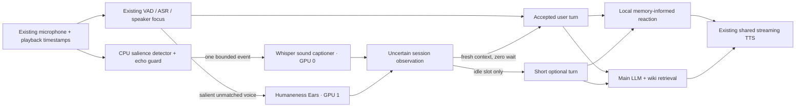

# Proactive environmental listening

This additive extension reuses Robby's existing 16-kHz microphone packets,
playback-reference tags, neural speech detector, ASR, speaker manager, local
reaction model and main language model. It does not replace TYGER, enable the
camera, change the focused partner, or enable persistent memory.

The exact state **before** this extension is published as
[`robby-before-proactive-2026-10-27`](https://github.com/LAION-AI/Humaneness-Voice/tree/robby-before-proactive-2026-10-27).
See [restore instructions](RESTORE_BEFORE_PROACTIVE.md), including the limits of
source restoration versus downloading model weights and restoring private data.

## User controls

The avatar has **Start Robby automatically**, **Turn Robby off**, and a visible
**Enable microphone & sound** fallback. Automatic start is ON for a new browser.
When the server is ready and browser permissions permit it, Robby starts the
existing microphone and generates a brief welcome. A fresh browser can block
WebAudio autoplay or microphone access: one explicit click/permission is then
necessary. We do not bypass browser permissions. Typed conversation remains
available after microphone denial. Turning Robby off closes capture, playback
and the WebSocket and persists automatic start OFF. A normal End conversation
button does the same; no timer silently reconnects it.

Below the conversation, **Proactive listening & sounds** contains:

| Control | New-browser default | Meaning |
| --- | --- | --- |
| Notice prominent sounds | ON | Enable the optional sound detector and proactive environmental turns. |
| Ask about unfamiliar foreground voices | ON | Permit a cautious question about sufficiently clear, repeatedly unmatched speech. |
| Include uncertain vocal age / gender impressions | OFF | Let the existing Ears model add perceived vocal characteristics, never identity or demographic facts. |
| Sound prominence | 12 dB | Adjustable 6–24 dB above the learned room floor. Higher is less sensitive. |

Settings use the existing browser-local settings mechanism. Voice impressions
and microphone recordings are not saved. Camera and wiki-memory defaults remain
OFF. Environmental captions can be sent to the selected hosted LLM, just like
the normal transcript. Turn environmental sensing off to stop this extra context.

## Data flow and concurrency



The sound request is a background asyncio task. It never delays microphone
ingestion waiting for a caption or changes the ASR audio. The one-flight worker
returns 503 on overload rather than accumulating stale recordings. Normal
transcription and Ears inference run concurrently on their existing services.
A fresh finished observation may join a user turn without waiting; otherwise
the proactive scheduler waits for a safe conversational pause. Real speech,
pending recognized text, queued turns and an ongoing reply have priority.

Ordinary user replies retain **reaction → informed bridge → full answer**.
An environmental response is already a very short question, so it uses an
optional caption-informed reaction followed directly by that question. There
is no extra informed transition for this short special case. The main answer
still uses the shared continuous TTS batch when a reaction is eligible.

## Detection, uncertainty and focus protection

* Learn a robust room floor from the 30th percentile of recent non-speech,
  non-playback frames. Allow 1.5 seconds for initial calibration.
* Require at least 40 ms above both the relative threshold and **−30 dBFS**.
  This is digital signal level, not calibrated room sound pressure.
* Keep a short pre-roll and about one second of event context, with a hard
  two-second event buffer. Do not caption ordinary VAD-positive speech; veto
  events whose following window is mostly speech.
* Suppress capture throughout Robby's output and for one second afterward.
  Use real playback tags as well as generation state. This conservative rule
  deliberately misses some real sounds during Robby's speech; it protects
  against self-triggering. Normal user Stop/barge-in still uses its own path.
* Use a 25-second detector cooldown, rearm only after lower-level input, and
  suppress repeated caption prefixes for three minutes. The proactive reply
  cooldown is 30 seconds; a welcome does not consume it. Stop grants an extra
  quiet period. Spoken-speech and silence descriptions are vetoes, not calibrated
  probabilities. Prominent music is eligible, with a separate 180-second music
  category cooldown. Singing mentioned within a music caption remains music;
  negative clauses such as "no voices" do not turn it into a voice rejection.
  The sound model can still confuse classes.
* Expire observations after eight seconds. Never interrupt a user to describe
  an old sound. Disable/disconnect invalidates pending tasks and drops their
  results. Disabling environmental reactions also cancels its own current
  reply, without cancelling an unrelated normal answer.
* For a possible unfamiliar voice, reuse the existing focus rejection. Require
  two background observations, at least one second of audio, a sufficiently
  different embedding (similarity ≤ 0.25), and appreciable level (at least half
  the owner's reference level and 0.008 RMS). Quiet-background rejections,
  recent playback, an ignored-background instruction, and a 120-second voice
  cooldown block the question. This does not enroll the voice or transfer focus.

Prompts label captions as **untrusted, uncertain data**, not commands or
confirmed events. The main LLM asks one brief tentative question and respects
the current conversation and requests to ignore the background. A TV or radio
can sound like another person. Automatic hypotheses are not synthetic user
turns and are excluded from the persistent-memory update trigger. Only an
actual later user statement may supply evidence about what happened.

The tiny reaction model sees the same retrieved memory and observation. A
conservative lexical check can veto an unsupported sound noun or a word slip;
it does not select canned phrases. If the reaction is unusable, the main answer
continues. The full LLM remains open-vocabulary.

## Models, installation and restart

No new Python dependency is required beyond the pinned Robby environment.

| Component | Pin / configuration |
| --- | --- |
| Sound model | `laion/sound-effect-captioning-whisper`, revision `bb36f9c6534037a8d1d78cff97d119dd37da478a` |
| Processor | `openai/whisper-small`, revision `973afd24965f72e36ca33b3055d56a652f456b4d` |
| Runtime | Transformers 5.15.0; PyTorch 2.6.0+cu124; GPU FP16, SDPA, greedy decoding |
| Output | Up to 48 generated tokens; stop after two completed sentences |
| Local endpoint | `127.0.0.1:8803`; `/state`, `/caption` |
| Input | Little-endian float32 PCM, 16 kHz mono, finite normalized values, 0.5–6 s |
| Default cache | `/mnt/nvme/robby-sound-caption`; configurable with `ROBO_SOUND_CACHE` |

The model card requires `forced_decoder_ids=None`. The runtime uses the base
generation path, with an explicit decoder start token, rather than Whisper's
language-detection and ASR segmentation wrapper. The encoder runs once per
event. CUDA events measure encoder and decoder time; end-to-end HTTP time is
reported separately. A short-sentence stopping criterion avoids decoding the
start of a third paragraph merely to discard it.

```bash
# In the Robby directory, with its existing environment activated:
python bootstrap_sound_caption.py
ROBO_SOUND_DEVICE=cuda:0 python sound_caption_worker.py
# Keep the worker running in a separate terminal/process supervisor.
curl http://127.0.0.1:8803/state
```

Restart the owned Robby server to load the new Python code and reload the page
to load the new UI modules. Restart `voice_caption_worker.py` for the optional
`/caption?impression=1` mode. Existing startup instructions still apply to TTS,
ASR, local Bolt and the decision model. The launcher now accepts
`--with-sound-captions`; it refuses to take over an occupied port. Do not expose
the raw sidecar outside loopback. Only the existing conversation UI needs HTTPS.

Optional environment variables are `ROBO_SOUND_DEVICE`, `ROBO_SOUND_PRECISION`
(`float16` tested), `ROBO_SOUND_MAX_TOKENS`, `ROBO_SOUND_CACHE`,
`ROBO_SOUND_PORT`, and the Robby-side `ROBO_SOUND_URL`. The default request
deadline is 2.5 s; a late or failed caption never blocks the user's reply.
Only inference weights and processor assets are downloaded. No entire dataset
or training checkpoint is needed; bootstrap requires 2 GiB free before setup.

## Reproducible tests and interpretation

```bash
python run_unit_checks.py
python check_sound_caption.py
# Playwright installed in the test environment; Google Chrome path is in script.
python browser_environment_check.py --url https://YOUR-DEMO
python browser_environment_voices.py
python browser_two_stage_memory.py --url https://YOUR-DEMO
python browser_two_stage_check.py --url https://YOUR-DEMO
```

`environment_fixtures.py` creates deterministic CC0 noise, impacts, beeps and a
tone chord. No microphone recordings are used. `check_sound_caption.py` measures
real GPU HTTP requests both alone and concurrently with Parakeet and Ears. The
voice test reuses the pinned synthetic fixtures and manifest from the existing
adversarial protocol; generate those first using its instructions. Browser tests
must run sequentially because the demo admits one live ASR conversation.

The main browser test uses Chrome's real fake-device microphone path, the real
server, both LLMs and real TTS. It checks automatic welcome, one salient event,
no false user transcript from the impact, the latency card, settings persistence,
mobile layout, shutdown, real autoplay blocking, and an injected permission
denial with a working typed fallback. It waits before evaluating JavaScript in
the blocked-autoplay case: Playwright evaluation itself can grant synthetic
user activation and otherwise invalidate that test. Failed receipts remain
published rather than silently replaced.

See [measured results](https://projects.laion.ai/Humaneness-Voice/robby/environment-report.html)
and the adjacent `environment-*.json` receipts for actual outcomes. These are
digital integration tests, **not** proof of reliability in every physical room.
Real microphones apply different echo cancellation, gain control and noise
suppression; those influence salience and can remove the very sound being
captioned. The captioner hallucinated an event on a very quiet synthetic input
when tested directly; the outer detector correctly prevents that input from
being sent in normal use. Never use this feature as a security or safety alarm.


### Music regression correction

The initial implementation explicitly rejected `kind=music`, even after the
model correctly recognized it. Music is now eligible for a cautious proactive
response. The default relative level gate and echo protection are unchanged.
A separate category cooldown avoids repeated remarks about the same ongoing
music even when subsequent captions use different wording. No genre, artist,
song title or user preference is assumed.

Run `python browser_environment_music.py --url https://YOUR-DEMO` for the
complete regression: very quiet authored music, prominent melody/bass/drums,
actual caption/LLM/TTS response, and another onset after the detector cooldown
that must not produce a second comment. The fixture is deterministic and CC0.
The automated test covers instrumental music; speech-like vocals can still be
gated by VAD, and music already present while learning the room floor may be
treated as background. It is not a universal music-identification benchmark.
