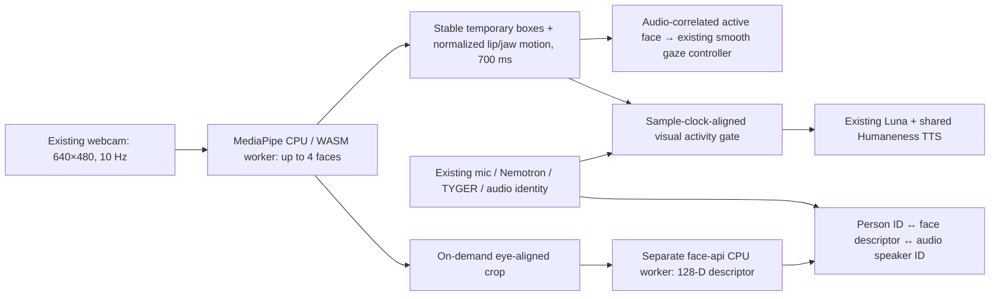
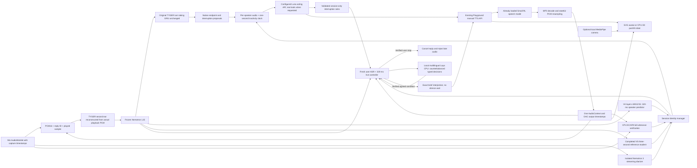

# Robby voice chat and TYGER speaker predictor

**Current auto-start update:** The microphone, camera and gaze following now start automatically when server readiness and browser permissions allow. Robby waits for “Hey Robby”, “Hi Robbie” and equivalent spellings. The same speaker's 10-second follow-up window is renewed after playback finishes. Face ID and camera-based speech gating remain off. Users can explicitly turn Robby or the camera off, and those choices persist. Persistent text memory is on by default, can be disabled or reset, and is not encrypted at rest. [Behavior and reproduction](WAKE_MODE.md) · [Memory and privacy](PERSISTENT_MEMORY.md).

**Current wake-mode update:** “Hey Robby” is required by default, followed by a 10-second window for the same voice. Speech-pause default: 300 ms. Automatic environmental reactions are off by default and can be enabled beside the avatar; explicit questions about recent/following sounds still work. [Wake mode, limits and reproducible tests](WAKE_MODE.md). Older defaults described below are historical.

**Current identity update:** explicit user/robot role grounding; direct registered-name lookup; open-speaker threshold **0.32** with cautious temporal continuity; multiple acoustic prototypes; and **default-on uncertain vocal age/gender/timbre impressions**. A lower profile panel provides separate, consented, default-off browser persistence. Repeated audible background voices can invite a tentative question without taking over the conversation. Camera now starts automatically if permitted; Face ID remains opt-in, with the missing sentence-pipeline connection repaired. [Implementation and reproducible checks](SOCIAL_IDENTITY.md) · [English results](static/social-identity-report.html).


The [quick-reaction quality study](static/quick-quality-report.html) tests 40 synthetic situations, tone-aware local prompting, repeated joke requests, serious topics and real TTS handoffs. See [QUICK_REACTIONS.md](QUICK_REACTIONS.md) for measured gains and remaining generic phrasing/main-answer joke limitations.

## Current update: proactive environmental listening

Robby now starts the existing microphone and a brief welcome automatically when
browser permissions allow it. A prominent **Turn Robby off** control stops capture
and playback and persists that preference. Browser-blocked autoplay has a visible
one-click enable path; typed chat remains usable after microphone denial.

A separate pinned **Whisper sound-captioning GPU worker** processes salient sounds
alongside ASR. Quiet/background-level audio and Robby's playback are gated out.
Fresh captions inform both the local reaction and main LLM as uncertain data.
Prominent music is included, with a three-minute repeat-comment cooldown.
Unknown foreground speakers can join without a wake phrase, receive session labels,
and are asked their name. A separate, switchable combined salience filter rejects
very quiet unaddressed background speech. Persistent wiki memory is **ON by default**, local bridging is **OFF by default**, and camera auto-start is ON when permitted. The sound threshold defaults to **8 dB**.
Ask “Was ist das hier?” and immediately play a sound: a bounded after-question
window informs both models before the answer. EfficientAT MN04 supplies CPU
AudioSet candidates in parallel with GPU captioning, with its own timing card.

[Implementation, defaults and reproduction](PROACTIVE_ENVIRONMENT.md) ·
[English measurements and browser receipts](https://projects.laion.ai/Humaneness-Voice/robby/environment-report.html) ·
[Restore the pre-feature checkpoint](RESTORE_BEFORE_PROACTIVE.md).

## Optional reaction before an informed Qwen answer

Enable the reaction checkbox only when wanted. The local model reads the same
retrieved memory and sound context, then its exact short phrase goes into Qwen’s
prompt. While that reaction plays, Qwen generates and the shared TTS prepares the
answer. There is **no second filler bridge**. One TTS weight instance batches two
streams at temperature **0.8**, with 160-ms first blocks and 400-ms following
blocks on this optional path. Invalid reactions are skipped; poems and exact
requests keep their direct path.
[Architecture and retained prior experiment](TWO_STAGE_SPEECH.md) ·
[Current measurements](static/environment-report.html).

**Persistent text memory is ON by default.** Manage it in the settings below
the conversation. It maintains private wiki entries with evidence quotes, five
versions, BM25/trigger retrieval and zero-to-two-hop links. Independent context
ceilings default to 10,000 knowledge / 5,000 recent-chat tokens, conservatively
accounted; the local model uses smaller limits. Browse, search, disable or reset
the wiki. No biometric profile is stored by this feature.
[Architecture, privacy and test commands](PERSISTENT_MEMORY.md) ·
[Verified recall and browser report](https://projects.laion.ai/Humaneness-Voice/robby/knowledge-memory-report.html).

The avatar and latest conversation occupy the top row; component timings sit
below, followed by collapsible settings. Existing ASR, tools, camera, expression,
interruption and privacy controls remain available. The historical bridge-phrase
PDF below is superseded by this contextual-generation experiment.

## Previous update: Parakeet default, camera off, parallel GPU delivery captions

The final ASR default is **Parakeet v3**. Nemotron still supplies streaming previews,
TYGER features and interruption candidates. The **camera starts off**; manual camera
and eye contact remain available. A one-time settings migration changes old defaults;
subsequent explicit choices are preserved.

**Humaneness Ears Medium now runs on GPU 1 alongside final ASR on GPU 0.** Its short
procedural delivery caption is uncertain context, not a fact about the speaker's
feelings. Your words take precedence. Late hints are skipped without delaying the
LLM; the independent UI checkbox can disable them. [Setup, model pins, timings and
limitations](VOICE_CAPTIONS.md) · [HTTPS report](https://projects.laion.ai/Humaneness-Voice/robby/voice-caption-update.html).

[English bridge-phrase PDF plan](https://github.com/LAION-AI/Humaneness-Voice/releases/download/robby-caption-bridges-v1/Robby_Decision_Model_Bridge_Phrases_Plan.pdf)
([editable source](BRIDGE_PHRASES_PLAN.md)). This historical proposal described cached reactions; its canned-bank controller
was superseded by the contextual local-generation experiment above.

Earlier caption-release verification: **465 offline tests** and the actual HTTPS caption/defaults
browser check pass. The separate noisy interruption test still has misses, documented
below; its failures are published alongside successful tests.


**Adversarial conversation tests:** the [repeatable protocol](VOICE_ASSISTANT_TEST_PROTOCOL.md#13-version-2-adversarial-stateful-conversation-protocol)
now includes seven stateful scenarios / 34 steps with competing voices, continuous
synthetic TV speech, music, noise, tool calls, topic recall and Stop/Wait phase
tests. [English result report](static/adversarial-report.html) ·
[declarative scenarios](adversarial_scenarios.py) ·
[versioned runner](run_voice_assistant_checks.py). Failures, blocked setup and
unexecuted physical-room/soak tests are explicitly separated; this is a
development regression, not a real-world reliability certificate.

Robby connects a browser-local animated robot to the existing Humaneness Voice
Playground. The configured demo defaults to [Qwen 3.8 27B through OpenRouter,
using Cerebras](https://openrouter.ai/qwen/qwen3.8-27b), with an explicit provider
menu. [NVIDIA Nemotron 3.5 Bolt E4B Q4_K_M](https://huggingface.co/nvidia/NVIDIA-Nemotron-3.5-Bolt-E4B-4GB)
through CUDA llama.cpp remains selectable locally. Both share the loaded
[Small 1.1 Alpha RL speech model](https://huggingface.co/laion/Humaneness-Voice-Small-1.1-Alpha-RL-r128-v1).
Nemotron ASR 3.5 and the original TYGER GRU supply recognition and interruptions.
The previous configured Luna path remains available as a compatibility mode.

The playback clock and live voice bridge share the existing speech model. The
previous experimental multi-user default combines frozen Nemotron diarization,
the completed V4 320-ms speaker predictor, a longer reference student and an
ECAPA full-utterance identity check. It submits by the enrolled speaker's own
inactivity, not global room silence. Speaker filtering is enabled by default;
it is approximate session memory, not reliable biometric authentication.

## Local sentence streaming and latency report (2026-10-25)

### OpenRouter, private credentials and visible conversation timings (2026-10-26)

The **Language model** menu switches between Qwen 3.8 27B / OpenRouter and the
existing local Nemotron. Qwen's **Endpoint** menu comes from OpenRouter's public
model-endpoint catalogue (five-minute cache). The requested Cerebras endpoint
uses API routing tag `cerebras/fp16`, with `provider.only` and
`allow_fallbacks=false`. Other currently available endpoint tags are selectable.
The query-string UUID in the OpenRouter web page is not used as an invented API
parameter. Real responses record the actual provider as well as the requested
tag. Unsupported JSON-format parameters are omitted for Cerebras; actual tool
calls, strict validation and German reply defaults remain. Explicit literal rule instructions compile into validated controller actions; generic semantic rules use real tools. A verbal promise alone never installs a rule.

With a configured server credential, Qwen/Cerebras is the default. Without one,
the source package falls back to local Nemotron. Only model/provider preferences
persist in browser storage (`robby.llmSelection`). Changes affect the next reply;
an already speaking response retains its model. A 429 before any streamed words
gets at most one short retry on the same endpoint. No other provider is silently
charged. Cancellation still closes the active LLM/TTS pipeline.

Enroll an administrator's OpenRouter key using a hidden terminal prompt:

```bash
python credential_store.py
```

[credential_store.py](credential_store.py) stores an authenticated Fernet
ciphertext at `~/.config/robby-credentials/openrouter.enc`, with a separately
generated `master.key`; directory permissions are 0700 and files 0600.
`ROBO_CREDENTIAL_DIR` can select another private directory outside the checkout.
Never put either credential file in Git. The key is decrypted only for a
server-side OpenRouter Authorization header; no read-key API exists. This is
encryption at rest with OS access controls, not an HSM or protection against a
compromised server account. Keep the master secret private and back it up safely.

An optional **personal key** password field uses only that user's current
WebSocket connection. It is cleared immediately after submission, encrypted in
session memory, never stored in browser storage or written as the administrator's
key, and discarded at disconnection. **Use server key** clears only the personal
override. Neither plaintext nor ciphertext is included in public settings,
transcripts or timing receipts. Public users can use the deliberately configured
shared credential without seeing its value. Cloud mode sends conversation text
to OpenRouter and the selected provider; camera inference remains local and
microphone/ASR processing remains on this server.

The same streaming director, acting catalogue, avatar commands, voice pipeline
and conversation tools serve both model routes. The independent turn-taking /
decision model remains separate. Public API examples:

```json
{"text":"Schreibe ein Gedicht mit vier Zeilen.","llm_model":"qwen","llm_provider":"cerebras/fp16"}
```

POST that object to `/api/bolt/llm` for sentence SSE or `/api/bolt/chat` for text
and audio SSE. Choose `llm_model=local` / `llm_provider=local` for the local model.
`GET /api/llm/models` returns public choices and credential availability only.
The browser uses `llm:select:<JSON>` on its existing WebSocket. Arbitrary models,
provider URLs and base URLs are not accepted from public input.

The latest ASR preview, submitted user turn and Robby reply now have dedicated
cards beside the avatar. Full history remains available in a collapsible section. Mobile stacks the panels. Optional model, microphone, camera and interruption controls are grouped below the conversation. The actual model/provider is shown below each latest reply.

**Response timing** is directly under the avatar. Cards show final ASR,
remaining speaker-identity wait, first LLM sentence, first TTS PCM, server reply
to first PCM, and the browser's real scheduling lead. Per-reply IDs prevent
later metrics from being assigned to another active response. Typed input is
marked **Typed**, not a fabricated zero. Background-prefetched ECAPA compute,
LLM first token/stream wall time, completed-sentence TTS GPU times and RTF are
available in details. Timings overlap and must not be added. TTS first PCM
includes transport/decoding; browser lead is not physical loudspeaker latency.
Cloud LLM timing includes API transit, rather than claiming device-only compute.

`validate_openrouter.py` exercises real Cerebras, an alternate provider, local
Nemotron, complete poems, tools and the public credential boundary.
`browser_openrouter_check.py` checks real HTTPS microphone → ASR → Qwen → TTS,
model/provider switches, context positioning, every timing card, personal-key
handling, reload persistence and mobile layout. Historical local-only browser
regressions explicitly select local Nemotron, to keep those comparisons local.
The [English deployment and timing report](static/openrouter-update.html) retains
measurements and limits. Test inputs are authored synthetic requests/audio.

### Conversation focus, groups and reproducible tests (2026-10-26)

The default current-partner cosine is now **0.28**, with a **700-ms speech
pause**, foreground-relative activity, 400-ms pre-roll and 320-ms post-roll.
Full words and full audio remain separate from short identity windows. A weak
320-ms student alone cannot reject a plausible whole-sentence return. Original
voice anchors survive; only confirmed evidence updates trusted variants.
Quiet background speech is checked without silently enrolling it.

**Let another person join** clears stale queued work and accepts the next voice.
An admitted person can also say “Das ist meine Freundin Alice. Rede bitte auch
mit ihr.” The guest joins a shared session roster while the original person
remains authorized. “Ignoriere die Stimmen im Hintergrund” suppresses background
questions; “Rede bitte nur mit mir” revokes the other participants. Background
voices cannot grant permissions. Memory remains session-only.

The sentence-stream route now drives the existing 320-ms live decision controller.
Literal agreed rules compile into validated session rules; semantic rules retain
the dialogue-model route. Laya handles configured live Stop decisions. A short
fresh foreground Stop can cancel even when its one-word identity is uncertain;
strong known-rival and bot-echo guards remain. No identity is learned from it.
This prioritizes user control and is not speaker authentication. A loud unknown
voice can still cancel: include that risk in false-abort tests. Ordinary
nonlexical interruptions remain more conservative.

Requested spins, grimaces and emotion chains dispatch immediately with unique
IDs while speech streams. Manual Stop stays independent. The UI retains all
camera, gaze, expression, person-memory and model controls.

Real multi-turn joke regressions check another/longer/topic changes, with 18 model turns and six actual session-owned browser/TTS turns. Interrupted generated words remain in context under an explicit partial-hearing warning. Humor quality still needs review.

The canonical **[Voice Assistant Test Protocol](VOICE_ASSISTANT_TEST_PROTOCOL.md)**
provides exact inputs, commands, clock definitions, regression cases, TV/overlap
stress conditions, group permissions and a staged configuration-search strategy.
[The current English report](static/rebalance-update.html) links actual receipts.
Use `run_voice_assistant_checks.py` for serial runs with per-attempt source/input
hashes and retained failures; `plan_voice_assistant_search.py` creates twelve
threshold/pause candidates without starting them. The public synthetic fixture
pack is a [separate GitHub release asset](https://github.com/LAION-AI/Humaneness-Voice/releases/tag/robby-test-fixtures-v1), keeping the source tree text-only. These are development
checks, not held-out human or physical-room accuracy. Earlier focus/Stop reports
remain available as historical results, not current operating guarantees.

### Local E4B hardware investigation: gpu-unlock (2026-10-26)

A separate agent inspected gpu-unlock at pinned upstream revision and ran its
CPU/mock checks, a real kernel-module build and the unchanged local E4B baseline.
The current Linux 5.4 headers cannot build the module (`pci_dev_lock`/unlock,
with a missing aperture header also identified). No module, driver, boot option
or GPU reset was applied. Unlock speedup is **unmeasured**.

Three measured repetitions after warm-up gave about **38.3 decode tokens/s** and
**620-ms first content with the actual Robby system prompt**, on a shared RTX
3090 with unrelated training still active. This is not an isolated hardware
capacity or task-quality benchmark. [English results and exact reproduction](https://projects.laion.ai/Humaneness-Voice/robby/gpu-unlock-4b.html)
include the actual GGUF/hash, llama.cpp revision, all repetitions and a controlled
future maintenance-window A/B procedure. The hardware-study scripts are in the
GitHub snapshot's `robby/experiments/gpu_unlock/` directory; the main source ZIP
contains the application and report, without firmware/model weights.

### German replies and selectable recognition (2026-10-26)

Robby replies in **German by default**, including ambiguous or English input.
An explicit request such as “Please answer in English” overrides that default
and carries through recent conversation. Both local and compact tool directors
use [the same language policy](speech_language.py); acting keywords remain English.

The visible **Speech recognition** menu offers original Nemotron 3.5, German
Moonshine Streaming Small, German telephony-adapted Nemotron 3.5, Parakeet TDT
v3 and faster-whisper Large v3 Turbo. Original Nemotron remains the recognizer
default. The choice persists as `robby.asrModel` and uses `asr:model:<id>` on the
existing WebSocket. `/api/asr/models` shows CPU/GPU readiness, errors and sources.
The exact public repositories and revisions are in [asr_catalog.py](asr_catalog.py).

The original encoder/TYGER/speaker-feature path stays resident for previews,
interruptions and identity features. After the existing configurable speech
pause, the **selected final recognizer's text** goes to the LLM. In particular,
Whisper uses buffered speech segments, not a claimed native streaming mode.
The alternatives currently all use this pause-final adapter, including models
whose architecture supports streaming. Resumed speech or a model switch
invalidates a stale final result without discarding pending input.

[asr_model_worker.py](asr_model_worker.py) holds four extra models in CPU RAM and
at most one extra model on GPU. PyTorch uses CPU/GPU transfers; CTranslate2
retains CPU weights via `unload_model(to_cpu=True)` / `load_model(keep_cache=True)`.
Work runs off the UI/event-loop thread. Failure retains the previous selection;
original Nemotron is usable even with the optional worker offline. Source-only
publication excludes model downloads and any microphone recordings.

Use the existing Python 3.12 / Transformers 5.15 / CUDA environment:

```bash
python prepare_asr_models.py
pip install -r requirements-asr.txt
python asr_model_worker.py
```

The worker binds only to `127.0.0.1:8801`. Alternatively pass `--with-asr-models`
to `launch_bolt_stack.py`. `ROBO_ASR_CACHE` selects the cache drive;
`ROBO_ASR_DEVICE=cuda:0` selects its GPU. `ROBO_ASR_MODELS_BASE` changes the
loopback worker URL, and `ROBO_ASR_MODELS_PORT` changes the worker bind port.
The live deployment uses `ROBO_ASR_CACHE=/mnt/nvme/robby-asr` and isolated
dependencies in `ROBO_ASR_DEPS=/mnt/nvme/robo-asr-deps`, leaving shared TTS
packages unchanged. To reproduce isolation, install this file with `uv pip
install --python /path/to/venv/bin/python --target /path/to/asr-deps --no-deps
-r requirements-asr.txt` after installing the existing Robby requirements.

Telephony weights are read directly from the pinned `.nemo` archive with
`weights_only=True`, strictly mapped into the original HF architecture, and
checked against every tokenizer ID and the German prompt. No second 2.5-GB
extracted checkpoint or full NeMo installation is needed. Moonshine uses its
conditional-generation class, attention mask and duration-bounded output.
Whisper has German conditioning and no custom name/keyword transcription bias.

`POST /api/bolt/asr?model=whisper_turbo` accepts the existing finite <=15-s mono
16-kHz float32 body. Other catalogue IDs work similarly. Live session audio
uses bounded RAM (up to 1,000 320-ms records); unusually long final input is
transcribed in <=28-s calls with short overlap/deduplication. This is not an
unbounded recording service. Speaker matching and privacy settings are retained.

Run `validate_asr_models.py`, then `browser_asr_models_check.py` serially.
The [English ASR report](static/asr-model-update.html) contains all transcripts,
warm inference and CPU/GPU swap timings, actual HTTPS fake-microphone checks,
language controls and limits. Three synthetic clips are an integration smoke
test, **not** a reliable ranking of German real-world accuracy.

### Reliable requested faces and spoken reactions

Common direct German/English face/head commands use [a conservative command
parser](avatar_commands.py) and the existing [bounded action validator](avatar_actions.py).
They no longer depend on the small LLM deciding to emit a valid tool call.
“Mach eine Grimasse”, “Schiele und rolle mit den Augen”, “Guck wütend, dann
mach eine Grimasse”, nods, head shakes, winks and all 40 catalogue emotion
slugs are supported. Generic grimaces cycle through the existing eight variants.
Quotes, negation, conditions and explanatory questions cannot trigger a direct
action. Quoted spoken words can accompany a separate real action request.

For faces/gestures the pipeline sends an `avatar_action` event before starting
the LLM. The browser starts it immediately, while the LLM generates the spoken
reaction through ordinary sentence streaming. Action IDs prevent replay when
later sentence/audio metadata repeats the plan. Pure requested rotations keep
their prior audio-playback anchor; an explicitly silent trick needs no LLM/TTS.
Old clients still receive the validated action in reply metadata as a fallback.

The existing LLM avatar tool remains available for other choreography/tool
requests; this direct path is additive. A direct action with a wholly empty or
malformed spoken completion gets one bounded, fresh LLM retry. Spoken text is
not canned. Standalone silent renderer notes such as `*[grimace]*` are discarded
before TTS rather than being sent as an empty speech request.
Speech failure does not erase an already dispatched valid face;
explicit interruption still cancels the action. Disabled expressive actions
remain disabled, with a prominent explanation above the robot.

The [English action-command report](static/avatar-command-update.html) records
the reproduced missing-tool/invalid-cue failures, real-model repeats, one
real-time synthetic microphone/ASR check and actual HTTPS CPU-browser rendering
and speech checks. `validate_avatar_commands.py` and
`browser_avatar_commands_check.py` reproduce them; run audio tests serially.

### Complete replies, poems and Robby's personality

The current [local system prompt and task structure](bolt_director.py) make
Robby a warm-hearted, funny and playful robot. Emotional expressions are
simulated in character; repeated AI disclaimers do not interrupt ordinary play.
Literal questions about real feelings/capabilities still get honest answers.
Requested poems, stories, explanations and revisions must actually be produced,
with length following the task rather than an all-purpose one-sentence rule.

`conversational_mode` is **false**. The released GGUF template otherwise appends
“Respond as briefly as possible…” after our instructions. Thinking remains off.
Ordinary answers have a 2,048-token ceiling; the old 320-token budget remains
only for explicit short-word benchmarks and optional avatar reactions. Recent
history is bounded to leave room for complete answers in the local context.

Poetry streams by verse line, including lines with no full stop; prose streams
by sentence or bounded phrase. Line/stanza breaks survive the UI and session
history, and every unit still enters TTS promptly. The same reply language is
retained across short individual lines. For counted poems/stories, a bounded
structure check requests only missing units (at most two continuation calls),
without restarting an already spoken answer. All words are LLM-generated;
there are no canned poems. The check verifies structure, not literary quality.
The UI reports an actual response limit instead of silently claiming completion.

Generic negation such as “Keine Einleitung” or “kein Smalltalk” no longer routes
ordinary requests into interruption-rule tools. Genuine knowledge/avatar/rule
requests retain those tools. The compact tool director's [recipe and validator](conversation_director.py)
also accept complete longer answers instead of the former 120-word ceiling.

`validate_long_replies.py` checks the real local model with poems, a story,
detailed instructions, warm chat and a continuation. `browser_long_replies_check.py`
checks a full eight-line poem and four-line follow-up through the actual HTTPS
UI, voice bridge, TTS and AudioContext playback. The [English report](static/long-replies-update.html)
includes authored before/after examples, test receipts and limits. Private
conversation transcripts and microphone recordings are not logged or published.

### Input waits for a speech pause

The **Speech pause before replying** slider above the camera controls selects
200–2,000 ms (default 700 ms), persists as `robby.speechPauseMs` in this browser
and is sent on every connection using `asr:pause_ms:<milliseconds>`. A live change
is acknowledged with `asr_settings`. `ROBO_SPEECH_PAUSE_MS` sets the server
fallback. This control applies to the local open-voice mode, preserving the
older strict speaker-gated mode's separate endpoint policy.

Neither punctuation nor a native TYGER endpoint submits input immediately.
They update a preview. All consecutive input sentences become one LLM turn
after the selected pause. A final bounded ASR pass checks the tail; resuming
speech while it runs invalidates that flush. Submitted audio is excluded from
the next turn's pre-roll. Later speech after an already submitted turn queues
as a new turn: an in-flight LLM request cannot accept retroactive input. LLM
output sentences still enter streaming TTS as soon as each is complete.

`pause_vad.py` uses the 1.29-MB [Silero VAD](https://github.com/snakers4/silero-vad)
16-kHz opset-15 ONNX model on CPU, one inference thread, 32-ms windows and
64-ms speech-onset confirmation with probability hysteresis. It observes the
existing mic packets on a worker thread; the frozen Nemotron/TYGER inputs are
unchanged. Background energy does not reset the timer. Actual background
speech can still count as speech; this is not speaker separation. A strongly
correlated playback-reference echo is suppressed for the pause clock, but this
is not certified acoustic echo cancellation. Explicit Stop remains immediate.

`bootstrap.py` and server startup fetch/cache only the pinned public model:
revision `066409f3d9db45a30d21dfcbf9147826ffdd7052`, SHA256
`7ed98ddbad84ccac4cd0aeb3099049280713df825c610a8ed34543318f1b2c49`.
Default cache: `~/.cache/robo-vad/silero_vad_16k_op15.onnx`; `ROBO_VAD_MODEL`
can point to the same verified model on an offline host. No microphone files
are written by the live path. The upstream model is MIT-licensed.

Run `python validate_speech_pause.py` for real-time paced authored speech/noise
checks, then `browser_speech_pause_check.py` via the documented Playwright setup
for HTTPS slider/default/persistence and actual microphone-to-TTS checks.
These audio tests must run serially. The [pause update report](static/speech-pause-update.html)
records results and limits; the earlier speed report retains its original,
pre-pause-gate latency records.

The live sentence-transport configuration is `ROBO_DIRECTOR_MODE=bolt` and
`ROBO_SENTENCE_STREAM=1`; the selected director may be local or OpenRouter.
The first intelligible voice is admitted without a wake phrase or introduction.
The default conversation focus then guards background turns and interruptions;
turn it off to restore the earlier all-voices behavior.
Approximate nearest-prototype ECAPA matching assigns
Speaker 1, Speaker 2… labels; optional names and explicit corrections such as
“Ich bin auch Christoph” associate several acoustic anchors with one person.
Profiles remain in session RAM and expire by the configured inactivity timeout.
The label threshold controls voice labelling; the separate partner threshold
controls admission during a focused conversation.

The local LLM streams short cues and words. One hundred fixed GENERAL templates
(40 emotions at two strengths, plus 10 delivery styles at two strengths) replace
generated GENERAL prose for ordinary replies. Completed output sentences enter
TTS immediately while the LLM continues. Input punctuation stays preview-only:
all pending input sentences form one turn after a configurable neural speech
pause (700 ms default). Later turns queue in order; a running LLM decode cannot
be retroactively edited.
Read-only information tools and avatar tools retain the verified tool loop
through the selected model. Direct rotations retain their six-second,
playback-anchored fallback.

The speaker teacher is warmed at startup. Background work prepares 1.28–3.04 s
of already-heard speech, consuming only fresh same-sentence results. Short or
failed preparations retain the full-utterance fallback. The measured TTS default
is 20 semantic frames (1,600 ms); smaller chunks were slower on these RTX 3090s.
The browser uses an adaptive reserve (180 ms for substantial first packets,
at least 300 ms for short codec packets), increasing it after underruns. Output
timestamps still drive Second Ear. The tested DFlash companion was slower for
short responses and is disabled.

The self-contained [English latency report](static/robby-local-speed-report.html)
contains component timings, complete-audio API measurements, live socket/browser
tests, speaker-context comparisons, actual word counts, failures and further
optimization proposals. A standalone copy is generated at the workspace root as
`robby-local-speed-report.html`.

### Launch and API

The shared TTS server must already run on port 8792. Install the Python
requirements and use a CUDA llama.cpp build supporting Gemma 4 / Bolt (measured
binary commit `5d9e5ac`). Main weights are pinned to HF revision
`1db54d5b12533ff1bcaa8e42cf4c667988a1f1be`.
On a new checkout, run `python bootstrap.py` first to fetch the pinned TYGER
source/bundle; these dependencies are not included in the source snapshot.
Alternatively set `ROBO_TYGER_SOURCE` and `ROBO_TYGER_BUNDLE` to existing copies.

```sh
python launch_bolt_stack.py --llama-server /path/to/llama-server \
  --models /path/to/bolt-models --download --with-robo
```

This starts the LLM on 8799, optional ASR/avatar service on 8793, and FastAPI
on 8798. It does not replace existing services or stop unrelated GPU processes.
Use `--reuse-llm` to retain an already loaded compatible model. The UI is
`/desk-robot/`; interactive API documentation is `/docs`.

| Endpoint | Purpose |
| --- | --- |
| `GET /api/bolt/state` | Model revisions and readiness |
| `GET /api/bolt/templates` | The 100 acting templates |
| `POST /api/bolt/llm` | Streamed local reply sentences |
| `POST /api/bolt/tts` | Supplied text + cue to streamed speech |
| `POST /api/bolt/chat` | Text to streamed LLM sentences and audio |
| `POST /api/bolt/asr` | Complete mono float32 LE / 16-kHz PCM, at most 15 s |
| `POST /api/bolt/audio-chat` | Complete input PCM to streamed reply |
| `WS /ws` | Live browser capture and playback |

SSE audio events contain base64 PCM16 LE, mono, 24 kHz. `reply_words` supplies an
approximate target for latency checks; actual counts are reported. Complete-audio
timings exclude speaking duration, live endpointing and physical devices.

Reproduce with `benchmark_bolt.py`, `benchmark_bolt_speakers.py`,
`benchmark_bolt_engines.py` (temporary comparison server), `bolt_socket_check.py`,
`browser_bolt_check.py`, and `render_bolt_report.py`. Keep audio tests serial
because the shared ASR demo has one conversation slot. Tests use authored
synthetic fixtures; no private microphone recordings are published.

For the previous speaker-gated system set `ROBO_SENTENCE_STREAM=0`; director
modes `compact` and `shared` remain available. Historical measurements below
refer to their original configurations.

## Expressive actions and the illustrated manual

### Play and petting update (2026-10-22)

Two additional **0–100%** sliders in **Personality & little tricks** apply
immediately and persist on the current browser. Both default to **100%**, preserving
the existing expressive style:

- **Silliness intensity** scales grimace/eye-roll exaggeration and carousel
  delight. Carousel rides make one, two or three complete turns (thresholds
  33⅓% and 66⅔%), retaining the six-second acceleration/brake envelope and
  afterglow. Low intensity also requests quieter LLM cheers. Zero suppresses
  autonomous play and these playful expressions, not conversation, gaze,
  explicit 360° turns, nods or the 40 normal emotion poses.
- **Cuddly personality** scales petting/puppy expressions and the warmth of
  generated responses. Spoken-stroke cooldown is `36 - 24 × intensity` seconds;
  invitations begin no sooner than `600 - 420 × intensity` seconds, with a
  `1800 - 1200 × intensity` second cooldown. Zero disables petting reactions
  and invitations. Requests remain optional, at most two per connection,
  never repeated in an unanswered quiet spell. Invitations are independent
  of the silliness slider, require a minute without user activity and yield
  to ordinary conversation. Existing individual checkboxes remain authoritative.

Slider changes cancel pending optional reactions; later events carry validated
numeric intensities to the director. Server-side cooldowns independently enforce
the limits. They do not alter ASR, speaker identity or turn-taking thresholds.
Model phrasing is sampled, so exact verbal intensity is not guaranteed.

**Explicit rotation reliability:** short, unambiguous German/English commands
such as “Dreh dich bitte und rede dabei” now receive a bounded six-second,
sentence-zero spin plan even if the LLM replies without calling `perform_avatar`.
Counterclockwise wording is preserved. Negations, quotes, conditional rules and
explanations do not use this fallback; complex choreography remains model/tool
driven. The director is instructed to speak playfully during the turn. Playback
timestamps, not response arrival, trigger the animation. Explicit spins ignore
the idle-silliness slider, but still respect the master action switch,
reduced-motion preferences, cancellation and calibration. The action panel
explains master-switch/reduced-motion suppression. Browser checks exercise a
complete spin during synthetic PCM playback at zero idle intensity; this is
separate from acoustic microphone/ASR testing.

Eight cartoon grimaces, a three-turn accelerating carousel and a soft contentment pose now
share the existing visual action system. After 20 seconds of inactivity the
browser may play a short, silent sequence. The **Bored after** slider in
**Personality & little tricks** adjusts this to 5–180 seconds, applies immediately
and persists locally. The same quiet interval separates sequences. Speech, replies, calibration and
hidden tabs take priority; reduced motion suppresses idle play. No extra model
or GPU pipeline is used for animation. These remain screen-only turns.

The six-second carousel accelerates through 80% of its duration, gently brakes,
and is followed by six seconds of happy afterglow. Its face grows from amusement
into elation. Optional LLM-generated whoops crescendo with the ride; animation
starts on actual audio playback, not LLM arrival. A separate **Cheer during
carousel play** checkbox controls these calls (45-second cooldown). If the
provider is silent/unavailable, play remains silent. User input cancels optional
animations as well as optional speech. Accepted petting invitations use a soft,
upward-looking **puppy** pose, and the model may make one gentle "Bitte, bitte?"
request without pressure. At 100%, invitation cooldowns remain unchanged.

Hold left-click and stroke the head where the hand cursor appears. At least
450 ms, five moving samples and 50 CSS pixels of on-head motion are required;
clicks and stationary holds are ignored. Pointer capture, blur/cancel handling,
smooth release and separate orbit gestures (Alt-drag or drag the base) preserve
the viewer. The expression is immediate and local. Optional spoken responses
are generated by the configured director, at most once per 12 seconds, and
use the usual TTS. They can start during a sustained moving stroke without
waiting for mouse release. The director varies soft vocalizations (e.g. an
audible "Mmmh"), gentle chuckles and short warm comments, normally 2–12 words.
Stationary holds do not retrigger reactions. No canned praise is used. Invitations wait three minutes,
have a ten-minute cooldown, are capped at two per connection, and do not repeat
in an unanswered quiet spell. Each behavior has a persistent switch.

`avatar_personality.py` validates and rate-limits event-only session context;
`static/avatar-petting.js` handles hit testing and strokes; `static/ui.js`
connects events to the normal conversation transport. Recent animation context
also accompanies ordinary turns, so “What are you doing?” has a grounded answer.
Mouse activity is not voice identity. The prompt frames affection as a playful
AI character, not physical sensation, suffering, dependency or exclusive
friendship. It permits silence after refusals or requests for quiet. Optional
speech can be cancelled without stopping an unrelated normal reply.

Verification scripts: `personality_browser_checks.py` (synthetic mouse and an
explicitly fast-forwarded idle clock), `personality_director_checks.py` (real
configured LLM with authored text), `test_avatar_personality.py` (offline
cooldown, bounds, protocol and tool contracts). No real user recording is used.

Open **Personality & little tricks** in the demo, or use the
[interactive manual](https://laion-ai.github.io/Humaneness-Voice/robby/)
([same manual on the demo](https://diane-asylum-understood-invoice.trycloudflare.com/static/avatar-manual.html)).
The manual has a CPU-only 3-D preview and all 40 authored expression cards;
it needs no microphone, credentials, API call or model download.

- Ask for a nod, head shake, 360° yaw turn in either direction, eye roll, wink,
  curious glance, carousel, contentment pose or one of eight exaggerated cartoon grimaces.
- Ask for any of the 40 existing expressions, including anger and bitterness,
  or ordered sequences: “Erst wütend schauen, dann eine süße Grimasse.”
- `perform_avatar` is a real bounded LLM function tool. It returns separate
  `avatar_actions`, never TTS text. Actions may attach to a zero-based sentence.
  Scheduling follows actual playback position; sentence times remain estimates.
- A silent listening `nod`/`shake` can be chosen by the existing live decision
  call, after speaker/visual checks, at most once per 10 seconds. It does not
  create another model polling loop or change TYGER's turn-taking policy.
- Seven persisted, initially enabled switches control all actions, idle antics,
  carousel cheers, petting, spoken reactions, invitations and listening gestures independently.
  Idle play defaults to 20 seconds of inactivity, adjustable from 5 to 180 seconds.
  Listening gestures piggyback on enabled existing live usefulness/rule checks.
- Stop/cancel, disconnect, hidden tabs and calibration clear queued actions.
  Idle antics yield to speech. Reduced-motion preferences disable spins,
  nod/shake movement and idle antics; expression poses still work.

Implementation: `avatar_actions.py` (schema/validation/prompt),
`conversation_director.py` → `tts_bridge.py` → `server.py` (tool/transport),
`static/avatar-actions.js` (bounded queue and motion), `static/rig.js` and
`static/desk-robot3d.js` (independent eyes / additive virtual motion),
`static/avatar-action-controls.js` and `static/ui.js` (settings and lifecycle).
`live_decisions.py` handles optional silent listening gestures. No new GPU model
or browser library is loaded. Six steps / 24 seconds maximum; turns last at
least 3 seconds. Spins require requests or enabled idle play; eye rolling is request-only.

The desk renderer's **360° turn is a visual-only exception** to physical pan
limits; it is not a motor command or mechanical safety claim. The older SVG
avatar uses a flat cartoon turn instead of a 3-D yaw. Grimaces use action-only
cartoon eye whites, wider eyes, 29-pixel pupil travel (normally 13), asymmetric
brows, wide crooked smiles and a tongue peek. Slow alternating movement and a
smooth envelope return to the incoming expression; normal gaze, idle behavior
and all 40 emotion archetypes are unchanged. Reduced motion retains a static
funny pose without head bobbing or eye oscillations. Whether every viewer finds
them cute is subjective.

Cartoon update, 2026-10-22: CPU-only Playwright checks on the public HTTPS demo
passed all four distinct grimaces, 101 sampled phases per variant, neutral
endpoints, reduced-motion behavior, existing action lifecycle, settings and
mobile layout, with no JavaScript errors. Observed render p95 was 36.1 ms on
this test machine (not a guarantee for user devices). Screenshots were inspected;
this visual-only check did not retest microphone, ASR or interruption reliability.

Reproduce: `python -m unittest test_avatar_actions test_live_decisions`,
`python avatar_director_checks.py` (actual configured API),
`python avatar_browser_checks.py` (Playwright; Chrome; CPU-only), and
`python avatar_live_browser_check.py` (actual HTTPS UI → LLM tool → TTS → motion;
run with the single conversation slot free). The default manual is generated
from the same live rig and expression catalogue, not an unrelated illustration.
Synthetic JSON receipts are published with the source; screenshots and private
session data are not exported. Failed development attempts remain documented.

## Current update: stopping a long spoken reply

### Banana-game verification and rule priority

The continuous synthetic replay reproduced delayed interruptions even with
correct topic transcription: classic teacher and fast/long student identity
checks are stricter than the ordinary utterance slider. One 49.29-second replay
produced five interruptions, first after 8.12 seconds; this is not immediate
every-mention reliability. No broad speaker-threshold relaxation was made.
A second replay exposed a separate priority bug: generic helpfulness sometimes
said “Darf ich kurz einhaken?” instead of the agreed “Stopp, stopp!”. Generic
helpfulness is now suppressed while explicit rules are installed, including
their rearm/cooldown periods. Clear the game to restore generic interjections.
The current and failed receipts are retained in the
[actions and banana-game report](https://laion-ai.github.io/Humaneness-Voice/robby/avatar-checks.html).

Final corrected replay: **six exact “Stopp, stopp!” replies in 49.29 seconds**,
first decision after **8.14 seconds**; unrelated topic, unknown voice and disabled
rule controls all passed on the same source hash. The 12.46-second largest gap
between these interventions is still not an immediate every-mention guarantee.
The action release also passed 317 offline tests, 8 real director-tool cases,
3 real decision-gesture cases and a full HTTPS typed-request → TTS → visible
360° turn → restored-position test. The CPU-only browser action fixture measured
36.6 ms render p95 on this host; this is not a universal device performance claim.

**Release status (21 October 2026): short spoken Stop is NOT reliably fixed.**
The latest synthetic browser test still failed when bot echo mixed with a brief
user command. Longer-command cancellation and actual spoken acknowledgment
passed a browser test; cooperative GPU cancellation reached idle in 0.49 s.
The last complete offline run passed 311 tests, but this is not evidence of
reliable real-room interruption. Retained failed receipts are intentional.

### Follow-up correction: short commands and acknowledgment lifecycle

The [current correction report](https://diane-asylum-understood-invoice.trycloudflare.com/static/stop-fix-update.html)
separates the latest source-hashed timing/identity controls from the failed
initial release described below. Reproduce with `python -m speaker_live.stop_regressions`,
`python -m speaker_live.stop_negative_regressions`, `python -m speaker_live.feedback_check`
and `python reading_final_regressions.py`, sequentially with the single ASR slot free.

The follow-up preserves quiet consonants in short ASR crops. Isolated ASR views
use distinct fixed leading-silence contexts (0 and 1.28 seconds), not the same
200-ms padding: the same clean Stop fixture decoded empty in that old context.
This padding is supplied immediately; it does not wait for microphone time.
The 24-condition synthetic padding ablation is retained in the correction report.
A nine-tap echo
filter may refine the scalar residual only when quiet, correlated training frames
and separate validation frames support it. It never alters native TYGER/mic input.
An inconclusive literal short Stop can now reuse the **existing** frozen encoder
and CPU student at three fixed, causal frame alignments. The vectors are averaged,
not chosen by whichever identity score looks best. This extra bounded pass is
not performed on every microphone frame. The classic speaker model must still
separate the current addressee from bot/other users. Only previously verified
recent voice examples are additional stop-reference anchors; no new enrollment,
name change, permanent voiceprint or second GPU model is introduced.

The ordinary short-word recheck requires teacher ≥ max(0.25, UI threshold−0.15), phase-stable student
≥0.40, current-person victory in the combined ranking and rival margins. It then
requires either teacher×student ≥0.12 or **both** live and phase-stable student
views ≥0.40 with stronger teacher/rival separation. ASR must agree across two
acoustic views or two distinct adjacent decode hops for a brief imperative.
For an especially short word with teacher below 0.25, the pre-existing brief-word
floor max(0.20, UI threshold−0.15) is usable only when **both** live and phase-stable
student views reach 0.45 and teacher/rival separation is at least 0.15. A weak
teacher plus just one favorable student view does not qualify. These cues are
correlated, so their agreement must not be interpreted as independent probability.
Ordinary turn-matching settings are unchanged. These are explicit development
operating points, not probability estimates or biometric authentication.

Optional feedback now waits boundedly for producer shutdown and consumed-command
processing rather than permanently disappearing after a single busy check.
Ongoing delivery is explicitly tracked and cleared in `finally`. Stop fragments
after cancellation are not re-enrolled or submitted as new questions. A new reply,
owner, user turn or disconnect still wins over acknowledgment; explicit wait/quiet
commands remain silent. The live acknowledgment test requires **matching reply
text and non-empty streamed PCM**, not just a metadata event.
`browser_spoken_stop_check.py` additionally feeds a synthetic MediaStream through
the actual HTTPS UI and checks that the canceled reply leaves the browser queue,
the acknowledgment is scheduled, a playback-complete notification arrives for
its reply ID, and microphone capture stays active. It includes delayed bot echo.

Implementation: `stop_voice.py`, `audio_sync.py`, `speaker_session.py`,
`stop_feedback.py`. Optional loopback-only `synthetic_stop_audio` diagnostics
require the existing local-only research guard. They are for explicitly synthetic
fixtures, disabled for public browser sessions, never stored by the application,
and excluded from publication/export. Do not use them to collect private sessions.

The shared speech backend also needs the accompanying `playground/runtime/`
update: previously it intentionally continued a disconnected generation, leaving
the acknowledgment queued behind that work. Robby now sends
`cancel_on_disconnect: true`; the backend cooperatively aborts only that request
at an audio callback and releases model ownership only after its GPU worker
unwinds. Normal Playground clients retain the old `false` default. No global
cancel endpoint or cancellation of unrelated jobs is introduced. The real
`shared_cancel_check.py` measures disconnect-to-idle latency separately from
browser audio cancellation. Runtime evidence hashes include these backend files.

A sparse longer phrase no longer gets the single-word identity exception merely
because few loud frames were present: its acoustic span must also be ≤800 ms.
Longer literal commands require teacher cosine at least max(0.35, UI threshold).
Silent probes clear old ASR views instead of refreshing stale command candidates.

### Initial release evidence (historical, before the correction)

**Initial validation, 2026-10-21:** 301 local automated tests and 62 isolated,
CPU-only export contract tests pass. The HTTPS browser test cleared queued audio
in 39.6 ms after the manual Stop click and rejected a late cancelled audio packet.
These historical numbers did **not** establish reliable voice-command detection: that
six-case synthetic long-reading replay passed only three cases. “Hör bitte auf”
stopped playback in 1.94 s, “Bitte hör auf zu sprechen” in 2.26 s, and the unknown
background voice was correctly ignored. “Stopp” and “Warte bitte” were missed;
the other-enrolled-speaker case timed out during setup and is inconclusive.
Earlier attempts include successes as well as misses. Consequently short-command
reliability was left an **open task**, not a completed or human-validated claim.
The manual Stop button is the tested fallback. All attempts are retained in the
linked report; do not interpret passing offline CI as passing the live replay.

The separate ten-stage regression suite passed on unchanged runtime source:
unit contracts, browser cancellation/persistence, lifecycle, gaze/privacy UI,
wake-free/strict enrollment, public-source browser display, explicit voice
variants, public-information tools, all 14 Luna director contracts, and streamed
echo. In the echo fixture a longer known-speaker utterance interrupted in 1.50 s
with zero echo-only false interruptions. These are limited synthetic/fake-device
checks, not an estimate of real-user accuracy. Run `python reading_final_regressions.py`
to reproduce this suite sequentially; inspect the separate stop replay as well.

Keep the microphone active and say **“Stopp”, “Hör bitte auf”, “Warte bitte”**,
“Please stop talking” or “Hold on”. The current reply's addressee must pass the
existing acoustic identity/echo checks; recognizing a word alone does not authorize
another person to stop the reply. Very short speech remains a difficult identity
case. The manual **Stop reply** button is an unconditional local fallback.

The unchanged TYGER two-ear GRU runs alongside a bounded ASR stop probe and the
semantic decision controller. Scheduling is checked every **320 ms**, not once
per TTS chunk or at sentence completion. At most one probe and one semantic
decision are in flight; this is a scheduling interval, **not a 320-ms detection
guarantee**. Actual latency includes ASR, identity evidence and model inference.
The controller receives current microphone candidates, planned reply text and
actual playback position. Turning OFF proactive agent interruptions does not
disable the user's ability to stop Robby.

Repairs in this update:

- A stop decision has its own task phase, so a stale proactive-semantic marker
  cannot cancel it on the next scheduler tick. Decisions older than 3.2 seconds
  cannot cancel a newer passage based on stale audio.
- Native partial ASR during playback is forwarded as a candidate, never trusted
  as identity evidence. The independent current-addressee verifier remains.
- A bounded compact-command path requires stop agreement from two acoustic ASR
  crops, at most 1.28 seconds of voiced evidence, fast-speaker cosine ≥ 0.35,
  teacher cosine ≥ max(0.35, the user's full-turn threshold), both rival margins
  ≥ 0.15, and teacher × fast ≥ 0.14. These are development operating points,
  not calibrated probabilities. It does not relax ordinary turn matching or
  authorize uncertain semantic requests. A bounded ASR homophone “Herr bitte
  auf” is understood as the imperative, never arbitrary mentions of a person.
  The balanced teacher × fast floor remains 0.14; a weaker fast cue requires a
  stronger teacher cue. Semantic query admission is permissive (fast ≥ 0.20)
  but grants no interruption permission. Its 3.2-second freshness bound covers
  the existing three-second API deadline: a user normally finishes saying Stop
  before the decision returns. Current reply, speaker and final acoustic checks
  still have to agree; a different reply cannot be cancelled by a late decision.
  For a <480-ms single imperative only, two agreeing ASR crops can alternatively
  use a stronger fast cue (≥0.50), teacher ≥max(0.20, UI threshold−0.15), both
  rival margins ≥0.15 and joint product ≥0.12. This compensates for unstable
  zero-padded teacher estimates without admitting a weak fast cue or applying
  the exception to arbitrary longer phrases. It remains experimental and must
  be checked against other enrolled/background voices, not positives alone.
- “Warte bitte” and bounded German/English wait commands are recognized and
  consumed as stops, instead of later becoming a fresh conversational question.
  Statements such as “Warte auf den Bus” are not literal stop commands.
- Cancellation immediately clears queued browser audio, rejects later packets
  with that reply ID, and cancels the producing TTS request. Duplicate barge
  commitments cannot stop a reply twice.

**Default: stop and remain silent.** The separately persisted UI checkbox
“Brief spoken acknowledgment after I stop Robby” optionally enables four rotating
short German/English acknowledgments, without a director LLM call. They start
only after a 1.2-second grace period and confirmed producer shutdown, provided
there is no continuing speech, pending turn, new reply or speaker change.
Explicit wait/quiet/pause commands always stay silent. Acknowledgments can also
be interrupted; microphone capture never pauses for them. This preference stores
only a boolean, not voiceprints or microphone audio.

The initial real-ASR acknowledgment replay successfully cancelled the long
reply in 2.28 s but produced **no acknowledgment**, so the optional spoken
feedback was then unit/browser-tested but **not end-to-end verified**. The initial
report retains this failed probe, separately from its
successful cancellation. Suppressing feedback while the floor is still busy is
intentional; do not promise that checking the option guarantees a spoken phrase.

News, Wikipedia and longer explanations now explicitly request **calm, gentle,
unhurried delivery, clear articulation and short natural pauses** in both the
response policy and compact TTS recipe. Explicit user delivery instructions take
precedence; spoken facts and exact quotations remain unchanged. This is acoustic
prompting, not a measured guarantee of a particular words-per-minute rate.
Wikipedia entity extraction no longer includes a following “und lies mir …”
instruction in the search query; real entity names such as “Krieg und Frieden”
remain intact.

Code: `stop_commands.py`, `live_decisions.py`, `speaker_session.py`,
`stop_feedback.py`, `server.py`, `tts_bridge.py`, `static/ui.js`,
`conversation_prompt.py`, `conversation_director.py`.
[Initial test report and retained limitations](https://diane-asylum-understood-invoice.trycloudflare.com/static/stop-reading-update.html).
Reproduce sequentially; the working host has one live ASR slot:

```sh
python run_unit_checks.py
python -m speaker_live.fixtures  # creates only missing public-synthetic clips
python -m speaker_live.stop_test --long-reading --continue-on-failure \
  --commands christoph-stop christoph-wait christoph-listen christoph-stop-speaking robert-stop-short background-stop
uv run --no-project --with playwright --python /path/to/project/python browser_stop_controls.py
uv run --no-project --with playwright --python /path/to/project/python browser_lifecycle_checks.py
```

Read the report before interpreting a pass: simulated echo/headless devices are
not a real-room human evaluation. Development failures remain recorded; a failed
or too-short Wikipedia answer is an invalid long-reading setup, not a stop pass.
The pre-existing single-slot ASR limitation and original study caveats still apply.

## Speed, public-information tools and flexible session speakers

The default director remains **gpt-5.6-luna**. The October 21 drop-in test used
14 synthetic German/English tasks, including real validated interruption tools,
three times per API model: Luna 42/42, DeepSeek V4 Flash 42/42, Mercury 2.5
25/42 (29/42 with instant reasoning + strict JSON schema), and Gemini 3.5
Flash-Lite 35/42. Local Gemma **4** E4B QAT Q4 scored 17/28 and Gemma 4 12B
QAT Q4 scored 31/42 in the tested llama.cpp configuration. These are task-check
counts, not a general intelligence benchmark. Failures include falsely promising
tool execution. API results describe our configured gateway and adapter, not
necessarily native vendor endpoints. See the linked report for timings, full
attempts, failed runs, limitations and current integration tests.

Normal replies now decode the service's mono 48-kHz MP3 in a CPU worker with
the already installed SoundFile/libsndfile, preserving ffmpeg as a fallback for
other formats/rates. A 1.6-second synthetic chunk took about 1.24 ms instead of
44.53 ms in the measured microbenchmark. PCM agreed with seekable ffmpeg within
5e-7; MP3 padding metadata is honored instead of playing extra trailing padding.
This is **not** a 36x whole-pipeline speedup. Browser startup reserve remains
450 ms, normal TTS chunks remain 1.6 seconds, and the established speaker's
one-second pause/identity guards are unchanged. HTTP keep-alive is extended to
120 seconds. Tool schemas are offered when relevant to the request/recent user
context; ordinary chat does not carry every lookup schema. The report separates
decoder work, API response time and actual HTTPS audio arrival.

### Speak without a wake phrase; explicitly add voice variants

**Welcome new voices without “Hey Robbie”** defaults ON and is independently
remembered in browser settings. New coherent, dominant foreground speech needs
at least 1.28 seconds of owned voiced evidence, four fast observations, sufficient
energy coverage, no tracked overlap, and the existing final ASR/ECAPA/echo
checks. Known-reference recovery is tried first. An unknown voice can then become
an unnamed session Guest. Robby answers its question and asks its name once.
Say “My name is Alice” or “Ich bin Alice” to name the guest.

“It's me, Bob” / “Ich bin's doch, Bob”, in a clear longer sentence, is an
**explicit user assertion** linking an unnamed guest's new voice variant to
one unambiguous existing name. Up to three extra independent fast/long/ECAPA
anchors are retained alongside the original (four variants total). The original
anchor is not overwritten. All subsequent matching paths, including current
speaker activity, consider these anchors. The UI shows the variant count.
Two already named people are not silently merged. Merely mentioning a name
does not add a variant; a same-name introduction alone still requires acoustic
agreement. Claims are not secure authentication and can be impersonated.

A diarization change can split the beginning of a name claim from the rest of
the sentence. Bounded prefix recovery re-transcribes the captured audio and
requires the same explicit name plus ECAPA agreement between two non-overlapping
1.28-second windows. It rejects tracked overlap and another named person's
prefix; it does not trust room-wide partial ASR alone. The synthetic integration
test deliberately associates two different voices by assertion, repeats that
claim clip, then checks the original voice with different words. This validates
the association mechanism, not held-out voice or real-room recognition accuracy.

Switch the checkbox OFF for the previous wake-required enrollment behavior.
Without an addressing phrase, a dominant TV/background voice can look like a
new interlocutor; this mode cannot guarantee that speech was intended for Robby.
Voice variants remain in **session RAM**, expire with their person and disappear
on forgetting/disconnect. No new biometric persistence is added. Existing
explicitly consented face-profile persistence is unchanged; it does not export
the newly added variant anchors. Face VAD and Face ID remain OFF by default;
camera position tracking and audio speaker recognition remain independent.

### News, weather and Wikipedia

Three bounded, read-only tools are available to the director:

- `search_news(query, source)`: official RSS feeds from Tagesschau, BBC News,
  Deutsche Welle, Deutschlandfunk and The Guardian, fetched concurrently. Empty
  query returns recent headlines; a topic filters current feeds by keywords.
  This is not a complete web/archive search. Tagesschau uses its published RSS
  interface, not an undocumented app endpoint. No article/paywall scraping.
- `get_weather(location)`: Open-Meteo geocoding, current model estimate and a
  three-day forecast with units, dates, timezone and WMO descriptions. A location
  must be supplied in the user's current/recent words. A guessed city is blocked
  before network access; ambiguous locations request clarification.
- `search_wikipedia(query, language)`: official MediaWiki search/TextExtracts in
  German or English, at most three short extracts and canonical article links.

Try “Was sind die neuesten Nachrichten bei Tagesschau und BBC?”, “Wie wird das
Wetter morgen in Berlin?” or “Suche bei Wikipedia nach Bananen”. Actual returned
links appear under **Sources consulted** in the reply bubble. These are consulted
sources, not automatic sentence-by-sentence fact verification. LLM synthesis can
still be wrong; consult the linked originals for important decisions.

Requests use fixed allowlisted HTTPS hosts (including checked redirects), a
1.5-MB response cap, bounded timeouts, strict arguments and a maximum of three
calls in one tool round. Results are untrusted data; the final completion cannot
execute another tool round. Cache: at most 128 public queries, 3-minute TTL
(10 minutes for weather), RAM only. No audio, voiceprint or transcript history is
sent to publishers—only the short query/location chosen for that lookup.
Publisher outages are reported, never replaced with invented live data.

Open-Meteo's hosted free API is **non-commercial**, rate-limited, and has no SLA:
[terms/pricing](https://open-meteo.com/en/pricing). News publishers retain rights
to their feeds; obtain any license required for commercial reuse. Wikipedia
extracts require attribution/CC BY-SA compliance. These external contents are
not relicensed as project-owned data. References:
[Tagesschau RSS](https://www.tagesschau.de/infoservices/rssfeeds),
[BBC feeds](https://support.bbc.co.uk/platform/feeds/NewsFeeds.htm),
[Open-Meteo](https://open-meteo.com/en/docs),
[MediaWiki search](https://www.mediawiki.org/wiki/API:Search).

### Reproduce / configure the director tests

Run with the documented project Python environment:

```sh
python speed_study/benchmark.py --models gpt-5.6-luna mercury-2.5 deepseek-v4-flash
python speed_study/benchmark.py --models gemini-3.5-flash-lite --output logs/gemini-rerun.json
python speed_study/audio_benchmark.py
python speed_study/knowledge_live.py
python run_unit_checks.py
```

The harness now uses the current integrated prompt; the historical baseline
prompt/tool schemas are retained in `logs/speed-baseline-prompt.json`. Benchmarks
send only explicit synthetic tasks and may incur the configured provider's fees.
`ROBO_DIRECTOR_MODEL` optionally overrides only Robby's director, not shared TTS
or the independent decision model. `ROBO_DIRECTOR_BASE` can select an OpenAI-
compatible localhost/HTTPS endpoint. A different remote base requires its own
`ROBO_DIRECTOR_API_KEY` environment secret; the existing provider key is never
forwarded to a different host. Do not put secrets in `config.local.json`.

The local Gemma test used GPU 0 only, one model at a time, llama.cpp `5d9e5ac`,
8,192-token context, one slot, flash attention, `--reasoning off`, 8 CPU threads,
256-token batches, QAT Q4_0 and no multimodal projector. The temporary local
servers are stopped; downloaded text-only weights remain outside the source
export for reproducibility. Neither model is a production default. Exact
checkpoint revisions and measured failures are in the HTML report.

## Live demo and reports

- [Director speed comparison, public tools and wake-free speaker update](https://diane-asylum-understood-invoice.trycloudflare.com/static/speed-and-tools.html)
- [Robby over HTTPS](https://diane-asylum-understood-invoice.trycloudflare.com/)
- [CPU-rendered 3D desk-robot simulator](https://diane-asylum-understood-invoice.trycloudflare.com/desk-robot/)
- [Implementation and test overview](https://diane-asylum-understood-invoice.trycloudflare.com/static/report.html)
- [One-second pause, answer latency and speaker-context checks](https://diane-asylum-understood-invoice.trycloudflare.com/static/turn-latency.html)
- [Voice-match threshold replay and sensitivity guidance](https://diane-asylum-understood-invoice.trycloudflare.com/static/threshold-replay.html)
- [Playback synchronization results](https://diane-asylum-understood-invoice.trycloudflare.com/static/sync-report.html)
- [Speaker predictor results](https://diane-asylum-understood-invoice.trycloudflare.com/speaker-study/)
- [Open tasks, fixes and current verification](https://diane-asylum-understood-invoice.trycloudflare.com/static/worklog.html)
- [Interruption retries, camera defaults and people gallery](https://diane-asylum-understood-invoice.trycloudflare.com/static/reliability-update.html)
- [Latest: continuous interruption decisions and eye-contact recovery](https://diane-asylum-understood-invoice.trycloudflare.com/static/live-follow-update.html)
- [Camera-filter onboarding fix and verification](https://diane-asylum-understood-invoice.trycloudflare.com/static/visual-onboarding-update.html)

## Continuous decisions and gaze recovery (October 21, follow-up)

Normal Robby replies now request **20 semantic frames per TTS chunk (1,600 ms)**,
up from 10 frames / 800 ms. The bridge fetches and decodes each source audio
chunk and forwards 24-kHz mono PCM to browser playback. The final chunk may be
shorter; cached brief interjections remain a separate low-latency path. Larger
chunks reduce per-chunk downloads/decoder starts but can increase first-audio
latency and cannot guarantee gap-free playback if generation or transport stalls.
A measured short initial codec block (~0.6 s) still ran out before the next
chunk: the first 1.6-s trial had a 337-ms browser scheduling gap. Browser playback
therefore adds a **450-ms initial reply reserve**, once per reply, not once per
chunk. Backchannels keep their device-only scheduling lead. Scheduled audio can
still be cancelled immediately. The microphone/TYGER processing hop remains
320 ms; Second Ear follows the actual scheduled playback positions rather than
adding a fictional fixed echo offset.

The latest fixes and **measured passes/failures** are in the linked live-follow
report. Proactive decisions now run on a real 320-ms scheduler (previously 640 ms),
with one outstanding task and cached decisions for unchanged semantic text.
Local keyword triggers can preempt a slower contextual request. A rule can
re-arm after four seconds on fresh post-playback words without waiting for a
whole second of silence. Failed incoming Stop identity checks retry unchanged
ASR candidates. Teacher/echo verification no longer blocks the microphone hop;
waiting encoder hops have priority over another ASR decode on the shared GPU.
This does not preempt an already-running decode or guarantee subsecond ASR.

The separate **useful conversational interjections** checkbox defaults ON.
Luna sees interim words and recent conversation and may choose a brief invitation
to intervene, at most once per 12 seconds; exact topic games retain their direct
local rules. Laya's contextual classifier failed development controls and was
not made more permissive: it remains on the incoming Stop path, while Luna handles
meaning-dependent proactive decisions. API latency is measured separately from
the scheduling interval. Speaker and visible-speech verification remain required;
this is not secure authentication. Existing manual Stop remains available.

**Resume eye contact** now also exits frozen calibration and manual/tour overrides.
Camera timestamps recover when preview presentation callbacks stop advancing;
the status displays actual pan/tilt or the blocking override. The end-to-end
browser test uses a moving public NASA image through the real CPU landmark worker,
face selector and 3D controller, rather than injecting angles directly into the
renderer. It additionally tests stale timestamps and frozen-calibration recovery.
Physical perceptual eye-contact accuracy and real-room false-acceptance rates
remain unmeasured. Explicit camera opt-out and biometric consent are preserved.

## Interruption and camera reliability update (October 21)

The main toolbar now exposes **Start talking**, **Camera**, **Stop reply**,
**Follow my position**, **Centre & follow me** and **Calibrate eye contact**.
Camera auto-start and position following default to ON; the browser still asks
for camera permission. An explicit Camera off choice is remembered. With several
faces, gaze keeps a stable primary track unless a confidently active speaking
face takes over. Recognition/privacy, rendering and microphone diagnostics are
separate collapsible groups; the people gallery remains visible.

The people gallery shows the actual eye-aligned crop used when a **new** face
profile is created and a separate current camera crop. Voice and face matches
are displayed independently, including similarity/distance when available.
Old profiles without a reference image say so: no photo is reconstructed from
an embedding or silently substituted. Crops stay in browser RAM unless the
existing explicit all-person consent switch authorizes local persistence.

Live agreed-rule checks no longer consume an ASR partial before speaker/visual
admission succeeds. Unchanged words are retried, and a rejected/busy interjection
does not latch the rule. A partial may remain usable for four seconds only while
microphone speech is still fresh. The final incomplete ASR word may match a
long keyword with one or two missing characters; arbitrary short prefixes do
not trigger rules. The UI shows whether it is waiting for words, voice identity
or a visible speaking face instead of silently displaying a growing transcript.

Audio-only proactive verification remains conservative. A poor initial window
can recover only after four sustained strong teacher checks spanning at least
1.8 seconds. For an already linked visible person, a separate corroborated path
requires a fresh positive Face-ID result (at most six seconds old), time-aligned
mouth activity, at least 1.28 seconds of voiced audio, teacher cosine/initial/
complete-context mean >=max(0.32, the normal UI threshold), same-person fast >=0.30 and long >=0.50,
with teacher and long rival margins >=0.12. A known face alone cannot authorize
unrelated sound. Face-ID refresh is requested lazily when live verification
needs it; it does not run in every video frame. These are experimental joint
gates, not calibrated identity probabilities or secure authentication.

After an agreement is installed, its brief literal reply can be pre-rendered
using the shared speech model while idle. A bounded four-clip session-RAM cache
removes generation latency on a cache hit. Warming never waits in a GPU queue
and is canceled before foreground speech; a cache miss uses normal TTS. No
additional TTS model is loaded. The report separates native ASR delay, identity
waiting and audio onset; a 320-ms processing hop does not promise a 320-ms reply.

## Additive multimodal people recognition (October 21)

[Multimodal implementation and measured checks](https://diane-asylum-understood-invoice.trycloudflare.com/static/multimodal-report.html).
The original TYGER GRU, two-ear playback synchronization, Nemotron encoder/ASR,
V4 fast/long students, ECAPA, diarization, acting, 3D rendering and keyboard gaze
calibration remain in place. The additional visual layer **corroborates** those
audio decisions; a face match alone cannot authorize an acoustic identity.



**Audio-first defaults:** the two checkboxes beside the main camera controls,
**Require visible mouth movement to answer (face VAD)** and **Recognize people
by webcam Face ID**, are both OFF. Acoustic speaker enrollment/embeddings remain
ON, with the existing 0.32 turn threshold and session voice memory. Camera
auto-start and position tracking remain ON, subject to permission and remembered
opt-out. The browser still uses lightweight landmarks for gaze, but skips lip
activity analysis and does not start the Face-ID worker or extract face images
while the respective options are off. Face confirmation cannot change speaker
acceptance while Face ID is disabled.

Settings v2 migrates old v1 gaze/greeting preferences while resetting the old
camera gate to OFF once. New explicit choices persist independently. Disabling
Face ID cancels its worker and pending results without deleting voice memory or
previously consented profiles. **Look at the active speaker** and **Greet unknown
speakers** remain enabled; visual greetings require visual activity and therefore
do not run with face VAD off. Camera-based gating, when explicitly enabled,
rejects ambiguous/offscreen speech; camera off/unavailable uses the audio path.
Typed messages and the manual Stop reply button remain usable.
The visual gate limits conversational answers, not cancellation: existing
acoustically verified user interruptions remain available even if a brief
"Stop" is too short for visual mouth-motion classification.

Temporary track IDs are matched by box overlap, centre displacement and scale,
not array order. Crossing ambiguity clears face associations. Mouth opening is
normalized to lip width and evaluated over 800 ms. Articulation uses excursion,
opening/closing reversals and motion per second (not per-frame travel), with a
secondary normalized mouth-width cue. A static open/closed mouth, small jitter,
one opening held open, or rigid translation/scale is not speech. Activity needs
at least five frames spanning 350 ms; confidence smoothing, activation/
release hysteresis, brief-loss grace and conservative overlap rejection avoid
immediate identity switches. Gaze switches have additional dwell/hysteresis.
This is visual *speech activity*, not lip-reading or proof of sound origin.

The previous detector could reject modest articulation at the requested 10-Hz
camera rate. The onboarding regression suite now exercises this case through
the production JavaScript detector, browser microphone, ASR, speaker enrollment
and TTS; its mouth landmarks are synthetic, not a measured human accuracy set.
Visual rejections distinguish missing frames, missing faces and insufficient
mouth motion. A button next to the rejected transcript, **Use voice recognition
without camera filtering**, disables only the offscreen filter; voice matching,
camera and gaze remain as configured. Repeat the introduction after clicking.
It does not replay an old rejected utterance or bind a face without evidence.
Microphone packet counters reset per connection, matching server audio seconds.
Run `browser_visual_onboarding_checks.py` with Playwright for this regression.

Video frame capture timestamps (when the browser exposes them) are mapped to
the actual sent microphone sample cursor, accounting for reported input-device
latency. Arrival time is not the audio timestamp. A ±160-ms matching tolerance
handles frame/device quantization; it is not a fixed playback/echo offset.
The original device/DAC/sample-position Second Ear clock is unchanged. Video
timestamps absent from a browser use a clearly heuristic presentation-time
fallback; physical A/V error has not been measured on a user's webcam.

Face recognition uses only face-api.js 0.22.2's recognition net, with **no second
face detector**, no second landmark model, no age/gender/emotion inference and
no server GPU. Its two quantized weight shards total 6,444,032 bytes. The
existing MediaPipe model and its frames/landmarks are reused. Human was reviewed,
but its default descriptor pipeline also includes attributes not needed here;
the standalone face-api descriptor API was easier to isolate and test. This is
not a claim that face-api is faster than every optional Human model. VSDLM's
mouth-state classifier and a second ONNX runtime were not added because the
existing landmarks already support temporal motion analysis; no comparative
VSDLM accuracy result is claimed.

Descriptor work is single-flight and lazy: new/reacquired tracks, then at most
one periodic refresh per track every 20 seconds, globally spaced by ≥1.5 s.
Live agreed-rule verification may request a fresh descriptor earlier, still
single-flight and respecting the global interval.
Small faces are skipped. Existing boxes and eye landmarks provide aligned
150×150 crops. Actual face similarity uses descriptor Euclidean distance <0.48
and a runner-up gap >0.08, not geometry as a fake face embedding. These are
conservative development thresholds, not calibrated recognition probabilities.
Named, acoustically verified introductions are linked only to an unambiguous
visible track. Face/voice disagreement abstains rather than changing names.

**Privacy:** images, landmarks and face vectors stay in the browser. Only
bounded track IDs, activity/confidence and microphone-sample timestamps go to
the current WebSocket session. Audio reference vectors remain in server RAM;
the browser may keep the corresponding face/name/voice profile in session RAM.
Persistent storage is OFF by default and requires a separate confirmation that
every affected person has explicitly agreed. Consented profiles are stored
unencrypted on this browser/device, not in a public dataset or server file.
New-person enrollment pauses saving until renewed permission. Turning saving
off removes the stored profiles; **Forget all face + voice profiles** clears
browser memory/storage and the active server speaker memory. Approximate
biometric cues are never secure authentication or liveness verification.

Unknown visible speech can receive a prepared German/English "who are you?"
without another LLM call, using the same TTS. It waits for an audio pause and
an unambiguous face, respects per-track 45-s/global 15-s cooldowns, and does not
replace a recognized introduction or question. Existing speech does not get
interrupted merely to greet someone.

Reproduce the browser dependencies and checks:

```bash
python bootstrap_visual_assets.py
python run_unit_checks.py
uv run --no-project --with playwright --python /path/to/python browser_multimodal_checks.py
python multimodal_live_checks.py
```

Dependencies are served locally from `static/deps/`, including pinned library
versions, CPU WASM binaries and model files. The bootstrap records source URLs,
SHA-256 and sizes in `static/deps/assets-manifest.json`. They are excluded from
the text-only source ZIP; bootstrap restores them. The live gate test uses real
ASR/enrollment/TTS and *synthetic timestamped visual observations*. Browser
tests use synthetic landmark behavior cases and real CPU inference on public
NASA/skimage imagery. Neither establishes accuracy in real multi-person rooms,
chewing/yawning, occlusion, adversarial replay or a particular webcam's latency.
The report distinguishes these tests from physical conversation validation.

Primary references: [MediaPipe Web Face Landmarker](https://developers.google.com/edge/mediapipe/solutions/vision/face_landmarker/web_js),
[face-api.js recognition API](https://github.com/justadudewhohacks/face-api.js/tree/8609b25a15f417398a4d2b95dc91985cd1e0c0c3),
[Human model overview](https://github.com/vladmandic/human/wiki/Models), and
[VSDLM](https://github.com/PINTO0309/VSDLM).

## Voice sensitivity and frontal gaze (October 21 update)

### Two-way live interruptions and executable conversational agreements

The prominent **Allow Robby to interrupt me for agreed rules** checkbox is ON
for each new page/session. First enroll with “Hey Robbie, I'm Christoph”, then
ask, for example, “Wenn ich über Bananen rede, unterbrich mich und sage Stopp,
stopp.” Luna now uses a real `set_interruption_rule` function call, receives its
validated result, and acknowledges the agreement. The UI shows the actual
installed condition and short reply, not merely the assistant's promise.
“Beende das Spiel” uses `clear_interruption_rules`; the Clear agreed rules button
also cancels rules. Rules and speaker identity remain session-local RAM only.

`interaction_policy.py` bounds and validates the conversational tools atomically, scopes voice
rules to the enrolled requesting speaker, and rejects unauthorized/negated
requests. Typed agreements are session-wide for enrolled users. Disabling
proactive interruptions does **not** disable your ability to stop Robby. Changing
identity mode or clearing enrollment clears stale speaker-owned agreements.
This capability requires the default hybrid speaker filter and an enrolled user;
turning off that filter is not a way to enable unverified proactive triggers.

`live_decisions.py` is a separate controller beside the unchanged TYGER GRU.
It evaluates fresh native ASR partials on 320-ms processing hops. Literal topic
rules run locally, without another LLM call; meaning-dependent rules use a
bounded, latest-only decision request. Acoustic known-speaker verification is
still mandatory. A short agreed interjection bypasses ordinary turn-end waiting
and additional Luna response generation, shares the loaded TTS model, and
suppresses a duplicate reply to the already-interrupted ongoing utterance.
Continuing the same monologue does not immediately cancel that brief interjection;
an explicit verified user stop can still cancel it.
The proactive path requires ECAPA cosine at least max(0.55, the configured
normal-turn threshold), a 0.10 rival margin and a same-person fast cue at least
max(0.45, fast threshold minus 0.17). It does not reuse a permissive 0.32 ordinary
turn admission. In the default long-context mode, the separately trained long
student must independently choose the same identity with centered cosine at
least 0.45 and rival margin 0.10; missing long evidence means wait, not guess.
Time-weighted sequential ECAPA evidence must also average at least
max(0.50, normal threshold minus 0.05). Early weak evidence is not discarded
just because a later sliding window happens to match. A real one-second
acoustic pause or a changed candidate resets the accumulator; a delayed partial
alone cannot reset it during continuous speech. The first usable window with
at least 1.28 s of voiced evidence must also match at >=max(0.45, normal threshold).
An initially rejected voice cannot become authorized merely from one lucky
later window: recovery requires four strong teacher checks spanning at least
1.8 seconds. The separately documented fresh Face-ID-plus-audio route can also
corroborate a linked visible speaker. Audio-only mode can still conservatively
miss a real known voice with poor early audio. Correlated windows are not treated as independent trials or
converted into a claimed identity probability.
Fresh audible speech is checked both before a proactive query and again before
its result can start TTS. A semantic result arriving after the microphone's
speech activity ended is discarded rather than turned into a late interjection.
An early weak-teacher/strong-fast rescue falsely accepted an
unknown public synthetic voice and was removed; that failed receipt remains
archived. Raising only the teacher floor still failed a later window, motivating
the independent long-student and sequential-evidence gates. The long model
alone also failed that retained timbre-confusable case. Requests to cancel the game are not themselves interrupted merely
because their partial transcript mentions the trigger topic.

During agent speech, a single-flight ASR batch may start every 320 ms (no request
queue). It covers continuous audio and acoustic views. Direct “Stopp”, repeated
“Stopp, stopp, bitte hör jetzt auf”, polite stop requests and a stop followed by
a new request can interrupt. Semantic decisions receive live user candidates,
the agent's planned reply, recent dialogue, and the **actual played position**;
planned text is not falsely treated as already heard. Every accepted stop still
passes the current-addressee/teacher/fast/playback identity gate. Native TYGER
BARGE, literal stop detection, and the manual Stop reply button remain available
if a semantic request fails or times out.

The likely intended “Laia” family was identified as
[Laya](https://github.com/NandhaKishorM/laya). The demo now runs
`convaiinnovations/laya-multilingual` locally in a separate CPU-only worker on
127.0.0.1:8797. The reviewed weight revision is
`e4e9ddf21a7b1903b7acffd8814ad4307bf63a67`; source commit is
`ffc142012af63d015fa19f05f29f9c5ff329a2cc` (Laya 0.4.12). This spelling/variant
is an explicit interpretation of the requested name, not a user-confirmed
checkpoint URL. Only this multilingual checkpoint is loaded, not the full family.

Laya returns typed option scores in a forward pass, not generated JSON. The
loopback adapter makes a paired, counterbalanced choice with answer options
reversed and averages the two relevant probabilities. A conservative 0.75
development threshold and explicit-command rules form a hybrid; the unusable
`act_probability` head is never an authorization gate. Speaker authorization
remains separate. CPU timing was about 145–176 ms for one question and roughly
220–390 ms for the paired pilot; actual loopback requests are measured in logs.
These scores are uncalibrated. The first single-question prompt was biased,
paired prompts still missed some indirect requests, and generic semantic rule
matching remains experimental. Do not claim all intent or identity cases pass.
Named-topic rules such as bananas use the dedicated local keyword tool, not
this less reliable generic classifier or another network request.

Reproduce the isolated worker without changing the ASR/TTS virtual environment:

```bash
python bootstrap_laya.py
python manage_laya.py start
python manage_laya.py status
```

The source is imported only in that worker. Model artifacts use safetensors;
`USE_TF=0` avoids the documented unnecessary TensorFlow import problem. Configure
the two non-secret decision fields below in `config.local.json`, then use
`python manage.py start`; it ensures the owned Laya worker is started but never
stops unrelated processes. `python manage_laya.py stop` explicitly stops only
this worker. It stays warm across ordinary Robo restarts.

The decision interface is configurable with non-secret
`ROBO_DECISION_BASE` and `ROBO_DECISION_MODEL`; an optional
`ROBO_DECISION_KEY` belongs only in the process environment. Supply an
OpenAI-compatible `/v1/chat/completions` endpoint supporting JSON output.
Current values are `http://127.0.0.1:8797` and
`convaiinnovations/laya-multilingual`. Without a configured endpoint, checks can
fall back to the existing Luna API; a retained six-case run hit its 3-s deadline
on every request, so that fallback is not the fast live default. An unrelated
user's local Granite server was not reused or modified.
The UI states which controller is configured. Frozen Nemotron/GRU/TTS weights
are unchanged, and no second GPU speech model is loaded.

**320 ms is a check interval, not a guaranteed response latency.** Native ASR
partials can arrive less frequently; speech context, speaker verification,
decision-service latency, shared TTS admission and first audio buffering add
time. `speaker_live/proactive_test.py` measures actual spoken audio *before* the
public synthetic monologue ends, with a virtual 240-ms DAC and 120-ms/5% echo.
It also checks the disabled checkbox, unrelated topic, and unknown voice.
`interaction_checks.py` exercises actual Luna tools (install, ordinary response,
cancel); `speaker_live/stop_test.py` checks allowed and denied spoken stops.
Failures, timings and limitations are retained in the
[live worklog](https://diane-asylum-understood-invoice.trycloudflare.com/static/worklog.html).
These are synthetic development checks, not physical microphone or human
false-acceptance measurements. The proactive unknown-voice negative is not a
claim of perfect general rejection: a retained timbre-confusable synthetic
voice could still pass the separate permissive 0.32 ordinary post-pause path.
That limitation is shown explicitly in the worklog rather than counted as
proactive speaker-recognition accuracy. Tool schemas and tool-result handling follow
the [official function-calling guide](https://developers.openai.com/api/docs/guides/function-calling);
the existing Luna model/provider remains unchanged.

The requested normal-turn ECAPA default is now **0.32 cosine**, previously
0.45; the nearest-user margin remains 0.08. The visible **Voice match strictness**
slider below the robot applies immediately to future checks, including known
people assigned a new diarization channel (that recovery path retains a 0.12
rival margin and requires an independently agreeing strong fast cue below 0.50).
The latter previously had an unconditional 0.50 floor that defeated lower
UI settings. Lower values can admit
background voices: 0.32 is a user-requested permissive setting, not a calibrated
human operating point. Raise the slider if unrelated people are accepted.
Ordinary native interruptions retain a 0.50 teacher floor; literal short stop
commands use the separately documented joint fast/teacher test. Overlap/view consistency, word-origin and echo
checks are not disabled. A rejected view check needs cleaner audio, not simply
a lower reference-match threshold.

The UI displays the last full-sentence match score and configured threshold.
Fast-cue strictness has a separate slider under Advanced. Settings survive a
page reload, reconnection and recognition-model changes; **only numeric settings**
are persisted in browser localStorage, never audio or enrolled voiceprints.
Reset voice matching restores 0.32 and the separately calibrated fast default.
An explicitly saved custom threshold is preserved; use Reset to adopt the new default.
Enrollment remains RAM-only and session-local. The hybrid already combines
Nemotron streaming diarization, learned Nemotron-feature speaker cues and a
classical ECAPA full-sentence reference. Channel IDs are not persistent identities.

`python -m speaker_live.threshold_replay` re-scores the existing public-synthetic
cosines at six thresholds. For the 3.04-s condition, 0.45 accepts 18/18 correct
known-speaker probes versus 16/18 at 0.50. Neither admits the ten correlated
background probes; 0.35 admits two. This **does not simulate all live gates**,
use held-out real people or estimate a room-level false-acceptance rate. The
receipts and limitations are published in the linked sensitivity report.
Those older replay figures do not establish false-acceptance rates at 0.32.

The CPU desk renderer now starts and resets with zero orbit/elevation, its
virtual camera at the display's 220-mm eye line. Front, Reset view and Home
agree. This removes the previous 12-degree sideways camera and low eye line;
pan/tilt, expressions, orbit inspection and camera following remain available.
`desk_robot_checks.py` verifies the neutral display-normal/viewer-angle error,
reset controls, pan/tilt limits and all 40 expressions in software-only Chromium.

### Camera budget, eye contact and keyboard calibration

Camera capture requests **10 FPS maximum** at 640×480. MediaPipe CPU inference
also has a separate 100-ms minimum interval, so browsers ignoring the capture
hint cannot run landmarks every animation frame. Robot animation remains smooth
and independent; camera input does not require rendering the robot at 10 FPS.
The fake-camera Chromium check measures both capture and inference rates.

Eye contact follows the eye-socket midpoint, not nose rotation or head roll.
Aspect- and relative-z-corrected eye spacing supplies a bounded distance estimate
using explicit 65° horizontal-FOV / 63-mm eye-baseline assumptions. A small
virtual pivot setback corrects near/far parallax. These are heuristics, not
calibrated camera intrinsics. Filtering and lost-face hold/fade avoid sudden jumps.

Open **Eye contact calibration** and start the guided tour: Robby faces forward,
the camera is opened if permitted, and large overlays guide eight positions.
Use **Y** to accept/advance; **X** freezes the observed position and expression;
arrow keys correct pan/tilt (Shift: 5°); **Y** saves and resumes. Escape cancels a
correction or exits; Enter closes completion. Typing in text fields does not
trigger calibration. A four-feature regularized fit predicts tangent pan/tilt
from eye rays and inverse distance. Only numeric geometric examples are kept in
browser localStorage; no camera images or landmarks are uploaded.

The CPU renderer uses smooth vertex normals, a z-buffer and perspective-correct
bilinear face sampling. Rounded profiles and a shared 96-vertex material seam
remove the stepped black/white base edge; the neck is a rounded fairing rather
than exposed boxes. Cached unchanged housing and avoiding redundant canvas
resizes reduce work and flicker. Synthetic geometry tests are not a guarantee
of subjective eye-contact accuracy or performance on every device.

### Interrupting the current reply

Keep the microphone running while Robby talks. Native TYGER two-ear BARGE
remains primary, using actual played sample positions and device latency, not a
fixed echo delay. A bounded ASR probe also checks short commands such as
**Stopp**, **Halt, bitte hör auf**, **Pause, bitte** and **Bitte sei mal leise**.
The literal command alone is not enough: the current addressee must win the
speaker comparison against other enrolled people and Robby's playback, with
independent fast/teacher evidence and separation margins. Another enrolled
person cannot stop a reply addressed to someone else. A verified stop cancels
generation/playback, keeps listening and does not generate a new spoken reply.
The visible Stop button remains an immediate manual fallback.
Queued full-turn stop transcripts use the same interruption guard, not the
ordinary permissive 0.32 turn threshold. A background stop cannot bypass the
guard by arriving later through final ASR; idle stale stops are ignored.

The optional stop probe reuses the same frozen decoder in one bounded batch
(continuous audio plus two fixed acoustic crops). Silence padding supports
short words without waiting for additional speech. A conservative linear echo
residual is used only when quiet frames strongly support a stable gain against
the existing DAC-aligned playback reference; otherwise the raw signal is kept.
Native TYGER input and speaker activity clocks are unchanged. Identity uses a
looser acoustic context than the original peak crop to preserve consonants.
Longer stop phrases require a stronger fast-speaker match than very short words;
brief, ASR-confirmed one-word/repeated-word stops use a 0.40 fast floor,
teacher floor max(0.25, normal threshold minus 0.15), their product at least
0.12, same current addressee, rival separation and bot-echo separation. Longer
phrases require teacher >=max(0.25, normal threshold minus 0.15), fast
>=max(0.58, configured fast threshold minus 0.04) and joint product >=0.12.
The relaxed 0.35/0.10 and low-duration rescue experiments were rejected after
foreign-voice failures. A phase-sensitive missed short stop remains a retained
development limitation; it is not hidden by relaxing the identity guard. These
are development thresholds, not calibrated human verification probabilities.
Repeated attempts cannot rescue an expired local stop: its last audible frame
must be no more than 800 ms before the ASR capture endpoint. A retained unknown
short-stop false acceptance occurred more than two seconds after its audio
ended; the stale-evidence guard rejects that path before teacher inference.
all paths still require the current addressee to beat other people and playback.
The browser rejects late chunks by cancelled reply ID, including cancellation
before its first audio packet. Neither a quoted stop word nor "das ist halt so"
is treated as an imperative. Joined ASR "aufzusprechen" is normalized exactly;
arbitrary fuzzy matches are not used.

Short words provide little identity evidence; ambiguous cases deliberately
abstain. See the worklog for measured success/failure rather than assuming all
speakers, rooms and microphones are covered. A same-owner contiguous tail that
arrives while final ASR is working is merged before submission instead of being
queued as a duplicate request. Different people and genuine long pauses are not
merged. Names remain authoritative metadata but are no longer forcibly
prepended to every response; Luna uses them for introductions, identity questions
and disambiguation, not as a repetitive greeting.

Reproduce this task batch with `python -m speaker_live.stop_test
--continue-on-failure`, followed by `python verify_active_todos.py` (one live
microphone slot, close your browser call first). The eight-case stop replay
includes four authorized imperatives, two other-enrolled-person negatives and
two unknown-person negatives, with actual streamed TTS, simulated playback delay
and echo. Old failed attempts remain available; a passing replay is not a
held-out human accuracy guarantee. The separately retained short "Pause, bitte"
fixtures were inconsistently transcribed and are not counted as valid positive
inputs. Centered-teacher and fixed-duration-averaging diagnostics did not provide
a convincing general solution and were not deployed.

## Low-latency speaker-relative turns (October 20 update)

The default combines V4 fast cues with completed V5 **3.04-second** identity
context. It uses the speech already available; short turns do not wait to collect
three seconds. The two-second mode remains selectable. A small frozen-ECAPA
ablation tests 1/2/3.04/up-to-6-second contexts on the same three synthetic
voices, noise gains and phases (`python -m speaker_live.context_lengths`). It
does not replace the larger speaker-disjoint V5 evaluation or calibrate humans.

`speaker_session.py` prepares read-only ASR and identity checks after roughly
240 ms of an enrolled user's pause (usually the first 320-ms quiet hop). It
does not send anything to Luna early.
At one second, a matching track epoch/version reuses the result; resumed speech
invalidates it. Final-turn ASR takes priority over queued background previews,
without interrupting an already-running GPU operation (`asr_priority.py`).
An inherited diarization channel cannot turn encoder-confirmed silence into
speaker activity. Background people/noise therefore do not reset the foreground
speaker's inactivity clock. Unresolved overlap still abstains rather than
inventing an identity. A bare wake phrase retains its separate introduction grace.

The latest continuity path also checks the already-arrived native 320-ms audio
before delayed diarizer rows are applied. A separated known fast winner,
foreground level and no more than 1.6 seconds since direct diarizer evidence
can positively extend that existing speaker's timestamp. No new identity or
interruption is created. Delayed rows cannot rewind this monotonic timestamp.
This preserves resumed words after an 800-ms hesitation without adding a fixed
pause to every turn. Quiet room audio cannot use this path merely because its
diarization channel stayed bound.

Fast enrollment anchors now average native observations from the verified
introduction's time interval, excluding quiet pre-roll. They no longer average
all repeatedly sampled diarizer subframes from a reused channel. The teacher
reference and short predictor reference are installed together only after
validation. No new GPU encoder or training job is required.

When room/background channels have been observed, their measured median RMS
sets an additional foreground floor at twice that amplitude. Quieter matching
background speech cannot renew or reassign an enrolled speaker's activity
channel, use native timestamp continuity, or trigger an interruption. This is
relative to the current microphone level, not a fixed volume threshold. Speech
at similarly low signal-to-background levels can still need repetition.

Native encoder ticks, feature taps and owned-ASR transcription share a reentrant
GPU scheduling lock (`gpu_guard.py`). This defensively avoids concurrent use of
the same encoder/hook/graph resources; it changes scheduling, not model math.
A CUDA-context failure was observed during development; its cause was not
established as a hardware fault. A fatal inference exception or dead audio worker
now makes `/api/state` report not ready and rejects new calls with a clear error,
instead of appearing healthy with a broken microphone. Such a CUDA context still
requires restarting the owned Robby process, not resetting shared GPUs.

The legacy `ROBO_DIRECTOR_MODE=compact` performs **one** request to the same
configured Luna model/provider. `conversation_prompt.py` contains the response
policy; `conversation_director.py` contains the complete three-field JSON recipe
and validation. The director returns one actual answer/SCRIPT, language and
concise delivery instructions, not multiple copies of the same answer. The
existing shared speech service receives this as a literal `GENERAL`/`SCRIPT`
manual prompt and runs no second director. Speaker preservation, sentence-level
acting cues, the same streaming TTS model and interruption cancellation remain
enabled. `ROBO_DIRECTOR_MODE=shared` restores the legacy shared director.

The policy prioritizes fulfilling the request, concrete answers, explicit
constraints and conversational follow-ups; it avoids echoing the request,
automatic follow-up questions, fabricated device actions and identities inferred
from mentioned names. Named users are addressed except for verbatim/special
formats. `python prompt_quality_checks.py` saves seven real-model outputs and
explicit predicates; this is a regression set, not a broad intelligence benchmark.
For ordinary named-speaker replies, a local addressee check preserves acting
cues and inserts the verified session label when Luna omits it. Explicit literal,
number-only, code/JSON and exact-word-count formats are exempt; no second API
call is made. Names are not inferred from the user's text. This label safeguard
does not substitute for the upstream acoustic identity checks.

`browser_pause_checks.py` uses Playwright, real browser microphone capture of
public synthetic fixtures, the actual worklet/WebSocket/ASR/Luna/TTS and a
continuously talking background. It checks two- and three-second modes, an
800-ms internal hesitation, exactly two correct-ID submissions, actual streamed
reply audio and no background duplicate. Captured PCM is aligned in RAM to the
source waveform before measuring latency. The report distinguishes accepted-turn
latency from first-audible-reply latency. No physical microphone or private
recording is used. The source-only download includes these reproducible scripts.

The final frozen-source suite repeats the selected three-second default in two
independent browser sessions. The optional two-second condition has a separately
labeled receipt when run as a comparison; a failed comparison is retained and
is not silently retried until it passes. Browser acceptance also requires
question WER ≤0.25, not just that one keyword survived.
- [Published robot SVG and bounded animation module](https://github.com/christophschuhmann/cartoon-face-generator/tree/210ca55ca464ef1be03017eb784b29aaa0a67ef8/robby)
- [Audited public pilot and trained student ZIP](https://diane-asylum-understood-invoice.trycloudflare.com/downloads/tyger-v2-public-pilot.zip)
- [Robby integration source ZIP](https://diane-asylum-understood-invoice.trycloudflare.com/downloads/robby-source.zip)

Quick Cloudflare URLs last only while their tunnel process is running; they are
not permanent hosting. The existing Playground links to Robby in its header.

## Current speaker research: October 20, 2026

The completed V4 study supersedes the old V2 diagnostic pilot below. Its best
validation-selected recipe mixes frozen Nemotron ASR 3.5 layers **4/8/12/15**
(one-based) over the newest four 80-ms states. It predicts a normalized ECAPA-like
192D speaker embedding using a 648,071-parameter Query-GRU. The original TYGER
turn-taking GRU and ASR weights remain frozen. Three seeds use 480 training,
10 validation and 10 test synthetic voices. The test identities were benchmarked
previously; this is not an independent real-human or authentication evaluation.

| Matched 320-ms recipe | Test macro identification | Test EER |
| --- | ---: | ---: |
| Stable-target baseline | 67.38% | 15.48% |
| Hard pairs only | 67.32% | 15.21% |
| Layer mixing | **71.07%** | 14.28% |
| Layer mixing + hard pairs | 70.67% | **13.96%** |

Means across three seeds. Layer mixing improves matched macro identification by
3.69 percentage points (paired identity-bootstrap interval +1.77 to +5.77 pp).
Increasing centroid-target weight can raise both genuine and impostor cosine;
that alone is not better recognition. Prototype/teacher verification thresholds
must not be reused without calibration for predicted-to-predicted live enrollment.

The V5 duration comparison is now complete: 45 runs, five recipes and three
seeds per 320/2000/3040-ms context. Validation selected the original
utterance-target recipe at all three durations. Test macro identification is
67.76% / 70.63% / 71.05%, and EER 15.60% / 14.25% / 14.18%, respectively.
The three-second gain over two seconds is only +0.43 pp (paired identity-bootstrap
interval −0.28 to +1.07 pp): no clear extra benefit. These are V5 matched
comparisons, not an apples-to-apples comparison to V4 layer mixing. The live
default retains V4 for fast cues and now uses the validation-selected V5
three-second reference; the V5 two-second reference is selectable. The V3
two-second checkpoint remains an explicitly labeled fallback.

- [Permanent model/source snapshot](https://huggingface.co/laion/tyger-speaker-predictor)
- [Completed V4 report](https://diane-asylum-understood-invoice.trycloudflare.com/speaker-training/320ms-study/)
- [V5 context comparison and live progress](https://diane-asylum-understood-invoice.trycloudflare.com/speaker-training/context-study/)

The new multi-user integration uses a speaker-relative inactivity clock and
speaker-owned ASR buffers, not just a lower global endpoint threshold. The
completed synthetic live test submitted Christoph's utterance 1.27 seconds
after its end while a different voice kept speaking, and returned validated
Luna name metadata and a reply addressing Christoph. This is a real ASR/LLM/TTS
pipeline test with synthetic input and virtual playback acknowledgments, not a
physical-room or general real-human accuracy result. Further live tests and
limitations are documented below.

## Using Robby

Click **Start talking**, grant microphone permission, and speak normally. TYGER
decides when you finish; you can interrupt a reply or press **Stop reply**.
Typing works without microphone permission. Camera tracking is optional and
keeps frames and landmarks entirely in the browser. MediaPipe assets are fetched
from pinned CDN URLs. The mouth follows output audio energy, not phoneme-level
lip synchronization.

The microphone panel distinguishes **browser capture**, **server receipt**,
**ASR recognition** and **speaker acceptance**. A recognized preview is not a
submitted turn and never calls Luna by itself. With the speaker filter on,
unregistered speech is intentionally not submitted: first say the wake phrase
and introduce yourself. **Talk without speaker filter** explicitly restores
ordinary voice chat if enrollment is difficult. This is not a hidden automatic
bypass; it also restores native TYGER's background-noise limitation. The input
meter and receipt counter work in both modes. No microphone samples or previews
are written to disk. A fresh microphone gesture resumes a browser-suspended
AudioContext, including when upgrading an existing typed-only connection.

The prominent speaker panel is enabled by default. Say **“Hey Robbie, ich bin
Christoph”** or **“Hey Robby, I am Christoph.”** Robbie/Robby/Robbi/Robo variants
are accepted; observed ASR spellings Rabi/Rabbi are accepted only with a greeting.
Saying only the wake phrase first can create a provisional guest;
an immediately following acoustically matched **“Ja, ich bin Christoph”** names
the same speaker. Robert or Andreas can join with their own voice and wake phrase.
Later turns carry the acoustically matched speaker ID and name to Luna, which
is instructed to address that person by name. Third-person name mentions do not
rename people. Typing does not enroll a voice and bypasses acoustic filtering.

Each enrolled speaker has a separate audio buffer. About one second without
**that speaker's** speech submits their words even if background speech/noise
continues. A native 320-ms hop, diarizer look-ahead, ASR and network processing
add timing granularity/latency; a submit is not the same as first reply audio.
Unknown people do not extend the deadline or interrupt Robby. A known user may
interrupt normally. Ambiguous overlap between enrolled users is not guessed.
An enrolled user over unrelated quieter background can still be transcribed,
but this is not audio source separation and cannot guarantee recovery of
simultaneously mixed words.

Default: **Nemotron 3 Diarization + V4 320-ms layer mixing + V5 three-second
reference**. The completed V5 two-second recipe is also offered; long-context
checkpoints are selected from validation, never partial test metrics. V4-only
is an ablation; ECAPA remains an explicitly labeled legacy
endpoint-gate comparison and does not implement the new speaker-relative clock.
Turning the filter off restores original TYGER endpointing, including its
background-noise limitation. The old V2 student remains research code, not the
deployed default.

Session channel continuity is retained for short replies, but a reusable channel
cannot override a clearly different current 320-ms voice: mean-centered fast
similarity below 0.15 does not refresh the known user's inactivity clock. A
short-student silence-classification miss can be recovered only with matching
voice similarity ≥0.15 and audible energy (at least 0.003 RMS and a quarter of
the current track's reference level). Unknown/background channels cannot borrow
these continuity exceptions to enroll. Final independent full-span ECAPA now
defaults to **0.32 cosine / 0.08 nearest-user margin**, adjustable in the UI.
The earlier October 20 run used 0.50; see the October 21 sensitivity update.
No operating point is
human-calibrated or suitable for secure authentication.

Exploratory channel-release, short CPU-ECAPA activity-veto and amplitude-cropping
variants were rejected: they lost soft openings or returning words across
ordinary hesitations. Research helper methods remain as reproducible offline
ablations, but are not invoked by the live path. A genuinely new channel must
recover an existing identity through the independent teacher query; its original
leading words are not trimmed merely to increase a speaker score.
Late final-verification results cannot rebind an unrelated new background buffer.
Enrollment/recovery jobs also recheck whether the robot has started speaking
after asynchronous work, preventing stale jobs from enrolling playback/room audio.
Full-span final voice checks are retained: limiting those to the last three
seconds would hide a background prefix. Short-window classification may miss
new audible speech, so the independent diarizer remains usable for unregistered
candidates; a silent cue cannot indefinitely extend an already-known turn.
Word-origin and full-span verification remain mandatory. This does not perform
source separation; equally loud mixtures can still require repetition.

Known speakers now get two seconds of protective ASR pre-roll. The bounded
0–1.6-second crop search cannot simply delete first words to maximize similarity:
the removed prefix must independently fail all known voice references (cosine
<min(0.45, threshold −0.05)) and its 95th-percentile frame RMS must be at most
0.6 of retained-speech 75th-percentile RMS. The retained view must match the
current user at the full configured threshold/margin and agree with owned-word
ASR. Final verification blends 80% of this validated crop with 20% of the
original full-span embedding. Ordinary two-view verification requires cosine
≥0.5. Only this independently proven quiet-other-voice prefix permits ≥0.35:
that original view is expected to contain a different voice. The retained
complete view must still pass the configured identity threshold/margin, and
the resulting transcript cannot have worse owned-word edit agreement than
the best existing ASR view. No early/background crop can replace a cleaner
complete transcript merely because its acoustic score is better. These
read-only checks run inside pause preparation and expose their evidence in the
endpoint timing metadata. This is bounded pre-roll repair, not source separation.

A provisional Guest's old wake flag cannot enroll a later background voice.
Named-user activations require a wake in this turn or independently re-decoded,
timestamped matching self-introduction evidence. An asynchronous candidate that
finishes while TTS starts always clears its decoding flag. Background previews
and rejection notices cannot overwrite the UI's already-accepted pending answer.
Interruptions retain a minimum cosine floor of 0.50 even if the user lowers
normal-turn strictness in the UI.

Initial enrollment retains a 2.5-second quiet grace until its complete CPU
reference is ready; the one-second deadline is for already-recognized speakers.
The reference uses a semantically verified same-name introduction crop, including
already-received quiet word endings, followed by the highest-energy contiguous
windows of up to two, 3.04 and four seconds. These at-most-three frozen
reference templates avoid dependence on one particular phonetic crop. The
maximum per-person template cosine is used consistently in recovery,
final verification, prefix exclusion and interruption checks; competing-user
margins are calculated per identity, not between templates of the same user.
The fast/long student selector still chooses 320 ms, two or 3.04 seconds and
does not wait to fill it. Multi-template scores require real-person calibration
before any security use; a small correlated impostor check is not sufficient.
Only the enrollment embedding is windowed: spoken words, ASR final verification
and the separate TTS model's reference-audio limits are not shortened. Short
introductions use only available speech, with no padding or extra collection
wait. This prevents quiet pre-roll or an underestimated last-speech timestamp
from making the background voice the new user's reference. Energy selects the
window, not a target speaker cosine or test label.

Names, voiceprints and diarization caches stay in session RAM. Inactive users
expire after 15 minutes by default (configurable); Clear/Forget or disconnect
discards them. A diarizer session orphaned by a crash expires after 60 seconds.
These are approximate identity cues, **not authentication**.

Playback-aware interruption verification also compares microphone content to
the actual DAC-aligned second-ear waveform retained in RAM. Similar timbre is
not sufficient evidence of an echo. With at least 1.28 s of evidence, measurable
playback energy and low absolute waveform correlation (<0.12 across +/-450 ms),
a native TYGER BARGE proposal can be accepted when the known teacher winner
passes the normal >=0.50 floor and >=0.12 margin over other enrolled people.
Echo-like waveform matches retain the bot-voice veto. Signed latency uncertainty
and inverted waveform polarity are covered; the ordinary residual-delay
calibration still uses its original nonnegative-lag policy. No BARGE is invented,
and no microphone recording or enrolled voiceprint is persisted. Real reverberant
rooms still need physical validation; this is not a source-separation guarantee.

### Input reliability and explicit feedback

ASR previews never submit a turn by themselves. The UI separately reports
microphone capture/level, received PCM duration, recognition and acceptance.
A suspended AudioContext is resumed on the next microphone gesture. The explicit
unfiltered button is a fallback, not an automatic relaxation of enrollment.
Both main and desk pages share this exact capture/client/server path.

Speaker-owned audio is reconstructed chronologically; raw pre-roll cannot
overwrite a later syllable through negative array indices. Diarized candidates
never import another channel's previous unassigned block. A candidate may repair
short channel gaps with contiguous raw audio when its selected frames own
at least 65% of that interval's acoustic energy. During an old/new channel
transition, a coherent foreground candidate may also recover its greeting at
40% coverage, but only if it wins energy over every other open candidate by
25% and is not an observed background channel. Coverage is recomputed against
the actual unmasked audio sent to ASR. All activation paths, including a fully
recognized wake/name, require at least 40% energy coverage: a clipped quiet-TV
view must not enroll itself using a louder person's words. These thresholds
are engineering heuristics, not a source-separation guarantee. Pre-roll is up to one
second because a new channel can appear late. Several bounded prefix views are
decoded in native ASR batches, without loading another encoder.

Pre-roll is **not** independent word-origin evidence: the separate owned-ASR
view explicitly excludes it. Ordinary turns require agreement between raw and
owned recognition; a nonverbal foreground voice must not inherit background TV
words just because its speaker embedding matches. This is a conservative
cross-check, not speech source separation. Low-confidence cases request a repeat.
The TV-suffix guard tolerates one missing/changed word in the independently
recognized prefix (for example a dropped article), but still permits one quiet
missing final word. It does not append a multiword unowned background clause.
When several bounded crops recognize exactly the same word sequence with the
same owned-word agreement, choose the latest such crop. This removes otherwise
inaudible-to-ASR background pre-roll without deleting a single recognized word;
identity models still hear that pre-roll even when ASR ignores its text.

The normal inactivity clock is one second. An isolated activation gets a brief
2.5-second introduction grace so “Hey Robbie … ich bin Christoph” can span a
pause. Explicitly addressed introductions also survive an ASR-dropped greeting.
A wake-only guest is provisional; a full introduction within 15 seconds replaces
the weak short-wake reference. Already named people are never overwritten by
another person's introduction. Late identity corrections atomically rebind open
continuations and their ownership intervals; changing just the channel map is
not sufficient while ASR is asynchronous.

Known quiet-background channel dropouts can be bridged for at most 1.6 seconds
from direct foreground evidence, requiring higher signal energy and a matching
recent 320-ms speaker cue. Background alone cannot refresh the clock forever.
Final teacher and word-origin checks still decide whether anything reaches Luna.

A previously observed background channel cannot enroll a permanent guest just
from a briefly overheard wake fragment. Complete introductions on such a channel
also require an independent raw-room decode with the same wake and name.
Unknown-candidate clocks advance with their bounded eight-second audio ring;
they cannot retain a stale activation indefinitely. A clipped greeting on a new foreground
channel can reuse timestamped native-ASR wake evidence only when the independently
decoded self-introduction names the same person. An ASR name is provisional
until its full acoustic reference exists; final recognition can correct it in
place without orphan duplicate users. The UI marks such profiles “joining…”.
If a channel transition lost the greeting entirely, an energy-eligible new
foreground candidate with an explicit self-introduction can re-decode up to
1.6 seconds of preceding original microphone audio. Enrollment requires that
this independent view actually contains the wake and the same name; neither a
fabricated wake prefix nor a bare room-wide keyword can activate it. Ambiguous
enrolled overlap blocks this recovery.
Named, verified people are never overwritten by somebody else's introduction.
Returning named users can recover a new diarization channel through a full
known-reference match (cosine >=configured threshold, margin >=0.12; below 0.50
requires an independently agreeing strong fast cue),
without creating a new identity or requiring another wake phrase.
If the teacher's nearest-user margin is close, the *same* winner can be
corroborated by the independent fast predictor: teacher cosine >=max(0.55,
configured threshold), teacher margin >=max(0.04, configured margin / 2), fast
cosine >=max(0.60, fast threshold) and fast margin >=0.10. A different student
winner cannot override the teacher. This path applies only to existing named,
teacher-verified profiles; ordinary speech still cannot enroll an unknown user.
Sparse diarizer activity no longer prevents this independent check: 640 ms of
owned speech can request verification of the already-captured context, while
the teacher still requires at least 1.28 seconds of available audio and the
same cosine/margin gates. This is not permission to enroll ordinary background
speech, lower the matching threshold, or wait for three extra seconds.
A strong independent fast match to a different already-known person also
updates the reused channel's activity owner for subsequent compatible
phonemes. It does not rewrite earlier tracks or skip full ECAPA verification.
This prevents a one-hop correction from reverting to the stale owner halfway
through the returning person's sentence.
A new unbound channel can also bridge an existing known person's utterance
when an independent strong fast match, audible level and at most 1.6 seconds
since direct diarizer evidence all agree. This is transient activity continuity,
not new enrollment or permanent channel assignment. Missing wake words or an
insufficient embedding window alone no longer classify loud foreground speech
as background; that classification requires low owned-energy coverage.
One final quiet-context retry can inspect already-captured audio if sparse
diarization did not advance the candidate's version. Repeated idle decoding is
still bounded, and final full-span identity/word-origin checks remain required.

ASR receives up to 800 ms of already-received post-roll to preserve quiet final
phonemes missed by diarization. This does not add another wait to the one-second
clock. Other known people and ambiguous overlaps stay masked and independent
owned/raw word agreement still applies; this is not source separation.

Reference refinement is bounded: only sufficiently long accepted follow-ups
with agreeing full/cropped acoustic views (cosine >=0.90, or >=0.85 when the
full known-reference match is >=max(0.55, configured threshold)), a separated known-user
winner (margin >=0.20), an original-anchor match and a margin over bot playback
can augment the reference. At most two follow-up vectors contribute a centroid
with half the original anchor's weight; the original introduction never drifts
or gets overwritten. A likely actual-playback voice is rejected at full-turn
verification too. This engineering heuristic is validated on controlled cases,
not calibrated as a real-human security threshold. All these vectors are RAM-only.

Full-utterance ECAPA uses default cosine 0.32 and nearest-reference margin 0.08.
When ASR trims a pre-roll prefix, identity verification independently combines
normalized full-sentence and trimmed-sentence embeddings. By default their
weights are equal. When independent owned-word recognition verifies a nontrivial
prefix trim and the retained audio is at least 1.28 seconds, use 80% crop and
20% whole span: discarded TV-heavy pre-roll is not equally good identity
evidence. Enrollment still uses the original full reference. An ASR crop must not
silently remove the useful speaker context. Strongly disagreeing acoustic views
(cosine below 0.50) are
rejected, rather than trusting a mixture that happens to contain a wake word.
For an already bound channel with at least two references, a separated winner
may retain continuity down to max(0.40, threshold − 0.08), with margin at least
0.12. It cannot enroll an unknown person by itself. The full-sentence strictness
slider is separate from fast-cue/enrollment stability. These are prototype
operating settings, not a real-human security calibration.

For two acoustically close known voices, a full/cropped consensus can retain
the nearest known identity with a smaller >=0.04 margin only when cosine is
>=max(0.55, configured threshold), the two acoustic views agree >=0.90, at least
1.5 seconds are voiced and playback remains separated by >=0.12. This avoids
rejecting a strong returning voice solely because two male references are
similar. Such close-score decisions never update the reference centroid.

A near-tied teacher winner can also be corroborated by the separate calibrated
Nemotron-feature student. It must name the **same** teacher winner, have centered
fast cosine >=max(0.70, configured fast threshold) and combined-reference margin
>=0.10. Full/cropped acoustic agreement must be >=0.85, at least 1.28 seconds
must be voiced, full ECAPA cosine must meet its configured threshold, and the
bot must remain separated by >=0.12. The longer student context cannot rescue a
bad fast cue (`SpeakerMemory.match` enforces this). Diarizer channel ownership
cannot break a teacher tie; student disagreement requests repetition instead.
This close-score path cannot adapt the voice reference either. Verification
events expose the student vote and teacher scores for inspection.

Native TYGER/second-ear BARGE proposals and explicitly verified live stop
commands can interrupt playback. The frozen
GRU and encoder weights are unchanged. In the filtered mode the native supported
operating point is made more sensitive (yield threshold 0.20, one-frame
debounce), then every proposal needs a full acoustic check: the latest roughly
two seconds must match an enrolled ECAPA reference (minimum interruption cosine 0.50) and
beat both other enrolled people and the actual current TTS playback voice by
at least 0.08. Quiet leading leakage is trimmed for this check only, and at
least 480 ms of audible evidence is required. The bot reference is computed
from actual streamed playback, cached in session RAM, never a guessed identity.
A proposal can wait up to 1.28 seconds for confirmation. Short speaker cues or
a reused diarization channel alone never authorize interruption. Explicit
unfiltered mode restores the original native threshold/debounce. This is
separate from each user's one-second turn-end clock.

Ordinary acoustic confirmation also needs recent independent diarized ownership
of that user. An unowned/new channel needs a much stronger full known-reference
match (cosine >=max(0.70, configured threshold), margin >=0.20); a medium short
ECAPA score by itself cannot interrupt. This specifically guards background
voices with similar timbre. It never enrolls a new user.

For a strong native proposal (yield >=0.8), an already-active enrolled track
with a matching independent fast vector may use the bounded continuity floor
max(0.40, threshold −0.08), still beating playback and other users by >=0.12.
This preserves decisive native interruptions without accepting a weak channel
label as identity. It never enrolls someone. Conservative acoustic confirmation
can take seconds for some voices; the first actual streamed-echo test measured
about 2.8 seconds, not a guaranteed 320-ms interruption latency.

## Two-axis 3D desk robot

`/desk-robot/` is linked from the original avatar. Both pages reuse `ui.js`,
`client.js`, the speaker manager, Luna, playback clock and the already-loaded
Humaneness speech model. There is no extra TTS GPU allocation for this view.

The original procedural `static/desk-robot3d.js` renderer uses projected 3D
geometry, depth-sorted surfaces and a textured LCD in **Canvas 2D**. No WebGL,
large mesh transfer or external 3D library is required. Desktop Chromium with
hardware GPU disabled achieved approximately 30 fps in the recorded check;
choose a 20-fps budget for lower CPU use. This is a host measurement, not a
Raspberry-Pi/phone performance guarantee. Render timing is shown in the UI.

Nominal construction: Ø190-mm shell, ~110–125-mm depth, Ø220 ×70-mm base,
~315-mm total height, Ø150-mm LCD with Ø127.6-mm active area, 75×75-mm M4
standoffs and a 9-mm camera aperture above the screen. The pan/tilt chain,
adapter, base, rear ports and inspection separation approximate the supplied
proposal. There are no arms, chest symbols or roll motor. Virtual conservative
limits are ±90° pan and ±15° tilt. This is **not** fabrication CAD, collision/load
simulation, electrical validation or a real servo controller.

Drag/arrow keys orbit the inspection camera; wheel/buttons zoom. The inspection
panel exposes manual head axes, a movement tour, axis/grid guides, separation,
render budget and all-40-expression preview. The shared 40-pose logic interpolates
eyelids, gaze, brows, mouth and small pan/tilt gestures. Luna's sentence cues
follow actual audio playback. Authored sideways head tilts do not create a fake
third mechanical axis.

MediaPipe follows one visible face locally. On this view, gaze/head tracking can
continue during Robby's reply without copying the user's jaw into TTS acting.
It does not localize audio or automatically associate several faces with voice
IDs. No physical gaze calibration is claimed.

The supplied 3MF contains 946,446 vertices and 1,892,857 triangles. It was
stream-inspected, not extracted into another large cache or sent to browsers.
The procedural scene has about 2,800 polygon faces. `inspect_robot_design.py`
records input hashes/bounds in `design-inspection.json`; the supplied
`migration.json` is a cache audit, not geometry. Original PDF/image/mesh assets
are not republished without a known transferable license.

```bash
uv run --no-project --with playwright --python /path/to/python desk_robot_checks.py
uv run --no-project --with playwright --python /path/to/python browser_mic_checks.py --url https://YOUR_HOST/desk-robot/
uv run --no-project --with playwright --python /path/to/python browser_checks.py --url http://127.0.0.1:8793/desk-robot/ --camera
```

The first test disables the hardware GPU, checks both axis limits and simulated
gaze, renders all 40 unique expression geometries/images, exercises separation,
and checks desktop/mobile layout. Unique drawings do not establish human
40-way emotion-recognition accuracy. The second uses synthetic speech through
the actual browser capture/worklet/WebSocket/ASR/Luna/TTS path, not typed input.

## Architecture



## Running the integration

Use Python 3.12 with a CUDA-compatible PyTorch build. This machine uses
`torch==2.6.0+cu124`, matching torchaudio, and the pins in `requirements.txt`.
FFmpeg, Git and Chrome are system dependencies. The existing Playground must
already run and expose its session-scoped `/api/turn` SSE and `/api/audio` routes.
See the [Humaneness Voice setup](https://github.com/LAION-AI/Humaneness-Voice/blob/main/docs/PLAYGROUND_INSTALL.md)
for that separate service and its Luna configuration.

```bash
python -m pip install -r requirements.txt
python bootstrap.py
hf download laion/tyger-speaker-predictor --include 'models/*' --local-dir ./speaker-release
hf download speechbrain/spkrec-ecapa-voxceleb --revision 0f99f2d0ebe89ac095bcc5903c4dd8f72b367286 --local-dir ./ecapa
export ROBO_SPEAKER_MODEL_DIR=/absolute/path/to/speaker-release/models
export ROBO_ECAPA_ROOT=/absolute/path/to/ecapa
export CUDA_VISIBLE_DEVICES=0
export ROBO_TTS_BASE=http://127.0.0.1:8792
python server.py
```

Replace both absolute model-directory examples with your downloaded locations.
This loads released students; re-running the large training study is not needed
for the demo. For reproducible snapshots, add `--revision YOUR_RELEASE_COMMIT`
to `hf download` and check the release manifest; `main` is mutable. The CPU
ECAPA teacher is required by the hybrid default. Start the isolated diarizer
described below for the chosen live configuration; its absence triggers an
explicit warning and a weaker embedding-only fallback. The existing Playground
provides TTS/Luna.

For detached operation, configure the non-secret settings in
`config.local.json` (template: `config.example.json`) and run
`python manage.py start`, `python manage.py status`, or `python manage.py stop`.
This validates process ownership and never stops the shared Playground or image
service. API credentials remain in the existing Playground configuration, not
in Robby's JSON files.

The page binds to `127.0.0.1:8793`; its local TYGER MOUTH-wire bridge uses
`127.0.0.1:8795`. Expose the page for microphone access with your HTTPS reverse
proxy, or `cloudflared tunnel --url http://127.0.0.1:8793`. Only one browser audio
session runs at a time in this pilot; multiple enrolled people can share it.
`ROBO_MAX_SESSION_S` defaults to 1800 seconds. No vLLM, Gemma or VoxCPM download
is required. TYGER EARS adds about 2.5 GiB of allocated GPU memory here; it does
not evict the shared TTS model or the unrelated image service.

The shared TTS worker can remain busy beyond one chunk after an interruption.
`shared_turn.py` uses a cancellable, bounded 45-second admission wait and visible
waiting/preparing status. Only explicit pre-admission HTTP 409/503 responses
are retried; accepted streams and ambiguous network failures are never retried,
avoiding duplicated spoken replies. Stop cancels the local wait without
evicting another Playground request. Newly confirmed enrolled speech can cancel
a pending reply before audio arrives; evidence starts after that reply's
submission, never in the preceding utterance.

Shared-host GPU availability is outside the speaker filter's guarantees. During
final stress QA an NVIDIA kernel/driver stall blocked ASR and `nvidia-smi`; the
five-second audio-backlog guard closed the call while plain HTTP health still
responded. `logs/host-gpu-incident.json` retains sanitized evidence. After the
driver responded again, only the validated owned Robby worker was restarted;
no unrelated process or shared TTS service was stopped and no GPU reset/reboot
was issued. A ready flag alone is not a live-inference health check. The UI now
explains this backlog error and asks for reconnection instead of exposing only
the internal `audio_too_fast` code. Persistent kernel stalls require a host
operator; do not reset a shared GPU to fix one browser session.

Override `ROBO_TYGER_SOURCE`, `ROBO_TYGER_BUNDLE` or `ROBO_TYGER_CACHE` to reuse
existing files. `bootstrap.py` pins upstream source
`97d011dcd4c8d2a117e54f00bf5b2d457cefa160` and the 2.6-GB inference bundle
`a5d4d73bb74fa4a7082dcd4387e44a1e5ac151b6`. It refuses to overwrite source changes.
For the CPU ECAPA teacher (hybrid default and legacy comparison), set `ROBO_ECAPA_ROOT` to an existing complete
`speechbrain/spkrec-ecapa-voxceleb` snapshot at
`0f99f2d0ebe89ac095bcc5903c4dd8f72b367286`. Live speaker inference never downloads
weights or moves the teacher to a GPU.

## Tests and reproduction

```bash
python -m unittest test_bridge test_identity test_speaker_teacher speaker_v2.test_predictor -v
python vendor/tyger-s2s/tests/ears/test_second_ear.py
uv run --no-project --with playwright --with numpy==1.26.4 --python /path/to/python browser_checks.py --camera
# Optional synthetic dialogue through the actual Luna/TTS API:
uv run --no-project --with playwright --with numpy==1.26.4 --python /path/to/python browser_checks.py --live
```

The ideal-clock grid tests 60 latency/network combinations, scheduled gaps and
cancelled playback. It does not measure physical audio hardware. Actual model
echo/interrupt tests use existing synthetic fixtures via the loopback-only
`POST /internal/sync-check`; `sync_validation.py` lists their original paths.
Running them elsewhere requires equivalent public synthetic speech fixtures.
No physical speaker-to-microphone measurement is claimed. Acoustic calibration
explicitly reports uncertainty when echo cancellation removes its probe.

`python final_verify.py --url https://YOUR-HOST/` runs the current sequential
frozen-source sweep (the demo has one live slot). It includes two independently
timed three-user scenarios, actual delayed streamed-TTS leakage, both browser
voice modes on both avatars, forgetting users, 320-ms/2-s/3.04-s selectors,
strictness/timeouts, CPU 3D, camera/clock, native feature parity and dataset
safety. It stops on failure and records a runtime-source hash in
`logs/final-verification.json`. A visual/typed-message smoke test alone is not
counted as a microphone success. Physical microphone/room tests remain separate.

Strict first-pass mode is the default (`--max-repeats 0`). Similar synthetic male
voices can legitimately cause an abstention rather than a safe unique match;
strict repeated stress runs exposed this limitation. For the separately labelled
**bounded recovery** protocol use `python final_verify.py --max-repeats 1` (or the
same option on `speaker_live.multi_test`). It permits at most one explicit repeat
per turn, only after nine seconds with no accepted turn. It does not repeat an
accepted request waiting for TTS, lower thresholds, change enrollment or change
the audio fixture. Reports retain repeat reasons and first-attempt counts.
Correct names/IDs/content, no unrelated enrollment, nonverbal rejection, actual
voice interruption and browser audio remain mandatory. A recovery-protocol pass
must never be presented as 100% first-pass recognition. The retained strict
receipt is `logs/strict-first-pass-attempt.json`.

The legacy ECAPA-only comparison uses cosine 0.58 with a 0.04 nearest-speaker
margin. The current hybrid default instead uses full-turn ECAPA cosine 0.32
with margin 0.08 and the separately documented bounded continuity/consensus
guards. Neither operating point is a real-user security calibration.
Noisy overlapping voices remain a limitation. The historical V2 student is diagnostic only;
its teacher-regression threshold must not be treated as a secure threshold for
student-to-student user matching.

### Streaming diarization and named-speaker integration

[NVIDIA Nemotron 3 Diarization](https://huggingface.co/nvidia/Nemotron-3-Diarization)
is a separately frozen 100M-parameter model, revision
`f667ed73aee57d40cc39428eb768b4fd87a0a29e`, under its own OpenMDW 1.1 terms.
It tracks up to eight arrival-ordered session channels, not human names. We
bind a channel to a session ID only after that channel's own recognized wake
utterance. V4/long predicted embeddings supply stored speaker references;
diarization preserves the channel when a short/noisy embedding is uncertain.
A new diarization channel cannot impersonate an already-bound channel just
because its short vector is similar. No claim of secure identity follows.

**A channel is not a person's permanent identity.** The live two-male-voice
fixture exposed a merged/reused diarizer channel. The complete-utterance ECAPA
reference is therefore checked before submitting a named turn. A different
explicit wake+self-introduction creates a separate profile instead of renaming
an already named person; a returning utterance is reassigned only when its
full-utterance acoustic reference matches with sufficient margin. Ambiguous
matches are surfaced as a request to repeat, not silently assigned a name.
Short/long predicted vectors remain stored alongside the full-sentence cue.

The native `ultra_low_latency` configuration scores 240-ms chunks with 80-ms
look-ahead; timestamped probabilities are aligned back to the buffered microphone
samples, not assigned to the latest received hop. The actual processor needs
5,160 samples initially and 5,520 per subsequent overlapping input window.
Only scored samples advance the speaker clock. The original Nemotron/TYGER
model, playback tags, second-ear reconstruction and GRU weights are unchanged.
Temporary thread-owned hooks copy existing early states: no second ASR encode
is added. Growing short windows explicitly align hidden-state and energy lengths.

The diarizer runs on **GPU 1 in FP16**, sharing that device with TTS; V3–V5
training stays on GPU 0. CPU short-window checks took 35–40 ms per step, but
the longer two-user test filled its streaming cache and exceeded the combined
hop budget, eventually hitting the five-second mic-buffer guard. CPU-only is
therefore **not** the selected live default. GPU memory is capped at 8% of that
process's visible GPU; model-only allocation is about 189 MiB. Actual sustained
latency/memory must include streaming caches, not just a cold first chunk.

To avoid upgrading the shared ASR/TTS environment, install the newer diarizer
dependencies in an isolated target (Python 3.12):

```bash
uv pip install --python /path/to/main/python --target /path/to/diarization-deps \
  --no-deps https://github.com/huggingface/transformers/archive/d4fcbccd0966ace9505b9cbd3041d28ad822d8a7.zip
uv pip install --python /path/to/main/python --target /path/to/diarization-deps \
  'huggingface_hub==2.2.0' 'tokenizers==0.23.3' 'safetensors==0.8.0'
# Download only config.json, processor_config.json and model.safetensors from
# the pinned NVIDIA revision above into /path/to/diarization-model.
export ROBO_DIARIZATION_DEPS=/path/to/diarization-deps
export ROBO_DIARIZATION_MODEL=/path/to/diarization-model
export ROBO_DIARIZATION_GPU=1
python manage_diarization.py start
python manage.py start
```

The sidecar is private loopback `127.0.0.1:8796`; the only public service remains
Robby on 8793. It rejects reverse-proxy headers, bounds PCM requests and stores
no microphone audio on disk. Configure `ROBO_DIARIZATION_DEVICE=cpu` only for
an explicit performance ablation, not the chosen live default. If the sidecar
is unavailable, the UI warns and uses the weaker embedding-only fallback.

`speaker_live/calibrate.py` calibrates predicted-to-predicted matching on
validation voices only, with disjoint gallery/probe source UIDs. Centered cosine
0.620 and margin 0.04 gave about 5% maximum-impostor acceptance, but only about
46% genuine-window acceptance. This exposes the limitation of embedding-only
strict gates; it is not hidden by reporting genuine cosine alone. That synthetic
calibration does not establish a real-microphone operating point. The UI's
strictness slider is adjustable; the hybrid's enrolled diarization channel is
used for continuity, not this weak per-frame acceptance rate alone.

The legacy `speaker_names.py` resolver can ask the configured Luna model for explicit JSON
metadata (`speaker_id`, `display_name`, `is_self_introduction`). It uses strict
JSON Schema when supported, otherwise locally validated JSON mode, following
the [OpenAI structured-output contract](https://developers.openai.com/api/docs/guides/structured-outputs).
No hidden reasoning is requested or parsed. An invented speaker ID, a name not
explicitly self-introduced in that exact turn, third-person mentions or extra
fields are rejected. Acoustic enrollment is authoritative. Deterministic
German/English self-introduction parsing provides an immediate local label;
Luna metadata may confirm it but cannot enroll an unrelated speaker. The current
live path does not issue this extra serial API call: `conversation_prompt.py`
emits name metadata only when the completed self-introduction exactly matches
the acoustically enrolled ID and locally parsed name.

The integration reuses `humaneness-small/settings.py` for the configured Luna
endpoint/model/key in memory; set `ROBO_LUNA_SETTINGS` to its relocated settings
file on another host. No API key belongs in the browser, release or Git.

```bash
python -m unittest test_speaker_turns test_speaker_names test_identity test_bridge
python -m speaker_live.fixtures       # new public-synthetic TTS fixtures only
python -m speaker_live.live_test      # continued background speech
python -m speaker_live.multi_test     # two named users, return voice, interruption
python -m speaker_live.multi_test --extended --background-shift 0
python -m speaker_live.echo_test      # actual streamed TTS, delayed synthetic leakage
python interaction_checks.py         # actual Luna install/ordinary/cancel tools
python decision_checks.py            # actual semantic stop/mention/rule decisions
python -m speaker_live.proactive_test # ongoing speech, disabled, unrelated, unknown
python verify_live_interactions.py   # require that pass; nine stops + browser/regression QA
```

The current multi-user protocol uses a real-time synthetic DAC clock with
actual position tags, chunk gaps, cancellation and playback acknowledgments.
Old immediate-arrival acknowledgments are retained only as historical controls,
not accepted as the final real-time conversation check. Public synthetic fixture
ASR is audited separately with `python -m speaker_live.fixture_qa`. Tests use
no physical microphones; a real-room field test remains necessary.

The [speaker pilot instructions](speaker_v2/README.md) cover deterministic
480/10/10 global splits, bounded HTTP range downloads, disjoint teacher/probe
utterances, procedural overlap/noise/reverb/echo, frozen L15 extraction,
architecture ablations, validation thresholds and held-out results. The pilot
uses only a small subset. The user subsequently authorized a larger exploratory
run despite the pilot's reliability limits. That run is implemented in
`speaker_v3/`; training does not by itself validate a real-user filter. The old
V2 student remains diagnostic. Current live defaults are the separately tested
V4/Nemotron-diarization hybrid described above, not the old optional ECAPA gate.

Fifteen actual pilot runs selected a 470,147-parameter centered MLP with 640-ms
context, about 0.32-ms CPU inference and 25.3% held-out EER on the broader-emotion
pilot. At a conservative frozen threshold it rejects about 90% of genuine short
probes. This is not a deployable user filter. The direct ECAPA control reaches
2.5% EER on long clean probes, using more audio and only four held-out identities.
Those unequal conditions do not establish comparable real-microphone accuracy.

## Forty-expression robot and textual acting

`/expressions/` previews all 40 EmoNet-Face authored categories and lets users
blend poses, vary intensity/seed and display 101 robot-specific anchors. The
robot's independent topology does **not** replace the original French-face
101-keypoint contract. The pinned recipe source is
`cartoon-face-generator` commit `210ca55ca464ef1be03017eb784b29aaa0a67ef8`,
`src/cartoon_face/emotions/catalog.json`; taxonomy provenance is included in
`static/emotion-catalog.json`. Heart, chest badge, cross, glow and heart eye
effects are absent. Eyelids/pupils, brows, cheeks, mouth contours, head pose,
posture and arms are continuous controls, with deterministic mild variation.

`performance.py` maps **Luna's SCRIPT acting directions**, not inferred audio
emotion, to sentence cues. `tts_bridge.py` adds the available 40 categories to
the Robby persona request while retaining the shared Playground director.
There is no extra LLM or audio-emotion API call. `ActingTimeline` uses the
browser's DAC playback sample position, so generation, buffering and gaps do
not advance expressions prematurely. Stop/barge-in clears future cues.
Sentence durations are derived from timed SCRIPT annotations and word counts:
they are approximate, **not forced-aligned word timings**. Audio amplitude only
adds mouth opening. Camera mirroring is local and limited to listening, so it
does not overwrite an acted reply. Users can disable acting, preview any pose,
adjust intensity and respect their system's reduced-motion preference.

Chromium checks cover 40 distinct finite archetype geometries, 101 unique
anchors, all 780 pairs at three mix ratios, mobile layout, DAC cue progression,
buffer gaps, cancellation and actual hosted Luna/TTS anger→relief playback.
These are geometry/interaction checks, **not human emotion-recognition scores**.
Some contextual categories remain visually close; no 40-class perceptual
accuracy is claimed.

```bash
python -m unittest test_performance test_identity test_bridge test_speaker_teacher
uv run --with playwright --python /path/to/python expression_checks.py
# Synthetic typed dialogue through the actual Luna/TTS API:
uv run --with playwright --python /path/to/python expression_checks.py --live
```

## Larger overnight speaker experiment

`/speaker-training/` exposes read-only progress and links to the generated
English results report. This is an actual resumable pipeline, not a claim that
the final training has already completed. `speaker_v3/overnight.py` selects
about 50 public snippets per voice using HTTP ranges, computes complete-clean-
utterance ECAPA targets and enrollment-only prototypes, synthesizes 100,000
24-second conversation clocks, and extracts five selected 320-ms steps from
each (500,000 windows). No full source archives or conversation WAVs are kept.
Some voices supply fewer than 50 eligible clips; the saved manifest records
actual counts, UIDs, ranges and hashes. Global split: 480/10/10 disjoint voices.

Each current causal eight-second Nemotron window provides its last 25 L15
states (1024D, 80 ms/frame), not only the cached final states of earlier steps.
Per-frame int8+float16-scale storage bounds the feature cache. Optional voiced
eight-second mean/std is separately ablated. Frozen encoder extraction uses
the existing EARS model through a **loopback-only** route, rejecting requests
while a live session is active and giving browser connections priority between
batches. A first four-window synthetic-input GPU batch took 0.147 seconds;
this is not a sustained-throughput guarantee.

Four preregistered students (582,019–817,155 parameters) compare attentive
statistics, query GRU, dilated causal CNN and a two-block causal Transformer.
They train sequentially on GPU 0 with a 10%-of-VRAM allocator limit; the shared
TTS on GPU 1 is untouched. They use newest-step query pooling, random causal
context lengths, optional long-context dropout, centered/raw cosine, a small
MSE term, train-prototype contrastive supervision and activity classification.
Validation selects the checkpoint and architecture; only then is the selected
model evaluated on unseen test identities. Reported ablations use 320, 640,
1,040 and 2,000 ms, plus a separately labelled eight-second pooling variant.
Metrics include enrollment/source-target cosine, macro identification, EER,
unknown rejection, silence/overlap recall and five augmentation subsets.
Source emotion labels are retained for per-emotion accuracy/cosine subsets;
unmatched source styles are explicitly labelled `other`, not guessed.
The quoted 320–2,000-ms contexts are state-pooling spans, not audio-history
limits: each state already carries its causal encoder-window history.

Default working cache: `~/.cache/robo-v3` on the root filesystem. Planned feature
arrays are about 15 GB; HTTP reservation budget 14 GB, array maximum 22 GB,
and at least 5 GiB free disk is required. No unrelated files are deleted. Stop
safely by creating `speaker_v3/STOP`; completed clips, teachers, feature blocks
and epoch checkpoints remain resumable. Remove only that stop marker when
intentionally resuming. Do not run two runners at once.
Progress events, source hashes/conditions, conversation clocks and training
histories are retained under the working cache for audit and reproduction.

```bash
CUDA_VISIBLE_DEVICES=0 python -m speaker_v3.runner
# Direct stage execution / resume:
python -m speaker_v3.overnight --stage sources
python -m speaker_v3.overnight --stage teacher
python -m speaker_v3.overnight --stage features
CUDA_VISIBLE_DEVICES=0 python -m speaker_v3.overnight --stage train
```

The manifest and deterministic seeds reproduce public synthetic source
selection. Windows are correlated, cohorts contain at most 12 same-split
voices, and the echo scenario is a delayed synthetic source track rather than
a complete independent robot/user acoustic simulation. No real-human or
real-room reliability is established. All original TYGER decisions and live
identity defaults remain unchanged until stronger evaluation justifies change.

## Follow-up: 320-ms specialization and layer / hard-example ablations

The new English report is `/speaker-training/320ms-study/`, linked from the
original training page. Its live status is `/api/speaker-v4`. Source is under
`speaker_v4/`; outputs are in `~/.cache/robo-v4`. Original V3 checkpoints,
reports, selected clips and feature arrays are retained without modification.

Stage 1 starts from the existing Query-GRU, uses only the newest four L15 states
and selects checkpoints on **320-ms validation**, not the old two-second score.
Three fixed seeds compare specialization alone and 50%/80% mixtures of the old
utterance regression objective with a stable speaker-centroid objective.
Centroids use only training voices' prediction clips, trim the bottom 20% by
cosine to the initial mean, and average emotion/language groups equally. The
enrollment gallery remains disjoint. If both mixtures lose on validation, a
separate timestamped validation-only protocol extension tests a gentler 20%
mixture. No new test outcomes are inspected to trigger this extension.

Stage 2 freezes the centroid weight and compares `(1+2)`, `(1+2)+layers`,
`(1+2)+hard examples`, and `(1+2)+both`, each with three seeds and matched anchor
windows. An additional random-pairs control uses the same auxiliary pair losses
and extra forwards without targeted mining. The matched subset consists of
200 deterministic windows per training anchor profile (96,000 total), plus all
10,000 validation and 10,000 test windows. This is not a full-data-versus-subset
architecture comparison. All arms start from their matched seed's Stage-1
checkpoint. The chosen arm is frozen using validation before new test evaluation.
The old ten test identities are a repeated benchmark, not a fresh population.

Layer IDs are **one-based 4/8/12/15**. A thread-filtered, temporary hook observes
the existing frozen Nemotron instance; no second ASR model is loaded. It returns
only four newest states per layer, from exactly the original causal eight-second
window. Original waveform seeds are replayed and L15 cosine against the original
quantized cache must exceed 0.995 or extraction stops. A real-audio preflight
measured 0.99975 and verified unchanged native L15 output and zero-window support.
Hooks are always removed, and live browser sessions retain priority. Private
research routes reject Cloudflare/proxy access. A native asynchronous slot-close
race now returns an actual HTTP 423 instead of an unavailable aiohttp exception.

Hard examples pair the same training identity across different emotions and
select negatives from the eight nearest training speaker centroids, preferring
matching full-utterance transcript hashes. That does not guarantee phonetic
alignment inside each 320-ms crop. The auxiliary losses combine positive cosine
consistency with a 0.15 triplet margin, each weighted 0.1. Base centered/raw
cosine, MSE, prototype classification and activity objectives are retained.
Hard-pair arms use additional example forwards; actual counts, matched-transcript
rates, committed epoch times and student GPU latency are recorded.

The new feature cache is restricted to three additional layers × four frames
in `.cache/speaker-v4/`: approximately 1.43 GB int8 plus scales, rather than
another full sequence cache. If NVMe headroom becomes tight,
`python -m speaker_v4.migrate_cache` can stop the validated study worker, copy
this derived cache to a bounded `/dev/shm/robo-v4-layers-*` directory, verify
every file hash, redirect the cache path, remove only verified redundant disk
copies, and resume the study. At least eight GiB RAM/tmpfs reserve is required.
The migration manifest records byte counts, hashes and regeneration instructions.
A reboot may lose this temporary cache; persistent models, results and all
original V3 data are unaffected. An owned dangling cache pointer is safely
recreated for regeneration on intentional resume. Active working filesystems
have a three-GiB free-space floor. One GPU is used with a 20%-of-VRAM allocator cap;
the existing TTS GPU is untouched. GPU caches hold compact int8 states. Completed
best checkpoints/histories are retained; redundant optimizer resume files are
removed only after successful checkpoint/result publication. Surplus MP3 cleanup
checks both the global and per-voice source manifests, verifies file hashes,
and logs every deletion in `cleanup_manifest.json`; referenced clips, models,
results, and unrelated files are never cleanup targets. The first cleanup
removed 969 unreferenced public-source downloads (156,073,365 bytes), recoverable
by regeneration from the pinned source selection, not from a local trash copy.

```bash
python -m unittest speaker_v4.test_v4
python -m speaker_v4.preflight
CUDA_VISIBLE_DEVICES=0 python -m speaker_v4.run
```

The runner is resumable from completed-arm JSON and atomic epoch checkpoints.
`python -m speaker_v4.finalize --wait` watches for successful actual completion
without using a GPU or tuning models. It then adds paired identity-bootstrap
comparisons, genuine/impostor cosine interpretation, an overall validation-only
recommendation including the original frozen control, cache/model hashes and
cleanup accounting to the English report. It never marks partial results final.
Create `speaker_v4/STOP` for a safe stop; intentionally remove that marker before
resuming. Never run two study processes simultaneously. These are synthetic
speaker experiments, not secure authentication, and “320 ms” remains a pooling
span with earlier encoder context, not a first-320-ms-only cold-start result.

## Context-specific follow-up: 320 ms, 2 s and 3 s (V5)

The English report is at `/speaker-training/context-study/` with live progress
at `/api/speaker-v5`. `speaker_v5` waits for V4 training **and** its final report
to complete before using GPU 0. It never changes the TTS model on GPU 1 or
automatically promotes a speaker filter into the live demo.

The fixed protocol compares four, 25 and 38 L15 frames: 320, 2000 and 3040 ms.
Nominal three seconds rounds up to 3.04 s on the 80-ms grid. All predict the
speaker of the **newest 320 ms**, not a majority of a long window. Each state
still contains history from the original causal eight-second encoder input;
these are not audio-only cold-start limits. The existing Query-GRU supports
variable length without additional trainable parameters or future frames.

Each context is trained separately, with the same 96,000 training / 10,000
validation / 10,000 test windows and paired seeds 2021–2023. Five recipes:
utterance targets; 20% stable-centroid loss; hard pairs; stable+hard pairs;
stable+random pairs as an equal-extra-exposure control. All start from the same
original V3 checkpoint. No layer mixing is added in this follow-up, so duration
is not confounded with layer changes. Eight epochs, batch 256, AdamW 0.0002,
early stopping after at least five epochs with patience three. Checkpoints and
context recipes are selected on validation only, with macro accuracy − 0.5 EER
+ 0.1 utterance-target cosine. Test evaluation waits until every arm/seed and
context winner is frozen. Ten previously benchmarked synthetic test identities
are reused, not represented as a fresh real-human test population.

Results include identification, EER, raw source-target cosine, genuine/impostor
enrollment cosine, silence/overlap recall, validation-calibrated unknown-speaker
rejection, per-emotion/noise metrics, current-utterance onset-age slices, paired
identity-bootstrap context differences, training cost and student-only GPU
latency. Onset slices are not a direct measurement of identity-gate switching
delay or a guarantee that preceding audio contains only one speaker.

Only the missing 13 older frames for the matched 116,000 windows are cached:
about 1.55 GB int8/scales/energy in a bounded `/dev/shm/robo-v5-context-*`
directory. Existing 25-frame states, sources and models remain read-only.
The full suffix must replay above 0.995 cosine, and energy must agree, or
extraction stops. Private `/internal/context-features?frames=38` extends the
existing local-only endpoint; its default 25-frame response remains unchanged.
Persistent results live in `~/.cache/robo-v5`; only the derived RAM cache is
ephemeral. Eight-GiB RAM/tmpfs and three-GiB persistent-volume reserves prevent
filling storage. Completed best checkpoints/history are retained; only each
successfully completed run's redundant optimizer-resume cache is removed.

```bash
python -m unittest speaker_v5.test_v5
CUDA_VISIBLE_DEVICES=0 python -m speaker_v5.preflight
CUDA_VISIBLE_DEVICES=0 python -u -m speaker_v5.run
```

The runner queues behind V4 by default; `--no-wait` is only for a deliberate
independent resume when earlier jobs are known to be stopped. Do not run two
V5 workers. `speaker_v5/STOP` safely stops at a guard point, retaining atomic
epoch checkpoints; remove the marker intentionally before resuming.

### Storage distribution (2026-10-20)

Persistent V4/V5 outputs now reside on the separate NVMe volume at
`/mnt/nvme/robo-speaker-studies/robo-v4` and `robo-v5`. Compatibility symlinks
preserve the documented `~/.cache/robo-v4` and `robo-v5` paths, existing server
routes and reproducibility commands. The completed V3 study's immutable
`arrays/pool.npy` (2,048,000,128 bytes) is also stored on that NVMe volume at
`v3-frozen-pool.npy`, with its original array path preserved by a symlink.
Other V3 arrays and source clips remain on the system volume. Derived V4/V5
feature caches remain in bounded RAM-backed temporary storage, not on RAID.

`speaker_v5.migrate_storage` performed a one-time, SHA256-verified migration:
it stopped only the validated study worker/queue/CPU report watcher, copied
and verified every file, redirected the old paths, removed only the verified
redundant original copies, and resumed all three processes. Live Robby and TTS
were not stopped. The audit is `/mnt/nvme/robo-speaker-studies/migration.json`.
This command deliberately refuses an existing destination; it is not an
automatic rebalance or cleanup command. At migration, free space was about
5.9 GiB on the system volume and 5.5 GiB on NVMe. RAID had only about 3.6 GiB
free, so was deliberately not used. Do not unmount NVMe while these symlinked
datasets/results are in use. Models/results remain persistent; only the
separately documented RAM caches are ephemeral.

## Privacy licensing and publication

### GitHub source handoff and secret checks

The additive GitHub snapshot lives in `LAION-AI/Humaneness-Voice/robby`; the
original Playground and root launchers are preserved. This directory is exported
by `export_source.py` from an explicit text-source allowlist, with a SHA-256
manifest. Models, vendor trees, runtime configuration, logs, uploads, microphone
recordings and enrolled profiles are excluded. A small separately selected
`static/stop-reading-data/` folder contains synthetic test receipts only, not
arbitrary logs. Related speed-study receipts live in `static/speed-study-data/`.

Before publishing, run `python robby/scan_staged_release.py` from the destination
Git root after staging the intended files. It checks staged bytes for common
provider/HF/GitHub tokens, private keys, literal credentials and forbidden
runtime/binary paths, and prints only filenames/rules/hashes, never a matched
secret. Pattern scanning is defense in depth, not proof against every encoding.
Credentials are supplied through environment variables or an authorized local
Git credential helper, never checked into this repository.

The `ci/robby-contracts.yml` GitHub Actions **template** runs the credential-free
pure tests in `robby/` using Python 3.12, NumPy and httpx, then compiles exported
Python. Full local tests require the documented vendor/runtime dependencies;
GPU/ASR/live-browser tests need the working services and must run sequentially.
Actions are pinned to resolved commits. The publishing credential lacks GitHub's
`workflow` scope, so no active workflow was installed and no GitHub CI pass is
claimed. A maintainer may review and copy the template to
`.github/workflows/robby-contracts.yml`; the equivalent 62 contracts passed locally
in an isolated dependency environment. This CI does not claim physical-device
or GPU coverage. The chronological HTML task log deliberately keeps older
unverified/stale checks open instead of presenting them as current passes.

Microphone audio is processed in server memory; recognized conversation text is
sent to the configured Luna API. The existing Playground retains synthesized
output according to its own temporary-file policy. Robby does not save raw
microphone recordings or enrolled voiceprints. Its identity buffer is bounded
and discarded on disconnect. Embeddings are approximate cues, never secure
authentication. This is not a medical service.

The identity database is session-only, but names/words also occur in text sent
to Luna and in temporary synthesized replies and prompt records managed by the
existing Playground. “Forget enrolled users” removes acoustic identity memory,
not already-spoken audio or the external API provider's retention. Clear or
disconnect closes the Robby conversation.

Robot assets and their controller are MIT in the cartoon repository. TYGER
code is Apache 2.0; its model bundle has OpenMDW 1.1 terms. The annotated voice
profile dataset declares CC BY 4.0; its attribution and pinned provenance remain
with derived pilot data. Do not relabel third-party models as CC BY 4.0 or upload
private microphone recordings or user embeddings. The model/source snapshot is
published at <https://huggingface.co/laion/tyger-speaker-predictor>; the initial
credential error mentioned in the historical pilot has been resolved. Use an
authorized local credential, never place tokens in source or chat logs.
### TTS precision and CUDA measurements (25 October 2026)

`benchmark_tts_precision.py` compares the same released Small RL checkpoint on
an isolated RTX 3090: three German/English acting prompts, three paired seeds,
six arithmetic variants (54 clips). Warm-up is separate. Frozen ECAPA, ASR and
Humaneness Ears score all clips; representative synthetic MP3s are embedded in
the English latency report. This is a small engineering comparison, not a
human listening study.

| Arithmetic | Median GPU generation | First GPU audio | Speaker cosine | WER |
| --- | ---: | ---: | ---: | ---: |
| Official strict FP32 | 973 ms | 516 ms | .434 | .079 |
| FP32 + TF32 | 1093 ms | 572 ms | .401 | .095 |
| BF16 base + original FP32 LoRA | 973 ms | 499 ms | .433 | .095 |
| Full BF16 | 954 ms | 491 ms | .361 | .095 |
| Merged FP32 | 876 ms | 467 ms | .434 | .079 |
| Merged BF16 | 795 ms | 421 ms | .390 | .127 |

The recommended conservative optimization is **merged FP32**: form `W+B@A`
once at load, removing two residual-adapter GEMMs per affected projection.
All nine tested generated code sequences matched the unmerged reference;
floating-point equivalence is not guaranteed for every future input. Merged
BF16 is faster but changed all nine sampled sequences and worsened speaker
cosine/WER in this pilot. TF32 was slower here and is not recommended merely
because Tensor Cores are available. Quality proxies are not human ratings.

The shared TTS runtime supports `HVS_RL_PRECISION=fp32_merged` before startup.
Omitting it retains the official `fp32_strict` fallback. Other experimental
values are `fp32_tf32`, `bf16_base_fp32_lora`, `bf16_all`, `bf16_merged`.
Never change arithmetic on a model after compilation or graph capture.
The waveform codec uses the same BF16 autocast path in every arm; these
experiments vary the semantic/local token predictors, not the codec.

`profile_bolt_tts.py` uses CUDA events: approximately 40 ms semantic prefill,
375 ms semantic frame steps, 295 ms local twelve-code prediction and 189 ms
stateful waveform decoding for a three-second sample. Token prediction is
about 74% of that measured GPU span. These spans are not an additive
decomposition of HTTP or physical microphone-to-ear latency.

`benchmark_semantic_graph.py` separately tests a bounded static semantic KV
cache and CUDA graph replay, including cache resets between different
prompts/seeds. `HVS_SEMANTIC_CUDA_GRAPH=1` is experimental and off by default;
18 paired generations per arm matched all generated code sequences, but
generation changed only from 871 to 865 ms and first audio stayed at 461–462
ms. This negligible gain does not justify changing the live default.
Use `benchmark_semantic_graph.py --target local` for the separate local-decoder
compilation/fusion experiment; it does not modify production configuration.
It gave 870 → 854 ms GPU generation and 459 → 455 ms first GPU audio in nine
paired clips, all matching generated codes, with 18 seconds additional warm-up.
The small gain needs a broader workload/batch comparison before deployment.
Further candidates are fused semantic/local replay, GPU-side stop checks,
fused sampling and shorter private PCM transport. None is a claimed speedup
until measured. CUDA graph requirements are documented by
[PyTorch](https://docs.pytorch.org/docs/2.14/notes/cuda.html#cuda-graphs).


## Interrupted replies: private playback metadata and broader Stop phrases (2026-10-26)

The legacy `[My preceding reply was interrupted…]` note was stored inside an
assistant history message. It could be imitated by the LLM and split into
visible/spoken fragments by sentence streaming. History now stores generated
words separately from `playback_interrupted`. Both directors put playback
uncertainty in an internal system instruction, never in assistant speech
examples. Legacy history is migrated on read. The sentence framer buffers and
drops the known legacy note even across single-character token boundaries;
compact validation removes it from the TTS script, and the UI has a compatibility
guard for old-server reply payloads. Legitimate pause cues remain intact.

While Robby speaks, the live controller uses configured local multilingual Laya
for semantic Stop decisions at 320-ms opportunities, plus a fast path for clear
commands. Before the fix, `Danke, das reicht` never entered the semantic check
and was not a direct command. `Halt die Klappe` was classified as Stop by Laya
but missed the fast literal-command path. Anchored closing/blunt requests now
include these phrases, `Das reicht mir jetzt`, and the bounded ASR variant
`Danke, cas reicht`. `Danke` alone, `Das reicht nicht`, ordinary mentions and
questions do not become direct Stops. Existing acoustic speaker, rival, quiet
background and echo checks still apply; these text rules do not bypass them.

Verification at the initial note/wording fix: 457 offline checks passed, including interrupted-history retention,
legacy migration, arbitrary streamed token boundaries, TTS prompt filtering and
negative Stop controls. Six actual Laya service requests distinguish the three
new positive phrases from continuation/negation/quoted-meaning controls. Two
real Qwen/Cerebras follow-ups retain clean spoken text. An injected legacy
reply in real HTTPS Chromium is absent from both the latest-reply card and chat.

The new actual-ASR/identity/TTS test is `browser_completion_stop_check.py`: it
generates three fixed synthetic inputs once, tests the two positive commands
at 0/160-ms phases with 12-dB interference, a negated control and a subsequent
spin reply. Its first attempted run was **blocked before enrollment by an
occupied ASR session**; no user's connection was evicted. Do not describe that
blocked run as a passing acoustic test. The later completed attempt missed all four positive noisy cancellation cases; the negated control passed, and the spin follow-up timed out. These failures are retained in `static/completion-stop-browser.json`. A clean Parakeet audit also found poor transcription of the synthetic blunt-Stop take, so input fidelity needs review. The preceding 6/8 Stop phase result
remains a documented limit, not a result proven fixed by text-only checks.

```bash
python check_completion_decisions.py
# Requires the pinned v2 inputs, Playwright/Chrome and a free native ASR slot.
python browser_completion_stop_check.py --prepare --url http://127.0.0.1:8793
```

Use `ROBBY_COMPLETION_FIXTURES` for the three additional MP3s and metadata; their
one-take generation records and hashes are retained. Every browser attempt has
a timestamped `logs/completion-stop-*.json` receipt; blocked and failed attempts
are never silently retried into a pass. [Current explanation and evidence](static/interruption-update.html).
