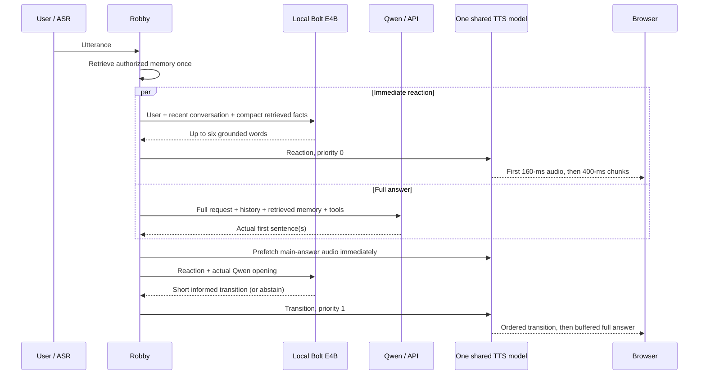

# Optional reaction and informed main answer

**Current default: OFF.** Enable “Short local reaction before Qwen” in the lower model settings. The local model reads authorized memory and current sound evidence, generates up to six useful words, and passes the exact validated phrase to Qwen before Qwen starts. Reaction audio, Qwen generation and main-answer synthesis then overlap through the shared TTS batch. There is no second informed-transition call. Invalid/empty reactions abstain. Persistent memory is a separate OFF-by-default option.

See [current environment/reaction integration](PROACTIVE_ENVIRONMENT.md) and the [test protocol](VOICE_ASSISTANT_TEST_PROTOCOL.md). The measurements below describe the earlier three-part experiment; they are retained for reproducibility, not current defaults.

## Historical three-part experiment

Robby now speaks a short local reaction, a short transition grounded in the
actual Qwen opening, and then the complete Qwen answer. The first reaction sees
the user, recent conversation, approximate speaker name, and compact excerpts
of the **same retrieved wiki memory** supplied to Qwen. It does not yet see
Qwen's answer. The second transition sees the already spoken reaction and up to
two actual Qwen sentences (a second sentence has a maximum 60-ms wait).
For jokes the transition sees only the setup, not the second-sentence punchline.

The checkbox **Models & quick replies → Two-stage quick reply** defaults on.
Turning it off plays the main answer directly. Persistent memory remains a
separate, default-off opt-in; current-session facts work without that opt-in.
Poems, exact-output requests, urgent help, Stop and optional avatar events retain
their existing direct-answer path. No extra model weights are downloaded.

## One TTS model, continuous batching



`live_batch.py` owns CUDA work under the existing engine lock. Every utterance
owns its semantic KV cache and audio-codec streaming state. Continued global
decoder steps are really batched: left-padded caches use masked positions and
the pinned Qwen implementation's cumulative-mask RoPE positions. The local
12-acoustic-token decoder also batches the conditional/neutral CFG branches.
Codec weights remain shared; per-utterance streaming state is restored only
while decoding that utterance. CUDA graph output tokens are cloned before reuse.

New jobs enter at frame boundaries after the foreground has produced its first
PCM block. The selected default is **two active streams**, with a priority queue
for the informed transition. Three active streams were tested but slowed the
foreground enough to create early underruns. The internal transport supports
one to three streams; this is not a claim about arbitrary multi-user throughput.
There is only one TTS weight instance. Temperature is **0.8**, CFG is **2.0**,
and the existing Mira reference and model precision are retained. Stochastic
sample order changes when the active batch changes; identical seeds do not
promise identical sampled audio across schedules.

The internal loopback-only `/api/live-speech` WebSocket multiplexes bounded jobs;
the public browser still uses Robby's existing connection and cancellation IDs.
The main answer is submitted for synthesis **before** the informed local call.
Its audio can therefore already be buffered when the transition ends. The
browser gets reaction → transition → answer, never concurrent audible voices.
Main speech retains final forced alignment and edge fades. Short prefaces use
10-ms envelopes without alignment lookahead. This path does not run the older
per-chunk Parakeet early-cutoff check. Main-alignment lookahead still exists,
but prefetching often hides it behind the prefaces.

First blocks contain 160 ms of generated audio, subsequent blocks 400 ms.
The selected browser startup reserve is 220 ms, with existing adaptive recovery.
Those numbers describe audio duration/buffering, not guaranteed wall-clock
inference latency. Startup warms the default one/two-stream sampling shapes;
other shapes, model switching, reference lengths or GPU contention can still
cause compilation/cold-start delays. One aborted turn closes the upstream
session, drops pending jobs and waits for the CUDA owner to release the engine.

## Useful first words, including memory

`quick_reaction.py` accepts bounded excerpts of already retrieved entries. It
does not inspect another user's store or perform another lookup/model call.
Up to six entry excerpts and 4,000 characters are selected; a current-person
match and recent literal self-introduction give specific grounding. This is a
small context subset, not the entire 10,000-token knowledge allowance.

For example, an authored Bob/Jazz/Alice test produces “Du magst Jazz, Bob” or
“Deine Freundin heißt Alice”. No identified person or no matching evidence
produces uncertainty rather than an invented past meeting. Explicit corrections
override approximate voice names. Retrieved text is untrusted reference data,
never system instructions. Voice identity remains fallible, not authentication.
Waiting announcements such as “Lass mich mal nachdenken” are rejected before TTS.
Invalid, repeated, late or unnecessary reactions/transitions are skipped, never
replaced with a canned filler. The local calls each retain a 700-ms deadline.

`informed_bridge.py` requests a concrete link to Qwen's actual content rather
than “Hier ist die Erklärung”. It is optional when another sentence would be
inappropriate. Qwen's substantive answer is not rewritten or truncated. The
existing narrow duplicate-acknowledgment guard can remove an opening already
spoken. A useful full answer still depends on the main model: some collected
trials contain an incomplete advice answer or a weak joke. These are retained
in the receipts, not represented as solved by batching.

## Reproduce and inspect

Use the repository's pinned Robby/TTS/local-LLM stack. Leave production sessions
idle for benchmarks; do not restart another user's active generation.

```bash
python run_unit_checks.py
python benchmark_live_batch.py
python benchmark_two_stage.py --output two-stage-audio-new.json
python benchmark_reaction_memory.py --output two-stage-memory-new.json
python browser_two_stage_check.py --url https://YOUR-DEMO
python browser_two_stage_memory.py --url https://YOUR-DEMO
```

The deterministic scheduler pilot uses temperature zero and truncates at 18
frames solely to test cache/codec isolation and timing. All conversational
two-stage TTS trials use 0.8. The memory probe uses 20 authored local-model
requests; it never reads private user memory. The browser memory test uses its
own capability, enables memory, stores authored facts, reconnects with **zero
recent-history budget**, tests the first spoken reaction, and resets that test
workspace. Browser Stop is a control-path test, not a new acoustic Stop claim.

See [the English measurements and listening report](static/two-stage-report.html)
and its JSON receipts, including failed/rejected variants. Metrics distinguish
first PCM, first main PCM ready in its private buffer, first main PCM delivered
in order, and browser scheduled playback. These stages overlap: do not sum them.
Neither server PCM nor browser scheduling establishes physical microphone-to-ear
latency or proves perceptually seamless voice/prosody at every boundary.

Files: `quick_reaction.py`, `informed_bridge.py`, `live_speech.py`,
`two_stage_pipeline.py`, `bolt_pipeline.py`, browser controls/timing panel;
TTS runtime `live_batch.py`, `live_batch_api.py`, `small_app.py`. Set
`ROBO_INFORMED_BRIDGE=0` to use the earlier one-preface route, or disable the UI
checkbox for the direct main-answer route. Older TTS servers without the
continuous-session capability retain the existing HTTP fallback.

A repeated browser-memory run failed in the existing exact-word TTS SCRIPT/
transcript validation before reaching the recall assertion; the receipt is kept.
Its original generated wording was not captured, so it is not diagnosed as fixed.
The harness now captures all events and notices errors earlier. A subsequent
fresh run passed. Distinguish this observed limitation from the successful
zero-history memory-grounding check.
